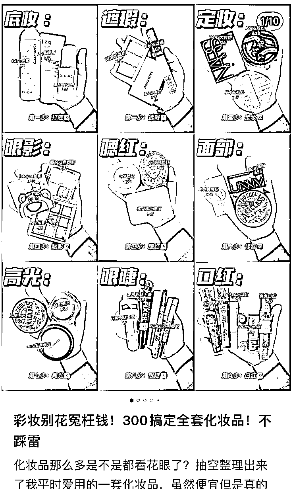
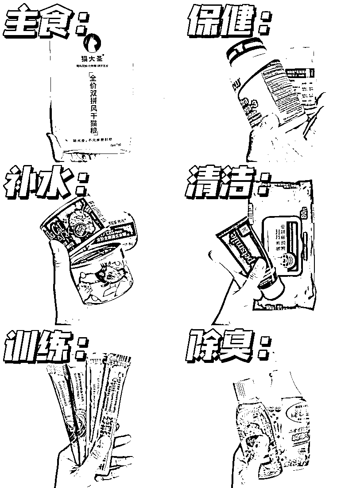
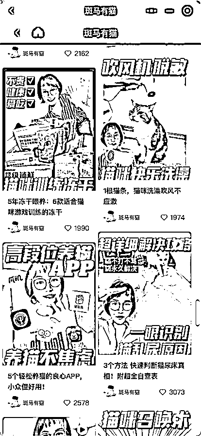
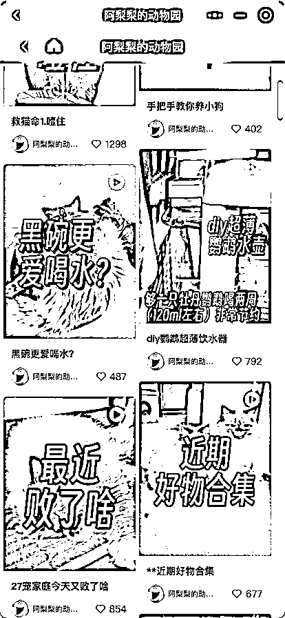
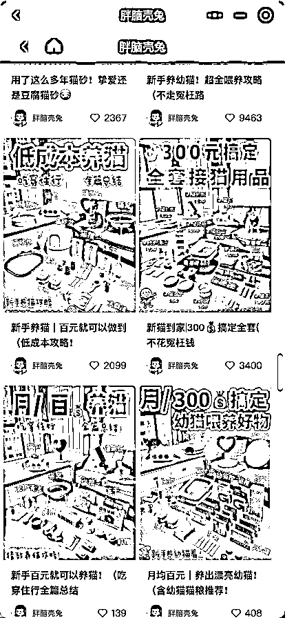
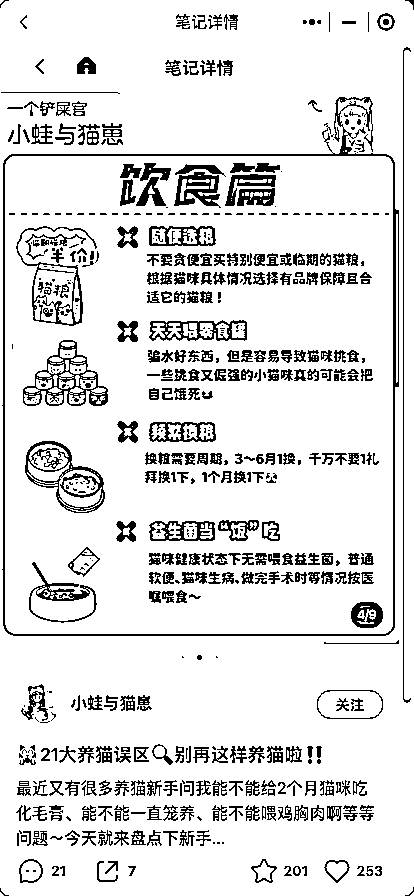
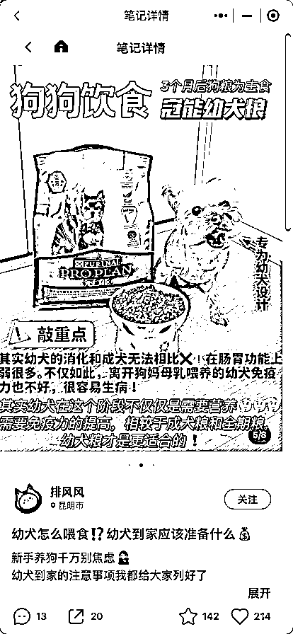
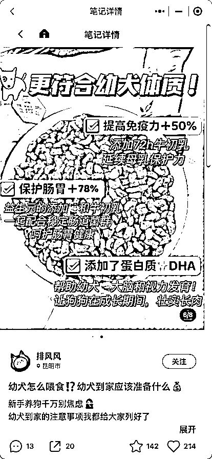
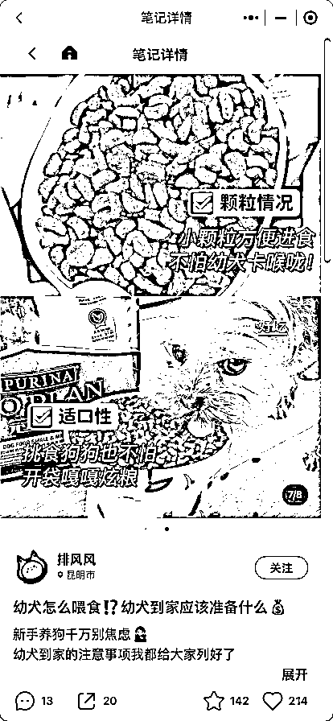

# 8.5.1.2 实操步骤

### 一、账号装修

账号定位方面，如果走科普路线，真人出镜的IP价值明显更高；要是打算用宠物当主角，最好搭配萌宠类内容一起运营，否则效果容易打折扣。

昵称尽量带上关键词，方便用户搜索，比如“XX养猫”“铲屎官XX”“XX说宠物”这类格式就挺好。

头像一个建议：用真人照片，这样更容易拉近和粉丝的距离，让账号形象更立体、更有温度。

### 二、内容线索去哪找

豆瓣、贴吧、知乎：这三个平台适合用来搜集选题素材，上面高质量的经验帖很多。

PetMD、ASPCA、icatcare：同样能找选题，但需要自己翻译。优点是内容有专业专家把关，比国内论坛里的素人帖子靠谱得多。

谷歌学术：用来查文献，宠物相关的研究国外起步早、积累深，资料也更丰富。

小红书：内容水平参差不齐，但特别适合用来研究别人怎么做呈现——比如标题怎么起、封面怎么设计、排版怎么安排。

### 三、创作流程

#### ① 找选题

选题思路别被自己的账号类目框住，其他领域的爆款一样可以借鉴，比如：

像“好会养猫一女的 200 元搞定日常消耗品”这种笔记，就是连选题带标题、封面一起参考的。

笔记的内容分配建议这样来：前期可以设定30%引流内容（蹭热点、套爆款模板），剩下70%用来展示账号的核心价值。这70%里要预留产品植入的位置，为以后接广告打基础。同时账号调性也得留意——如果整天只发“PDD平价养猫”这类笔记，以后想接高端产品就比较难了。

#### ② 定封面

小红书的瀑布流分发方式，让封面的地位变得特别重要——用户第一眼看到的就是它，所以封面不够吸睛，笔记很难有出路。不过，不建议每篇笔记都照搬爆款封面，那样既费神（我自己现在就陷在这种循环里），也缺少个人辨识度。还是需要定下一套能体现自己风格的封面模板。

花字统一，封面都用真人照片

花字、封面、视频特效都统一，但这位博主也是熬了很长时间才摸索出适合自己的爆款方向

花字统一，封面统一用多物品摆拍

#### ③ 定图片内容

图片内容和封面的逻辑有相似之处，但要求没那么高。你只需要琢磨出自己的模板就好，不需要仿照爆款。不过可读性还是得留意。

科普部分的模板可以拆成这几块：底图、标题、段落、配图，字体、配色、排版都能固定下来。

推广部分（宠物和产品合影）的拍摄模板可以拆成：宠物与产品合照、产品细节图、宠物试吃图。文案模板则是：大标题、小标题、卖点详解，各自的字体配色和排版也能固定。

推广部分的“产品细节图”示例

推广部分的“宠物试吃图”示例

#### ④ 定文案

文案这部分很多朋友都分享过，核心无非就是：段落要分清楚，开头固定打招呼，中间抛问题、埋关键词，结尾做自我介绍并引导互动。这里就不展开讲了。