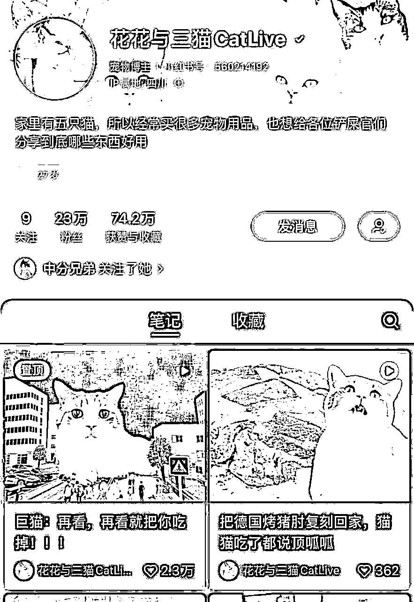

# 8.5.2 宠物号案例 ② @阿伟：萌宠老号的📕生意经

我们运营的账号是@花花与三猫 CatLive，内容主要围绕五只猫和铲屎官的养宠日常展开，以短视频为主，图文作品也会同步更新。算下来，我们在宠物内容赛道已经深耕多年，2017年起就持续发布内容，全平台累计关注者达到两千万。📕属于我们较晚拓展的分发阵地，目前关注人数为23万。

起初，📕这边的推进并不算顺利。后来接到平台邀约，我们才正式入驻，并开始投入专门精力做运营。尽管📕上的关注规模暂时不及其他平台，但眼下其商业价值反而更加突出。和当下不少萌宠创作者相比，我们在内容玩法上未必最新潮，这次主要想把这六年沉淀的一些经验分享出来，希望能对大家有帮助。