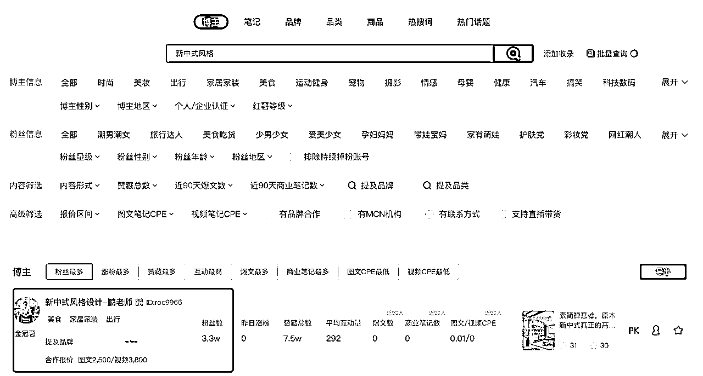
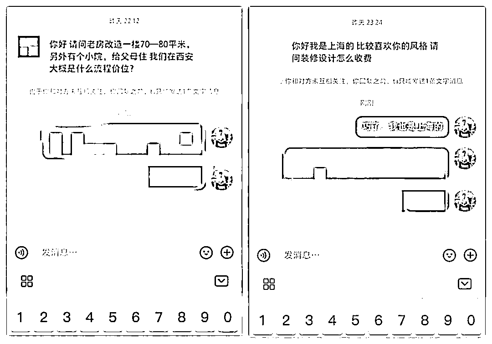
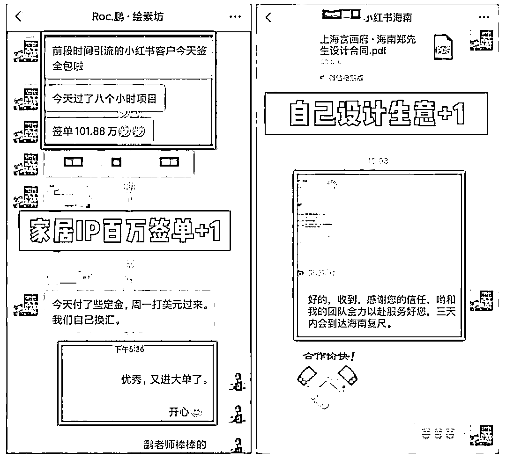

# 8.6 3万粉家居号，变现2000万+

各位好，我是谢无敌，闪亮猫传媒创始人，也在小红书MCN行业深耕多年。熟悉我的朋友知道，我长期做小红书知识付费，其中“谢无敌的红书宝”已是知识星球里排名靠前的小红书社群。

但很多人不知道，我还有另一重身份：在陆家嘴经营一家1600平方米的东方风格设计企业，团队有若干设计师，孵化的家居博主账号也不少。

我们自营的【言画府空间设计】，眼下约80%流量来自小红书、抖音等内容平台。旗下家居账号里，位列首位的鹏老师IP粉丝仅3万，却已是东方风格设计细分领域的头部IP。

跟小红书其他热门赛道比，我们的粉丝体量不算大，笔记数据也不算出挑，可咨询订单几乎天天出现，累计变现已超过2000万。

