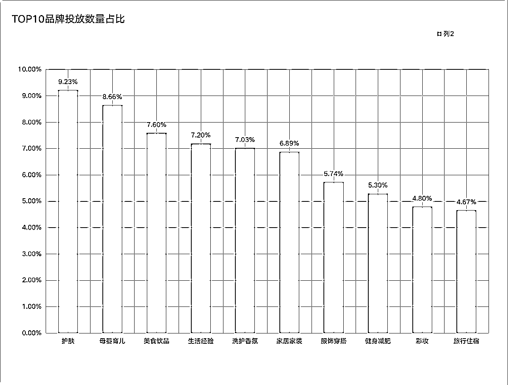

# 8.6.1 家居家装投放速览

2022年前六个月，各品牌累计投放1.5万个；投放占比排名前三的品类分别是护肤、母婴育儿与美食饮品；整体投放金额预计达到25亿元。家居家装在同期拿下6.89%的投放份额，排在第六位。

蝉小红数据显示，家居家装这一大赛道包含六条细分线：家居装饰、装修、家居用品、家用电器、家具、居家经验。接下来会逐一给出各细分方向的优质博主案例，并标注变现方式，供大家参考。

31