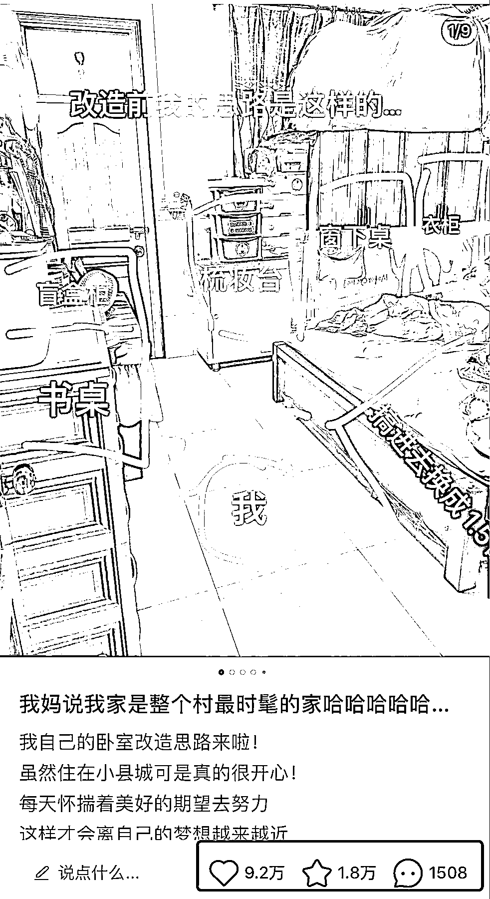
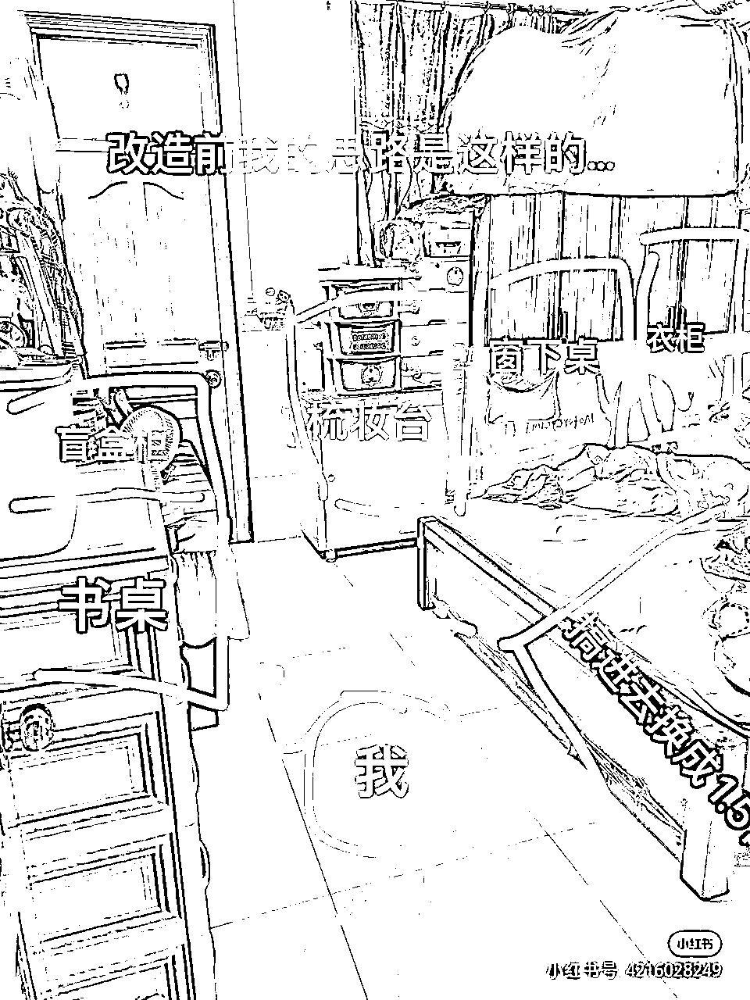
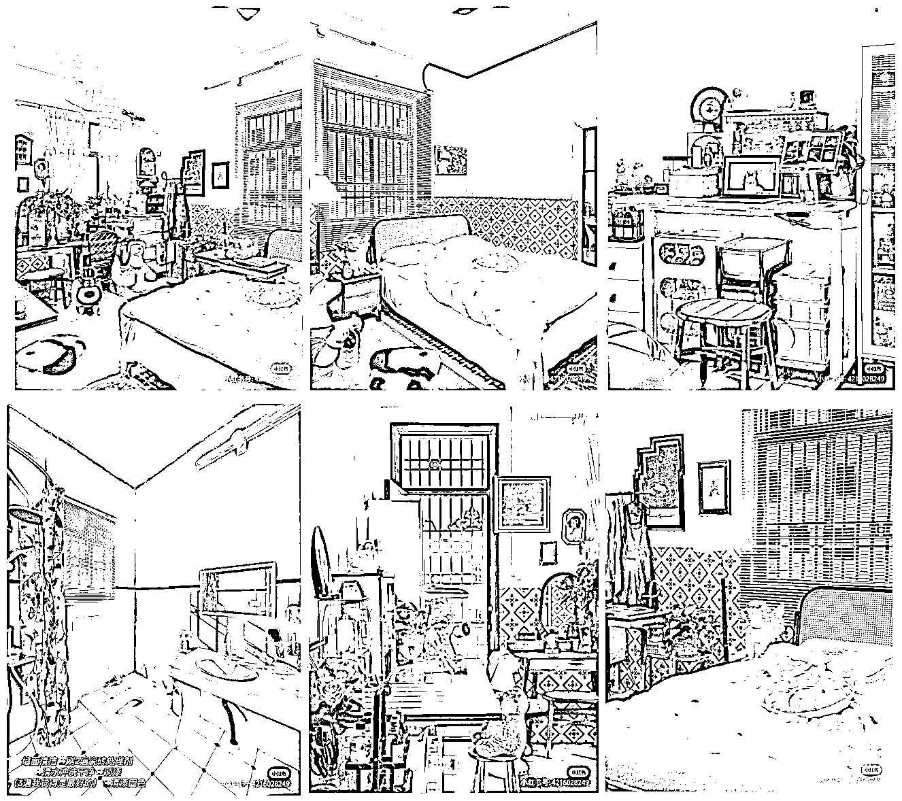
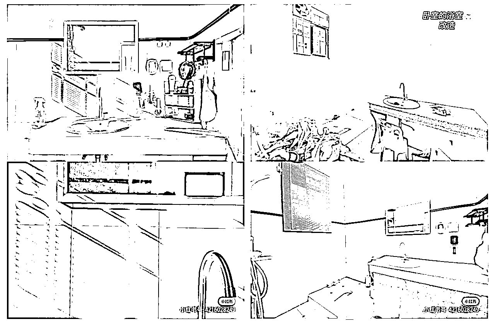
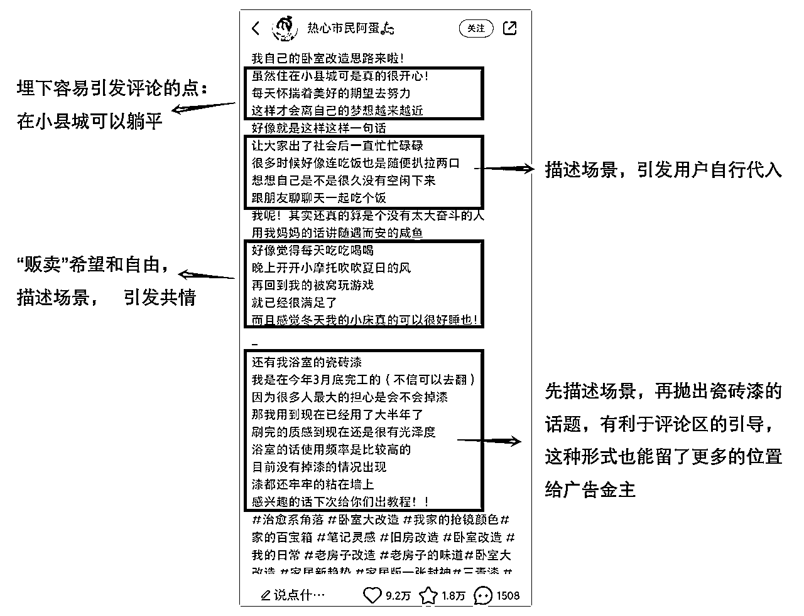

# 8.6.2 爆款拆解：1.9万粉家居博主篇篇爆款？

今天要拆解一个家居博主的爆款案例。这位博主专注房屋改造，账号虽然只有1.9万粉丝，但笔记几乎发一篇火一篇。这篇爆文到底藏着什么门道？一起来看。

1）数据表现

2）笔记直达

👉[查看原文](https://www.xiaohongshu.com/discovery/item/6364f5fb0000000009004420?xhsshare=CopyLink)

3）标题拆解

笔记标题是《我妈说我家是整个村最时髦的家哈哈哈哈哈…》。首图乱成一团，标题却说“全村最时髦”，反差一下子拉满——用户的好奇心瞬间被点燃：这屋到底能时髦成什么样？

再说标题套路。这个标题背后是一个常见公式：我妈说××（场景化描述）。美食赛道特别爱用，比如“我妈让我直接去楼下摆摊”“我妈说这玩意儿太好吃了！”用的人多了，难免有标题党嫌疑，评论区偶尔也有人暗讽。不过把这个套路用到其他赛道，目前看效果依然不错。

4）图片拆解

先看首图：

这张首图是灵魂画手风格的手绘简笔画，乍看乱糟糟，细看却很有条理，实操感很强，还带点可爱和真实。它和标题里的“最时髦”形成强烈反差，好奇心一下子就被勾起来了。中间那个小人儿也画得很妙，既让画面更丰富，也让读者忍不住代入自己。

再看图片2-9：

这一组是改造完成后的全方位展示：卧室、学习区、卫生间都有出镜。整体氛围感很强，乱中有序，精致里带着生活气——是那种“真的有人在住的家”，而不是为了拍图硬凹出来的“📕出租屋”网图感。

细心的读者会发现，改造后的照片要么有暖光灯，要么有阳光，看着特别温馨。想让画面有氛围感，暖色光永远是最佳滤镜。

5）文本拆解

6）补充说明

家居改造类内容，前后对比一定要够强烈；后面的图尽量多场景、多角度去拍，用户的“获得感”会更强。另外，这个赛道的场景延伸性极强，变现空间也非常大——从改造工具到地板墙纸，从地毯到窗帘，到处都能植入广告，广告位实在太多了。

7）相似案例参考

同类账号还有几个不错的改造案例，可以一起看看：

•《租到丑房子不要怕，改造一下就好啦！！》👉[查看案例](https://www.xiaohongshu.com/discovery/item/6378be0c000000000b029e22)

•《我估计是刚改造完却惨遭退租第一人😭》👉[查看案例](https://www.xiaohongshu.com/discovery/item/6363996b0000000009006438)

•《7㎡仓库秒变卧室～全自动布置改造，get！》👉[查看案例](https://www.xiaohongshu.com/discovery/item/63777d2d0000000024021045)

