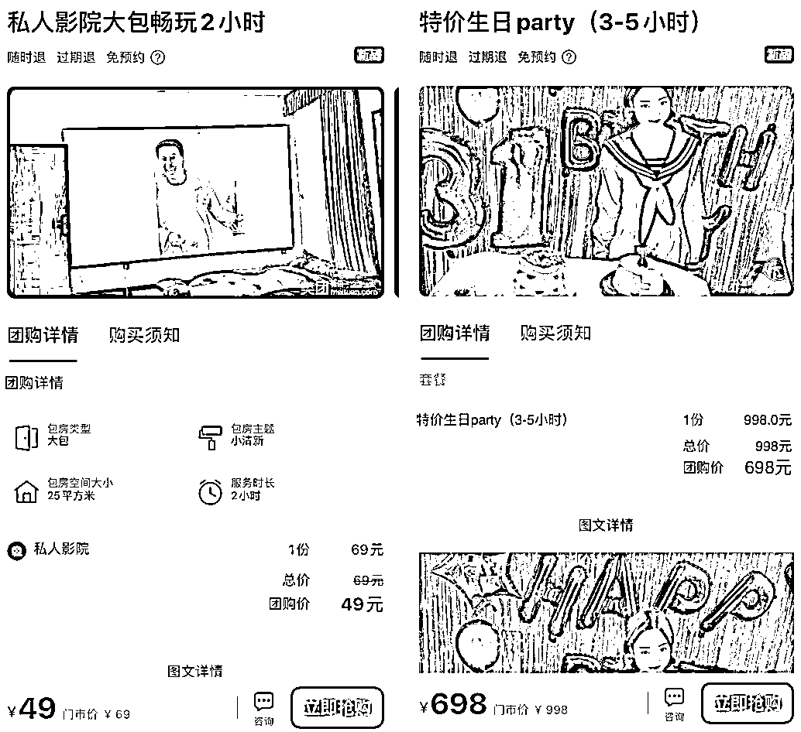

# 2.2 产品设计，决定引流效果 @宋威 @Mage

想让推广引流更有效，产品设计是绕不开的一环。动手前先问自己两件事：作品靠什么爆？顾客为什么愿意买？

第一，找出产品的爆点。最懂产品的人往往是自己团队，所以要从爆款里挖出真正能引发传播的点。虎头局的热卖单品老虎卷，出圈点就是拉丝——拉得越长，相关视频越容易爆。这个点跟味道没有直接关系，拉丝长不等于更好吃，它只是足够有特色，契合抖音的传播逻辑。上海曾走红的伊芙朵冰面包，靠的是掰开爆浆；抖臀蛋糕则因为一大块松软蛋糕能抖动。因此在抖音做推广，应该先把爆点找出来、设计好，再围绕它集中发力，效果才会更理想。

第二，弄明白顾客为什么下单。前面说的爆点更多承担新奇特的作用，用来种草、勾起好奇和购买冲动。若想继续提升转化，产品至少要有一项明显优势：高性价比、口碑好、味道好、环境好、服务好等，占住一样并做出突出感。未必要让所有套餐都走性价比路线，可以区分引流品和主推品，让推广带来的流量得到最大化利用。常见产品体系包括引流品、粘性品、利润品、赠品、超高客单价品，门店可结合自身情况灵活组合。

以轰趴别墅在团购平台设置的引流套餐为例：起初只设了两个套餐，吸引力不足，之后又补上几款引流套餐——49元2小时私人影院；中包KTV 199元套餐（不含酒水饮料）；4人麻将3小时58元套餐；698元生日聚会套餐3-5小时（赠送拍摄制作视频）。

相关图片见下：

房租属于固定成本，门店生意主要集中在周五至周日，周一到周四别墅大多处于闲置状态。设置上述套餐，目的就是通过平台引流。到店客户转发朋友圈可享6折，基本上都愿意发，于是慢慢沉淀出一批较精准的客户。每发一次朋友圈，少则几个人、多则十几个人添加，而添加者大多有明确意向。当然，这些套餐基本不赚钱，主要是为了引流，避免别墅空置。

内容来源：《虎头局抖音本地生活从 0 到 1 半年做到 3000 万 GMV 实操分享》、《从亏损 8000 到盈收 3W+，轰趴别墅通过精细化运营实现转介绍率 70%》

