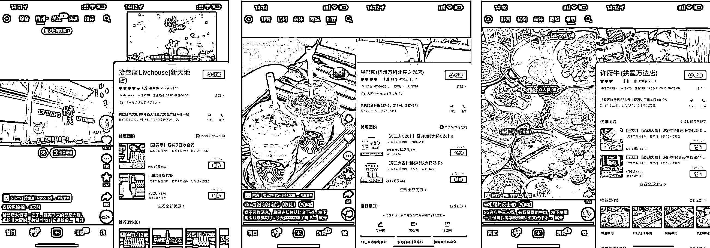

# 3.2.1.1 抖音本地生活到底是怎么一回事？@曹聪 ᴄᴏʟɪɴ。ᴄʜᴀᴏ

拆开来看，抖音本地生活其实就是三个关键词的组合：“抖音”“本地”“生活”。

“抖音”指的是承载它的平台，当然，换成小红书、快手、视频号也完全成立。“本地”圈定的是地域范围，和它相对的是“异地”“海外”这类空间概念。“生活”指向的是业务类别，与之对应的还有“职场”“教育”等不同领域。

所以，所谓抖音本地生活，本质上就是用户通过抖音下单各类生活消费产品或服务，再由本地实体商家配合完成核销的一种商业闭环。说得再通俗点，它就像是“短视频版的美团点评”——把本地吃喝玩乐商家的商品和服务，包装成团购券、代金券，放到抖音上来卖，靠兴趣推荐算法的信息流去促成交易。

本地生活的演进，始终跟着互联网平台的迭代走。最早是 58 同城这类信息平台，后来是美团点评主打的图文推荐，再往后就是抖音、快手、小红书掀起的短视频兴趣推荐，到了现在，连支付宝、地图这类 App 也想挤进来分一杯羹。

在互联网人口红利见顶之后，本地生活成了各平台确定性最强、想象空间也最大的增长机会，同时还是那种高频、旺盛、始终有活力的黄金赛道。美团、抖音、快手、小红书、京东、支付宝，全都在拼命发力。既然巨头们都在抢，那对店铺老板来说，这就不是一道选做题，而是一道必答题——不仅要答，还要尽量拿高分。

从 2022 年开始，这轮抖音本地生活和上一轮相比，出现了几个关键变化，也让这件事变得必须做、值得做、值得下重注去做：

（1）抖音上线了基于 poi 地址的原生团购，等于把兴趣成交的整条链路彻底打通了。从短视频种草，到线上买券，再到线下核销拔草，全程形成了闭环。过去只能看广告投放的曝光数据，现在还能看到成交数据，投放 roi 好不好，一眼就能看清，也方便后续优化。只要是有意识去做系统化改善的玩家，提前入局的人必然会吃到流量红利。

（2）团购达人的门槛被大幅拉低。部分城市已经内测 0 粉开通，其他城市也只要求 1000 粉。成为团购达人后，能在任务广场直接拿本地生活的带货链接赚佣金，还能在同城达人群、商单群里接单，靠剪辑和发布赚取另一份收入。

本地生活的底层逻辑是“品带人”，和电商带货的“人带品”正好相反。只要品够好，哪怕视频本身拍得一般，照样能带来很可观的销售分佣。也正是这一点，极大点燃了素人 up 主的创作和带货热情。

内容来源：《为什么说抖音本地生活是道必须拿高分的必答题？》

