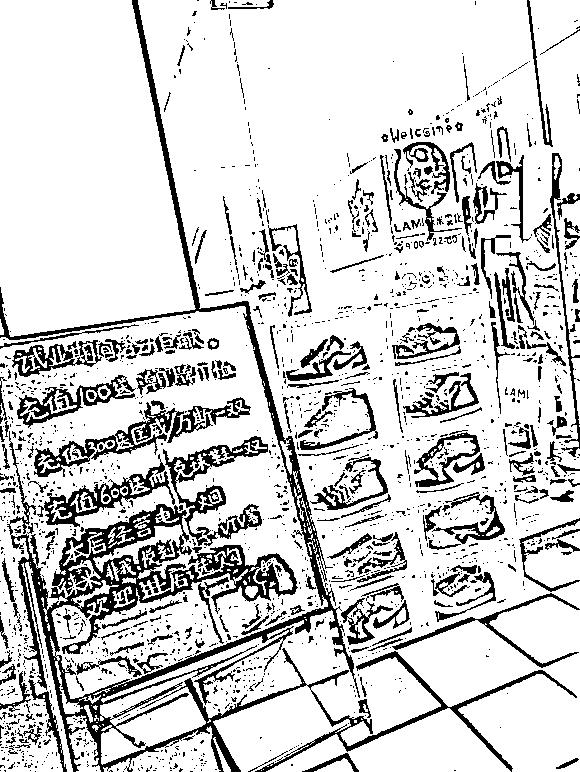
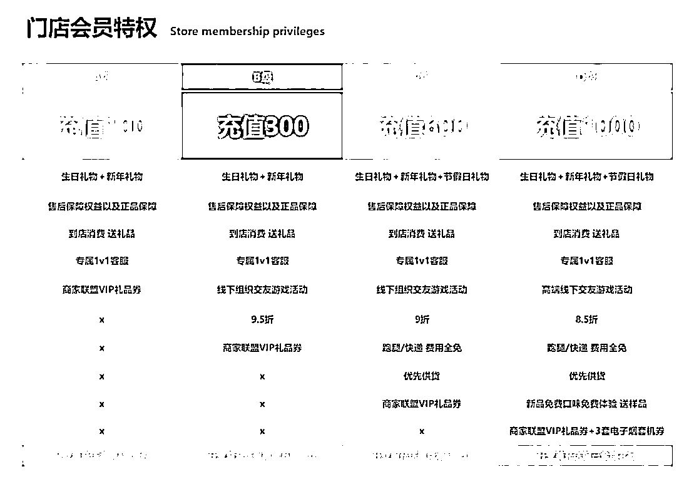
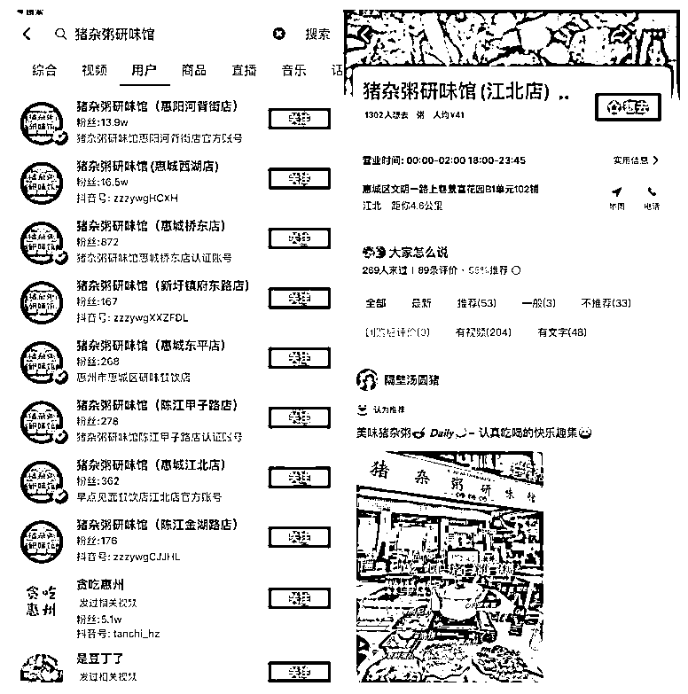
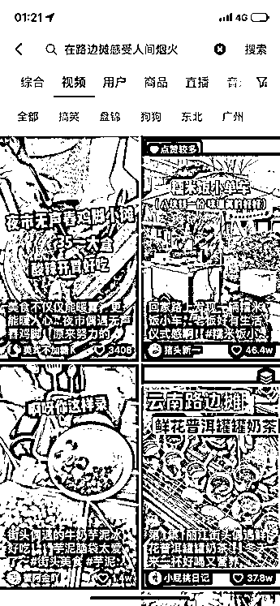

# 3.2.1.3 同城号内容怎么打？5个案例拆解 @西撒、@乔合

同城号不是只拍产品，也不是非要追全国大热门。下面五个案例，从新店、美容院、电子烟门店、猪杂粥矩阵到小吃摊，把内容、投放和转化串起来讲。

## 1. 新店：把老板娘的开店日常拍成系列

做抖音号，第一步是让用户知道你在做什么。这个餐饮店的账号定位，就是老板娘的开店日记：用像朋友聊天的口气，讲每天开店遇到的琐碎事，拉近距离，让用户慢慢追着看这家店后来怎么样。

具体做法很直接：从选址就开机，装修过程一步步跟拍，把开店日常做成系列，再配上轻松逗趣的聊天式文案。店还没开，就先拿到20多万本地曝光。等装修完开始试营业，第二天门口就排起队。整个过程只花了几百元Dou+。

底层逻辑也清楚：餐饮同城号不必把用户画像切得太细，因为做的是周边几公里生意。核心是持续在附近曝光，让周边人知道有这么一家店、有这样一位老板，再吸引他们到店。内容上，我们没打算天天拍美食，这类片子可以靠素人矩阵探店去冲爆款；更希望账号有记忆点，长成同城小IP。实测下来，开店日常确实能把流量带起来。不必追求全国级大热门，本地播放能到小几万，偶尔上个小热门破个圈，对门店生意就很有帮助。现在这家店在当地人气榜一直是第一。

## 2. 美容院：让男性创始人出镜制造反差

看了一圈同城美容院账号后，我们选了差异化路线。为了避免节奏拖沓、前几秒就抓住注意力，特意让创始人出镜当主角，用“男用户探美容院”的反差感吸引人观看。

这位圈友镜头表现力强，也很放得开。脚本优化后，视频拿到8万同城曝光；因为挂了团购产品，卖出20多单。后来又有一条20万播放的视频爆了，周边约10公里用户基本覆盖，至今还在持续带客，门店也做到本地美容美体榜第一。

## 3. 电子烟门店：用短视频换同城曝光

电子烟门店要的是最便宜的流量，短视频正合适：不往私域引，只要同城曝光。让附近的人知道有这家店、店在哪、卖什么、开业有什么活动，就够了。

把品牌牌摆在店门口，拍视频投豆荚并挂门店定位。两条视频花500元，总投放1000元，覆盖附近30公里，拿到约48万本地曝光。本地人因此对新店有了第一印象：有活动、划算、电子烟品类全。后来这个抖音号被封，截图也没留下。

开业充值活动是：充100送潮牌T恤，充300送匡威或Vans，充600送AJ。赠品成本不高，T恤从广州批发，8到12元一件；鞋子走莆田货源，价格很低。赠品本来就不是拿来卖，纯粹赠送，收到的人一般也不会太计较真假。五月底试业时做充值，开业前两天陆续来了几拨人，之后越来越多人觉得划算开始充值，还互相推荐，口碑就传开了。后来我们又拍了数十条视频宣传这个活动，每条投100元流量，门店人气很快被拉起来。

## 4. 猪杂粥研味馆：矩阵打法放大排队感

这是很典型的短视频矩阵案例：先在抖音把单店快速打爆，再开放招商加盟；分店复制同一套内容打法，形成品牌规模效应，让品牌在抖音和本地持续放大声量。

营销上押注“排队”这个经典招数。视频拍得很简单，画面只传递一个核心信息：这家大排档天天排队、场场爆满；文案则标准化成“创业第XX天+一句走心话”。开店时把亲友请到店里免费吃，多角度拍素材，简单剪完用他们的抖音号发布，统一投100元DOU+，看到效果后再追加。

## 5. 小吃摊：卡点与剧情两条内容线

做小吃摊同城号时，我会持续对标同城热门视频来优化数据。最近地摊内容火，我就专门拆解烟火气小吃的拍法。发布的视频主要有两类：一类是卡点，偏特写，用3:4竖屏；另一类是剧情，镜头先移动，接着和老板对话，再拍制作过程，剧情类用全屏。

发布时务必挂定位，标签写本地城市名和“xx探店”，专门吃同城流量。标题可以蹭热点，比如“逛xx夜市碰见xxx，好吃到想分享”。内文结构可以去📕刷爆款，改一改或直接套模板，尽量用顾客口吻，像在跟朋友分享。比如可以写“不用再问，确实就在xx城”，讲在旁边买蛋糕时偶然发现、之前吃过一直惦记，夸种类多、外皮弹糯、内馅香甜，现场吃一个再打包几个，提醒晚点去、晚上才出摊人少，去晚可能买不到；也可以“想推荐给所有人”开头，说在超市偶然看到、觉得颜值高就买来试，入口很惊喜，红豆味浓、混着肉松香、中间还有整颗蛋黄，最后催大家冲并期待新口味。视频发完后，记得在评论区补上店名、地址和营业时间。除了短视频引流，我也会在抖音开直播；每次出摊前先发一条卡点或剧情视频，用视频给直播间带人气。

内容来源：《如何看待抖音同城流量的红利？以 3 类门槛低，变现空间高的项目展开讲讲》《00 后实体店创业者：用互联网思维破局疫情影响》《我做了哪些操作，摆地摊也可以 60 天营收 20w+》

