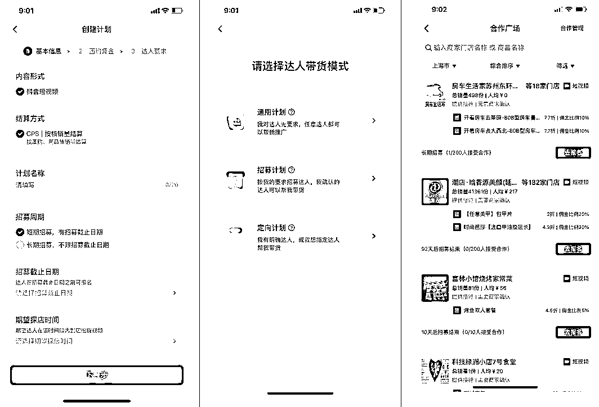
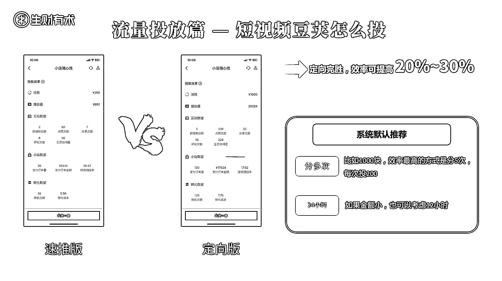

# 3.2.2.1 找达人：等级比粉丝更重要

很多商家找达人时，第一反应是看粉丝量。其实更该先看团购带货等级。团购达人从1级到6级，分级主要衡量本地团购的实际带货能力，粉丝数并不在考核项里，真正看的是转化效果。也就是说，粉丝多不等于作品带得动货，千粉达人未必输给大号；反过来，高粉达人的合作成本往往高出一大截。

所以不管你是连锁品牌还是街边小店，筛选KOL也好、KOC也罢，都建议把带货等级放在粉丝量前面，优先谈内容质量过硬的KOC，投入产出比通常更划算。

若一定要参考粉丝规模，可以这样分层：20万粉丝以下的达人，只要不收坑位费、愿意分佣，就可以批量邀约到店拍摄；20万以上且需要坑位费的达人，则要谨慎选择。

实操顺序也建议记牢：先谈不收坑位费的，再考虑收坑位费的。别一上来就砸坑位费，否则一步走偏，后面容易连环踩坑。等自己跑出经验，再去碰付费坑位；还不熟的时候，优先找愿意到店免费拍视频的达人。

达人资源从哪里来？最省事的是找本地服务商，现在不少城市已有团购达人服务商，手里握着大量达人资源。如果不想在服务商上花太多，可以去抖音创作者服务中心的团购达人入口，按城市或全国筛选入驻达人，逐个私聊；也可以给某位达人一点费用，请他帮忙招募，成本还能再压一压。抖音商家还可以自己创建招募计划、设置达人要求，达人会在团购中心的合作广场看到计划，直接报名联系。

第二步：把合作方式谈清楚

团购达人自带分佣机制，这能大幅降低一口价成本，转为按效果付费。所以千万别只上架一个团购商品就完事，一定要设置佣金。这样你才能用更低成本去谈合作，也才会有“自来水”达人愿意帮你免费推广。做这件事并非一定要砸很多钱。市面上常见的合作模式主要有三种：

1. 餐补、一口价、不设分佣：一些大品牌做品牌宣传会这么干，付完一口价就不再挂佣金。
2. 餐补、一口价，再叠加CPS分佣：这是当下常见打法，不过探店达人的一口价报价水分不小，同一位达人可能从300元报到3000元。可参考的价格是：LV3约200元、LV4约400元、LV5约600—1000元；产品本身热卖、有流量时，达人通常会适当让价。
3. 餐补加CPS分佣：预算有限的中小商家、刚起步阶段更适合，投产比一般能跑正。

第三步：拍摄只抓核心卖点

每位达人都要突出你最核心的亮点、最核心的卖点。别的不用多拍，就拍那个最关键的东西，比如你的拿手菜、金牌服务，或者店里必须推的活动。所有达人都围绕这一点放大。

第四步：Dou+投放有技巧

分享一个花了几十万投Dou+换来的经验：如果你有1000元预算，别一次性全押进去。最好在同一时间段拆成5笔200元分别投，效果通常比一次性投1000元提高20%到30%。

圈友@宋威的投流打法也值得参考：他一开始和达人合作，基本都用第三种置换模式，给达人提供80元代金券采买产品，加10%分佣，达人播放到1万时投100元Dou+，到5万播放再追投100元Dou+。这两笔Dou+的核心目的是追涨，卡在1万到10万流量之间吃中间助力，冲上10万流量池。Dou+投放选项直接选门店点击，效果最好；范围选门店6公里内，性别和年龄按自己的用户画像来。这样做能明显降低推广成本，同时提高推广效果。