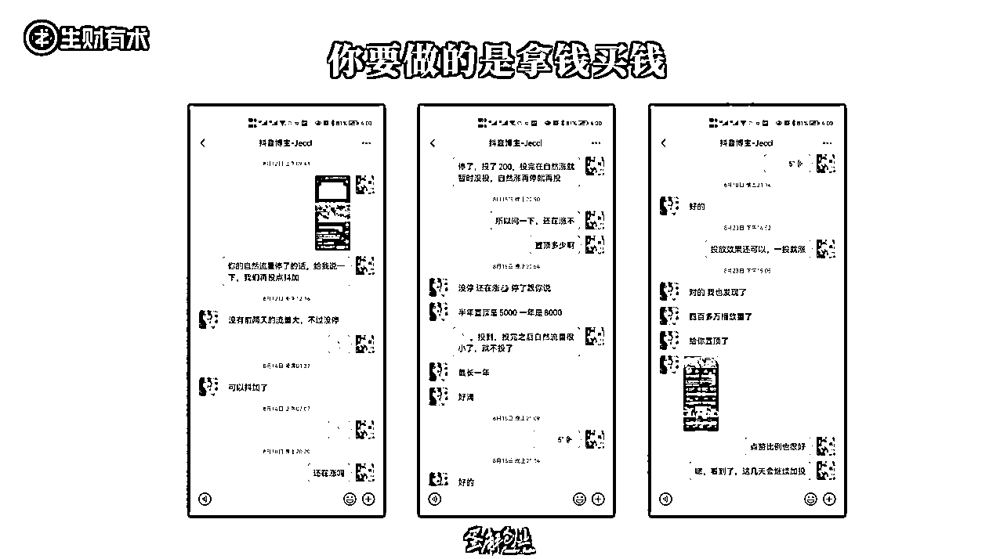

# 3.2.2.2 关键二：算清 ROI，把好效果成倍放大

找探店达人上门拍视频，很多人以为这事就算成了。可实际上，这不过是同城号运营这场马拉松的起跑线。

接下来真正该做的，是盯紧数据：

- 这条视频最终跑了多少播放量？
- 有多少人刷到视频后，顺手领了店里的优惠券？
- 领了券的人里，又有多少真的走进门店完成核销？

把这三个数字摆在一起，算出来的比例，就是业内常说的转化率。

只要转化率足够能打，客单价也撑得住，就该算 ROI——也就是投入产出比。

举个具体的例子：一个 99 元的套餐，每卖出一份能赚 30 元。你找达人拍了条视频，跑出 5000 播放量，300 人领了券，其中 100 人到店核销。等于这条视频帮你成交了 100 单，每单赚 30 元，总共进账 3000 元。

这意味着，你每花 100 元投 Dou+，就能换回 3000 元的利润。那还犹豫什么？投 1000 元，换 3 万；投 1 万，换 30 万。这其实就是一道简单的算术题。

所以说，请达人来店里拍视频，只是同城号运营的第一步。如果后续的数据一概不看、不管，那你很可能就成了一个天天被“白吃白喝”的冤大头老板，是不是这个理？

下面这张截图，就是一个老板的真实操作。他主动跟达人说：你这条视频自然流量跑完的时候告诉我一声，我来帮你投 Dou+。

反过来看，要是你盲目找一个 500 万粉丝的大号，比如 2000 万粉丝的「大 LOGO」来探店，出场费可能 20 万起步，而且还不保证播放量。万一效果不理想，这 20 万就真打了水漂。