# 3.2.3.1 700关注，撑起门店九成客流

作者：@怡伶 78667 @Nico 酱

自去年十月起，我打理一家艺术体验空间，📕上的账号关注度至今700，咨询高峰阶段甚至不足500。可门店约九成生意由这个平台输送，企业客户里还有单价一万、两万往上的单子。

成交链路并不复杂：公域内容吸引人—加🛰️—预约—到店消费。从平台来的客人目的性普遍强，成交率很高，几乎聊一个成一个。🛰️端我投入有限，朋友圈也几乎不更新。

赚钱平台上关于注册、定位、主页包装、🛰️端经营的教程不少，我不再重复。这里只复盘种草获客的实战心得，包括跑通的办法和踩过的坑。

主营调为Tufting后，我重点发两类帖子：自我介绍卡、客户作品展示帖。两类都带来曝光和精准客户，实战营同学测试后大多有反馈，不少行业都能借鉴。留言区里被提得最多的字眼是“预约”：

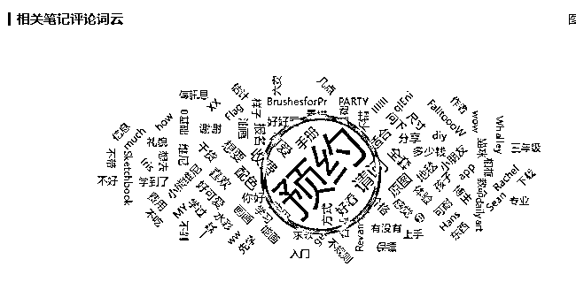

**招数一：把自我介绍卡固定在主页顶部**

我的首篇Tufting内容就是这张置顶介绍卡，也是咨询、预约量最高的一篇。在平台检索“上海 Tufting”或“Tufting 上海”，通常能进入结果页前十（各人搜索会有偏差）。这类帖子适合把自家服务悄悄带出来。我拆成类型和写法两块。

类型上，常见三种：故事经历型、直接介绍型、假装顾客探店的体验型。

故事经历型：讲个人经历、做自我介绍，但别记流水账，重点落在工作部分，方便自然带出业务；不直接喊导流，也让对方明白“我这里能买到XXX”：

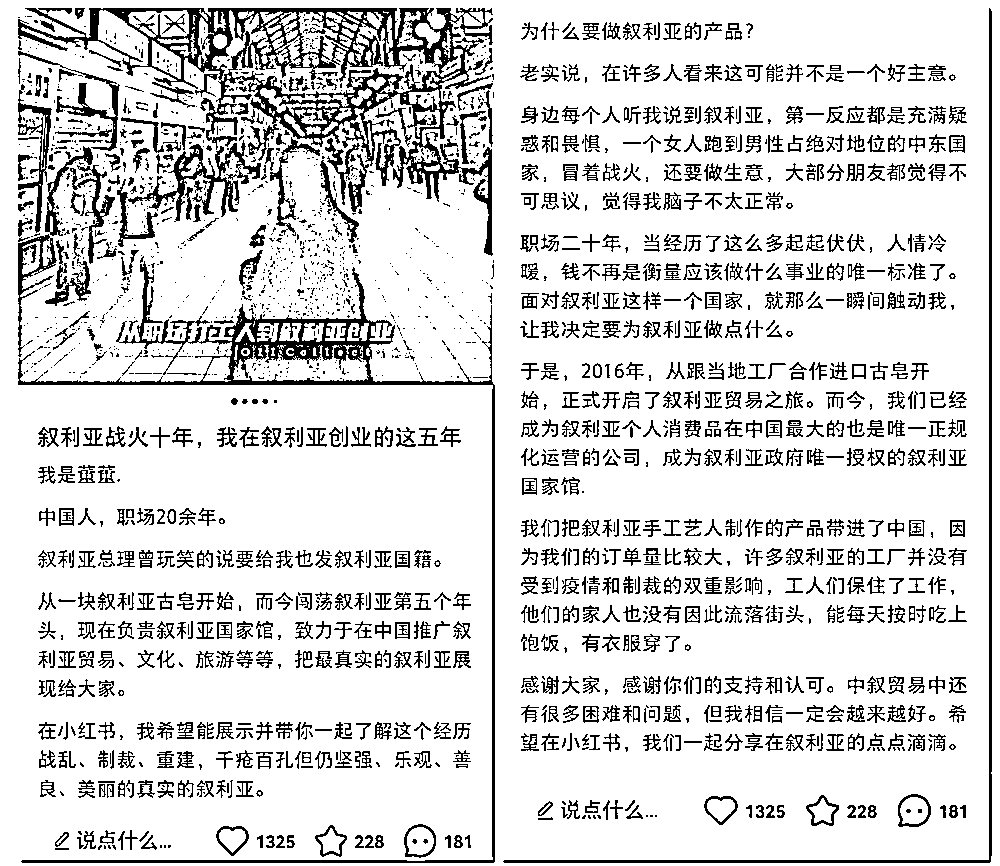

体验型：起初广告味偏重，后来调成常见探店帖风格，固定到主页，连店址都直接写，平台也没判违规。有实体店可试这种假装顾客探店的语气；没有店，也能模仿普通顾客分享的口吻，系统有时识别不出广告，挺好用：

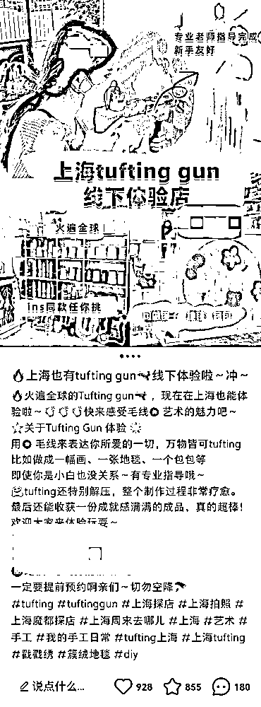

直接介绍型：开门见山交代身份、能提供什么、流程和理念，广告感强，更适配企业账号；个人账号处理不好容易踩线：

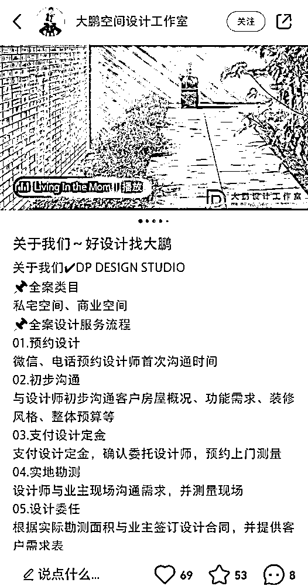

这三种可结合自身多试，并长期固定在主页（累计20篇可解锁置顶）。那篇帖子互动全来自自然推荐，评论区问价的人不少。若早期互动弱，可人为做冷启动，把“怎么联系”“怎么预约”“店在哪”这类咨询留言分散布置，效果不错。新访客点进主页，第一眼看到介绍和留言，有需求就会主动问：

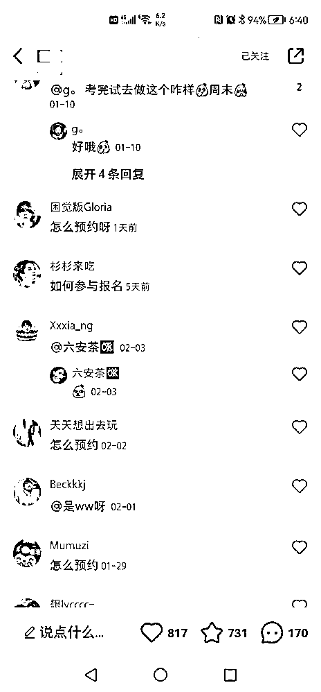

写法看配图与文案：图与工作、产品或服务相关就行，最好有人出镜；不愿露脸，侧脸，或工作实景也行。文案不用炫技，聊天式白话最好；越像日常唠嗑，对方防备越低，越肯开口问。

**招数二：拿客户作品当种草素材**

做定制、接客单、做设计的商家，很难不用客户作品做内容。比如我必然要发客户Tufting成品，才能吸引对体验感兴趣的人。但有两个坑：

- 作品帖容易写成生硬广告，个人账号效果打折；
- 爆款多是普通顾客口吻，商家总不能老说“我亲自体验的”，身份切换难。

看了不少做得好的企业账号和商家账号，再结合实战，我觉得可以这样破：

第一，坦率承认自己是老板，以经营者视角讲客户到店过程、展示成品；也可立公司或工作室员工的人设。比如我那篇老板视角的帖子，赞藏普通，评论和私信咨询却不少：

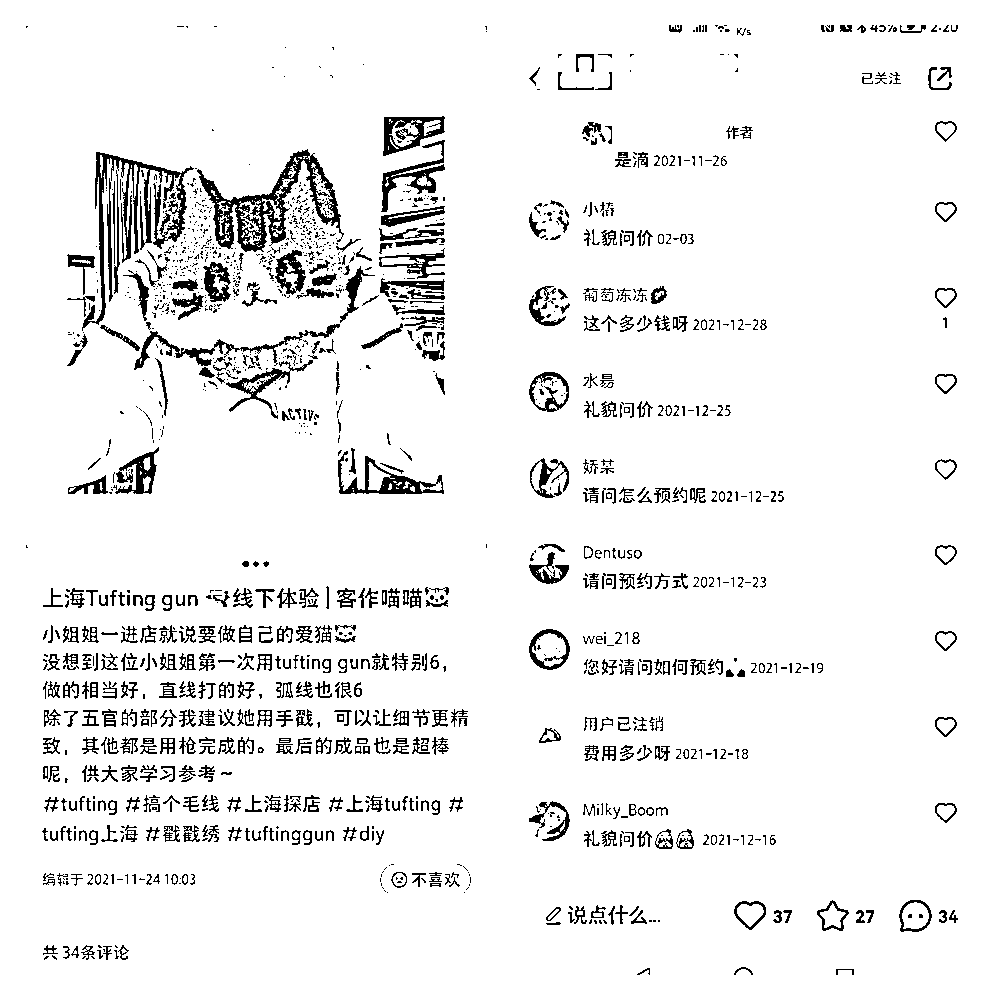

小浔溪那篇用踢脚线工厂打工妹身份，数据爆，人群也准：

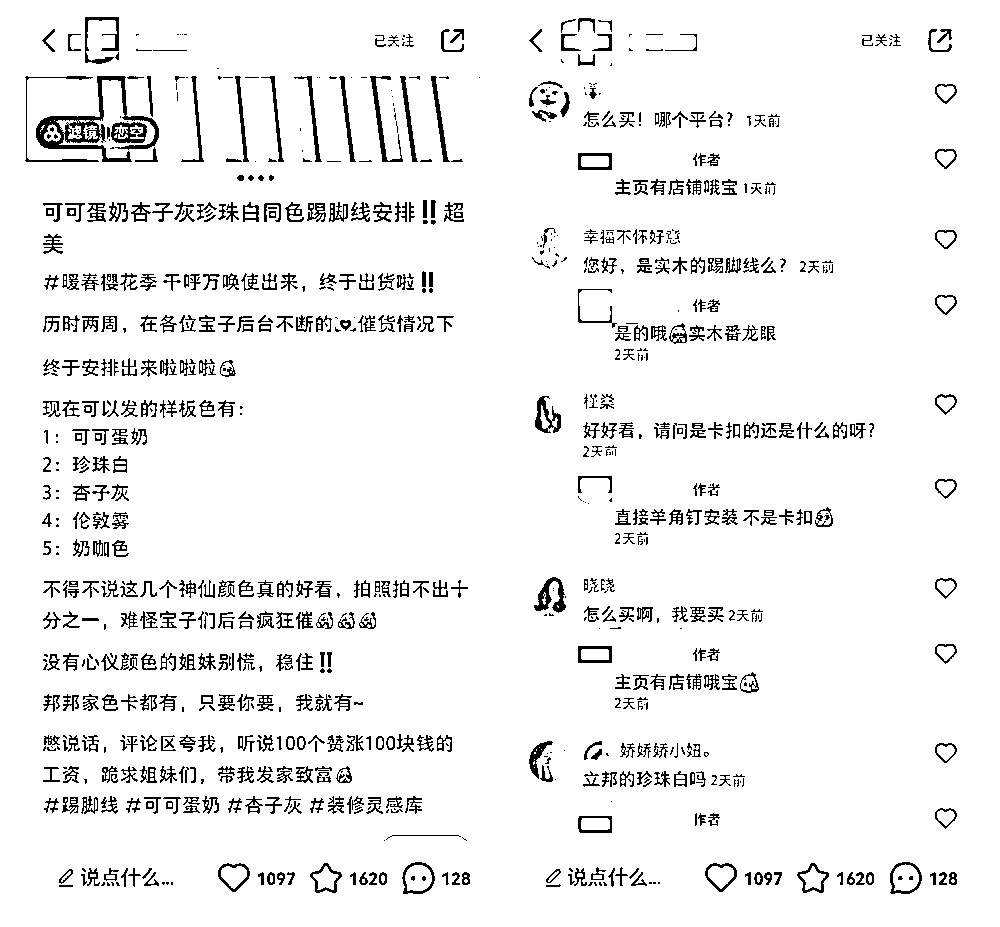

第二，不管老板还是员工身份，语气都像聊天，像邻里拉家常，篇幅别长，可适当俏皮。对比感受一下：

- 生硬版：冬季新品｜这款原木餐桌入手不亏
- 聊天版：客户一家子都在夸这张原木桌，姐妹们可以冲

语气很关键。即便坦白企业或老板身份，只要说人话，用户通常不排斥，甚至会因为你“可爱”“真实”“坦率”而对产品起好感。

另外几种获客方式也可参考：

招数三：个性签名处挂🧣，做跳转。

招数四：留言区自导自演。我发过美业门店资料帖，让几个小号在下面问“求一份”“想要完整版”，制造热闹感。

招数五：私信自动答复。同样的话别超过3次，提前备好带联系方式的图。

招数六：收藏式获客。小号发带联系方式的帖子，大号收藏；别人翻大号主页时能看见。

招数七：把平台昵称改成🛰️号，这是效率最高的一招，客户来问直接回“看我名字”。

**种草帖的其他注意点**

1. 封面图

用户最先看到的是封面图，前期务必多打磨几轮。我观察下来，爆款封面要么精致美好，要么真实接地气，取决于类目和账号人设。我的产品偏网红时尚，精致好看更吸粉，所以每张都处理美化：

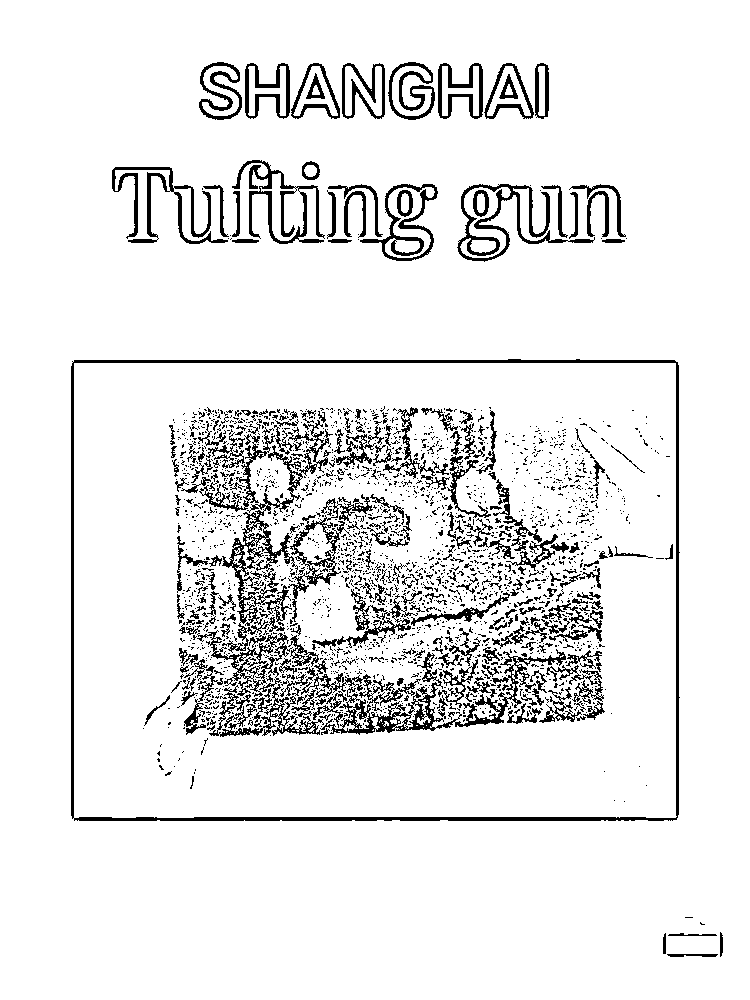

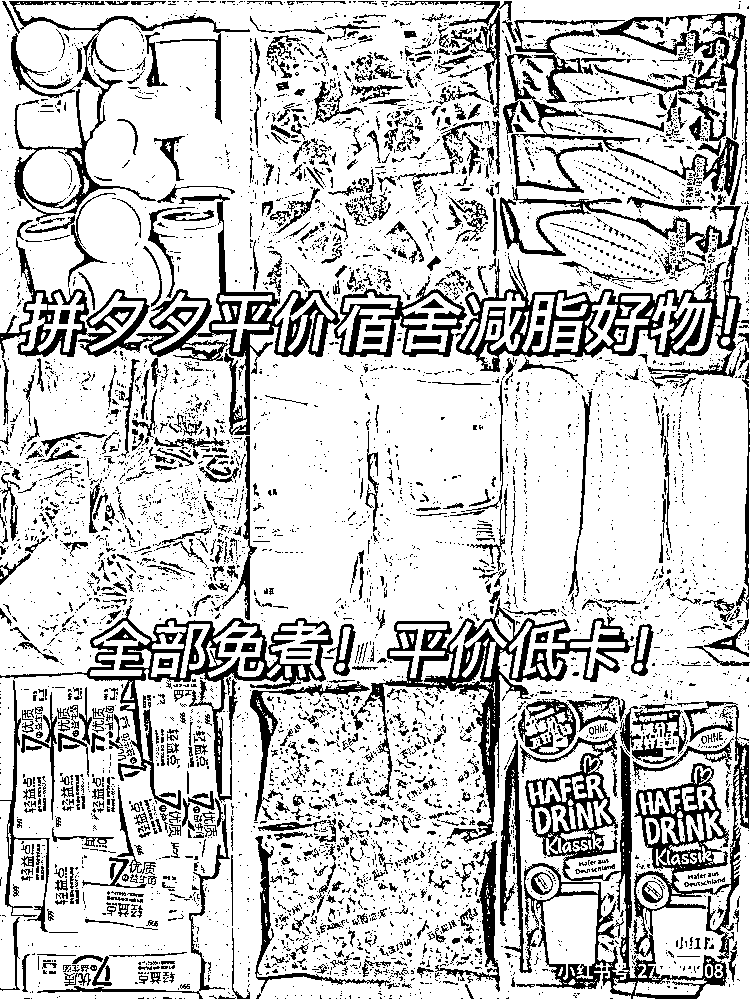

左：精致美好型；右：真实接地气型

封面制作推荐美图秀秀、黄油相机，文字贴纸多；稿定设计有现成模板，新手友好。

2. 关键词

关键词选得准，效果会非常猛。这套逻辑也能迁移到别的平台，底层相通。

先找行业里流量大的产品词。在平台搜“画画”，画圈处会冒出一串相关词，挑合适的放进日常文案；继续下滑还能看到更细的词，可参考：

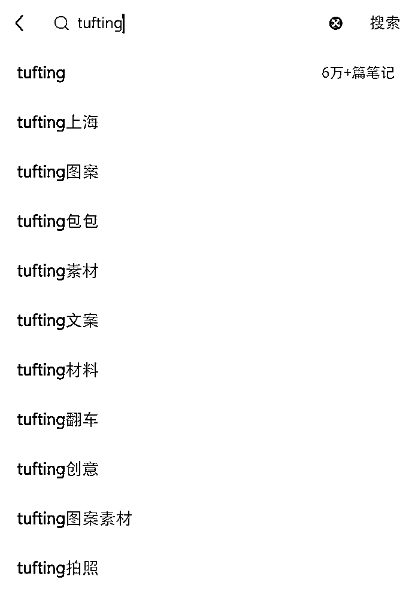

再去对标账号翻爆款，把他们文案里的关键词记下来：

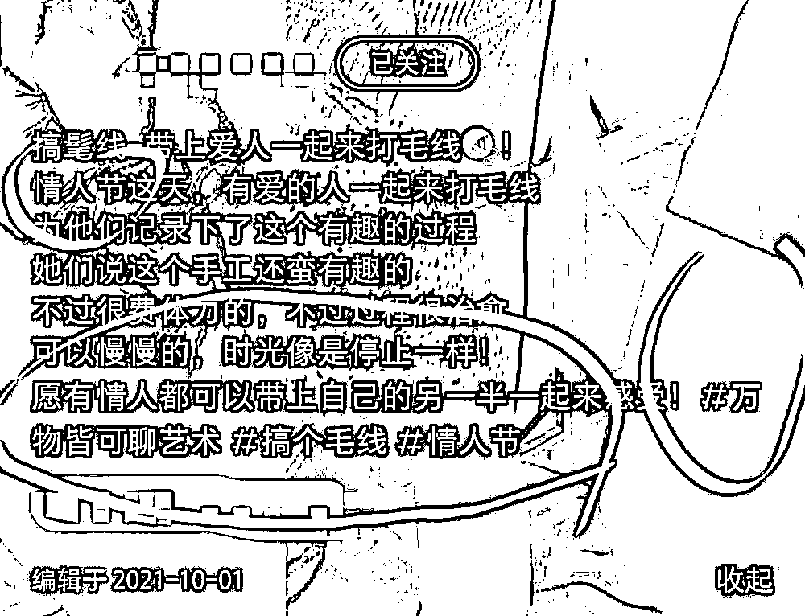

还要看企业账号的关键词投放、买量和搜索情况。这个功能挺实用，我刚升级企业账号，后续有心得再分享。

词收集完就铺：标题、正文、结尾都放，尤其本地词（如上海 Tufting）。起号期宽泛词与细分词搭配使用。宽泛词像“探店”“周末去哪儿”这类大众词；细分词对应产品，如Tufting、上海Tufting、戳戳绣。我最初只放细分词，流量平平；叠上宽泛词强曝光后，整体效果不同。前提还是内容要吸引人。这个玩法在大众点评也有效，做点评的老板可把店铺名加团购都配上关键词试一试。

参考来源：一篇讲千粉以下月入十万、靠平台救活艺术体验店；另一篇讲200家日式皮肤管理加盟店背后的美业与线上运营结合。

