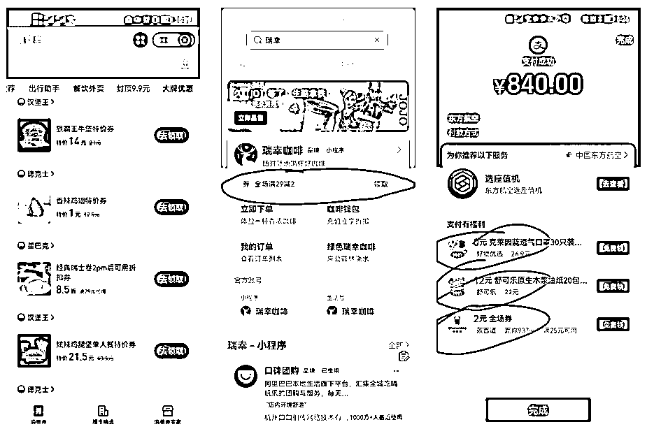
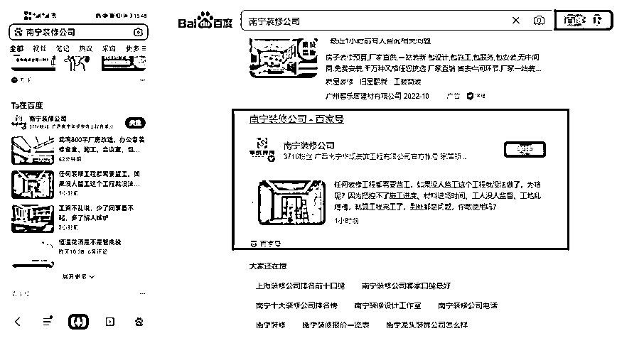

# 3.2.6 门店获客，别漏同城活动平台 @封伟-自动化变现

线下门店的生意半径有限，顾客大多来自附近社区和本地人群，所以流量重点也应放在周边。基于这个特点，同城活动类平台其实很值得门店拿来引流。下面梳理一批常用渠道，包括豆瓣、🐧、本地生活团购平台等，你可以按自身行业和需求挑选匹配的同城平台。

## 1. 常用的同城活动渠道

- 豆瓣
- 🐧
- 本地论坛：三四线城市尤其值得看，虽然大家时间被切得很碎，但本地论坛和社群里依旧有不错的人气。
- 本地生活团购平台：多由本地站长依托区域平台延伸出来，上线成本通常比美团低不少。
- 物业社区
- 垂直平台的同城分站：例如妈妈网重庆站

两个重点提醒：
- 豆瓣同城活动发布后，可以通过调整活动时间提升访问量，排名更容易靠前。
- 本地生活团购平台潜力不小。此前有家理疗店做线上引流，直接对接当地企鹅生活汇，免费上线爆款活动（平台免费入驻、成交后抽点），再配合其他优化，当月业绩翻了 10 倍。

内容来源：《实体店如何有效互联网化，90%的老板容易忽略的细节》

## 2. 按功能把平台分成三类

- 把口碑、收银和公域发券串起来：支付宝生活号/小程序。目前能免费做到这一点的只有支付宝，做连锁品牌的门店值得重点看。
- 展示附近小程序：支付宝和🛰️都支持。
- 让用户一键找到门店、团购和电话：百家号、抖音、快手、📕。

案例一：支付宝的优惠券玩法不止一种，高频复购的商家尤其要留意。首页、品牌区、支付环节、生活号、小程序都能发券，可以组合使用。

案例二：百家号是容易被忽视的入口。把地域名和关键词做进认证后，内容更容易快速进入首页，搜索优化（SEO）效果不错；认证通过后，百度移动端和 PC 端首页都会展示。

资料同样出自：《实体店如何有效互联网化，90%的老板容易忽略的细节》

