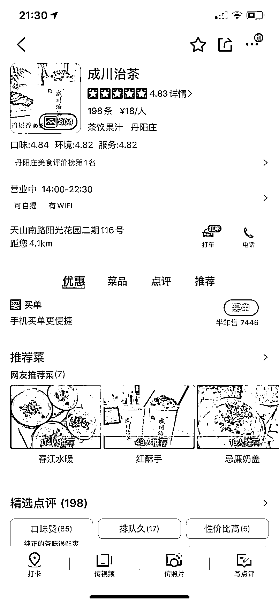

# 3.2.7 多渠道引流组合玩法 @缄默

💡核心思路

真正的引流很少只押一个渠道，更多是多线并行。下面以大众点评 + 小红书 + 公众号为例，给出一套可参考的组合方案，具体怎么配比还要结合你自身情况来调。

一提到引流渠道，很多人会想到电视广告、公众号投放、小红书、大众点评、电梯广告。但要论效果和性价比，还是大众点评加小红书一起做最划算。电视广告和公众号投放对到店率的贡献其实很小，一般更多见于网红餐饮、医美这类门店。

大众点评基本是门店线上引流的必选项，但很多人忽略了后续维护。团购服务费要抽 6%～12%，所以不一定非上团购；只做口碑评价的话，核心任务就是攒点评。在二三线城市，这种玩法很容易把量做开，知名度也上得快。

另一条线是小红书种草：安排大量水军账号发笔记，挑一两篇重点刷赞、刷评论，把排名顶上去，整个过程和大众点评同步操作。

大众点评刷评价有个常见配置：一半以上用 v5 等级账号，这类评论能获得首页流量扶持；再用 10% 的 v8 等级账号，评分给到 4.5 或 5 分，配上 150 字以上的文字和视频，最后自己再顶一顶、评一评。

小红书也按这个思路来，笔记数量通常铺到 60～90 篇，先把数据做起来，制造“网红必打卡”的观感。用户一旦跟风发布打卡笔记，就趁机把个别真实用户的数据也刷上去。

后期再找当地公众号推一波，网红店基本就成了。可以说，线下门店在线上最具性价比的入口，九成以上都是这么操作的。

内容来源：《门店的一些引流套路》

