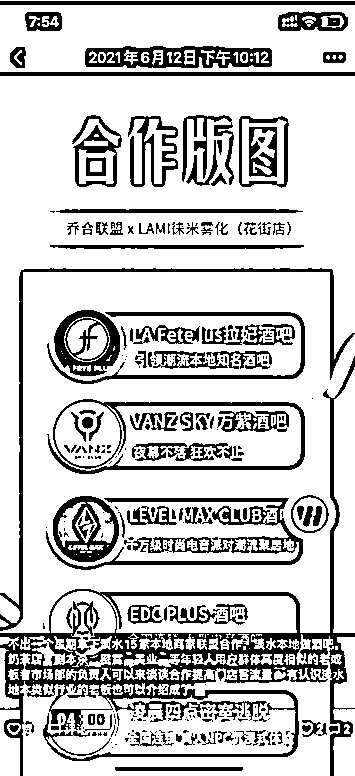
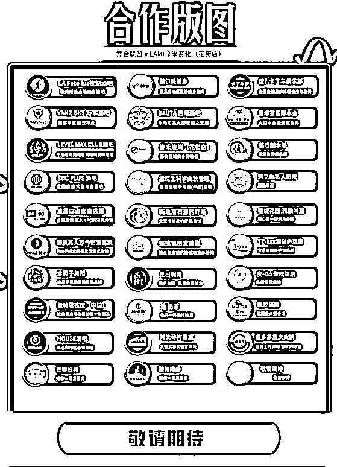

# 3.4.2 找商家一起联盟搞流量 @芷蓝 @乔合 @尹基跃

商家联盟这事，说白了就是“抱团取暖”，一般分成两条路：同业一起玩，异业互相带。

**异业联盟，一张卡撬动全城客源**

把不同行业的商家凑到一起，做一张联合权益卡。这张卡对外卖 98 元，里面装的可能有洗车店的免费洗车、家政公司上门擦玻璃、餐饮店打折券、教培机构的体验课……杂七杂八加起来，价值能堆到大几千。关键是，所有提供福利的商家，都能借这张卡往自己店里引流。

不过，想参与这个玩法的商家得先掏 5000 元进货，采购 120 张卡（给的是合作价，相当于打了折）。只要把卡推出去，成本基本就回来了。所以大家都有动力去卖。

这模式的好处是：一个城市里能迅速炸开，全城都知道。短板也明显：必须凑够足够多的商家，活动才跑得起来。

**同业联盟，教培行业这么玩**

同业联盟卡，教培领域用得最多。比如篮球、油画、音乐这些不同细分品牌，各自拿一个引流体验课出来，凑成一张卡。假设联合了 20 家机构，卡卖 298 元，家长可以任选 5 家去试课。对孩子来说，报课试错成本一下子低了；对机构来说，家长上门的机会也多了。

找商家的时候，直接打开大众点评，按位置搜索就行。但有个原则必须守住：找那些业务上没有竞争、但目标消费人群高度重合的商家去聊。

具体对接时还有几个坑要避开：

① 先看商家的星级和最近半年的产品销量，这样可以大概判断出他家的客流量怎么样。

② 一定要选用户画像一致、但产品服务不重叠的。打个比方，我的舞蹈室主要来的是 20-35 岁女性，这群人通常也爱做美甲美睫、喝咖啡吃西点，那就可以往这个方向找。

③ 第一次上门谈的时候，一定要告诉对方你的工作室就在附近，最好还能请他过来看一眼。必要的时候，直接送自己的服务或产品给他体验，合作谈起来会顺很多。

要是凑不齐那么多商家，也别着急，还有两个备选方案：

**合作方式一：互换商品体验券**

两家把各自的体验券放在对方店里，客户消费时随手搭赠一张。好处是操作傻瓜式，缺点也明显——你没法监督对方到底送没送，利益也绑不紧。

**合作方式二：固定合作伙伴**

找 2-3 家关系铁的合作方，做一张通券，比如【29.9 元 = 美甲一次＋中国舞体验课一次＋xxx】。用户一看，花 29.9 能换一堆体验，价值感瞬间拉满。

**电子烟门店 × 酒吧的异业实操 @乔合**

我们的路子是先跑通一个小模型，确认有收益，再放大干。一开始只合作了几家酒吧，酒吧也需要年轻客流，等于资源互换。他们通常给的是酒水卡，你自己出个开台费，就能去玩了。

后来发现酒吧给的流量根本不够。那段时间，我每天在地图上挨个搜剧本杀、奶茶店、密室逃脱的号码，加客服挨个聊。

聊下来发现，大部分实体店老板压根没有互联网思维，脑子里就是开店、上美团、上团购，然后坐等流量。既然小店不行，那就换思路，去找大店合作，越大越好。因为大店背后往往是公司化运营，有互联网思维和互利共赢的意识，你稍微起个头他就懂了，合作成交率明显高很多。

跑了两个月线下市场，我们最终拿下了 60 多家店 + 20 多个地摊。地摊那边不用给优惠券，直接给他们礼品券，让他们帮忙派发。你只需要送他们几套电子烟就行。

摊主在朋友圈发一句：来喝奶茶送电子烟。这其实是在帮他自己维护老客户，成本一分不用出。顾客买他的奶茶，他顺手送一张电子烟礼品券，对方凭券来我们门店领一套电子烟。相当于一杯奶茶就帮我们带来一个新客。

千万记住：别把这些摊主发展成你的代理，一旦他们成了代理，利润就全没了。

内容来源：《00 后实体店创业者：用互联网思维破局疫情影响》、《门店私域运营 | 小航海学习手册》

