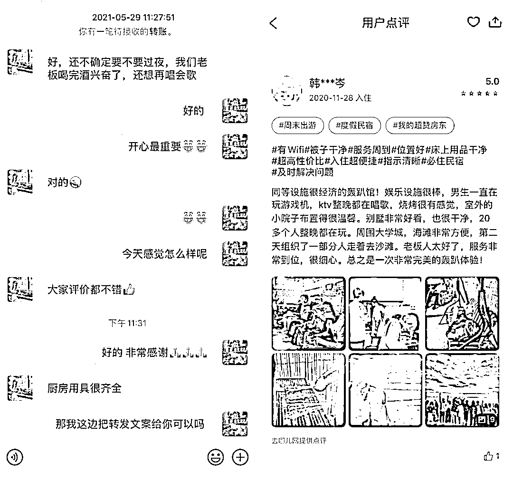

# 4.1.2 社群运营 @尹基跃 @Mage

很多门店在搭建私域时，都会面对这几种群：活动群（也叫快闪群）、宠粉群和会员群。其中快闪群最容易上手，门槛低；会员群则最值得花心思长期打理；宠粉群用 SOP 的栏目化运营思路来做，基本就能跑得很稳。

用户进群之后，其实心里是有一个疑问的：“这个群对我有什么用？我凭什么留下来？”所以进群环节一定要有欢迎语和群介绍，让新成员第一时间明白自己身在何处。比如，一家餐饮店在群人数满 6 人之后会自动发送欢迎语，其中就包含：

1. 用“北欧慢城 VIP 服务群”的身份来打招呼，说明这里既是吃喝玩乐的交流阵地，也会不定期搞秒杀、团购、霸王餐等活动，同时有活跃度积分制，坚持在群里活跃满 100 天就能拿单人霸王餐；
2. 跟进一张社群管理的活跃度说明图；
3. 随后客服接力上线，扔出一个欢迎红包。

活动群怎么玩

我在做客户运营的时候，会把那些“问过但还没下单”的客户拉进专属微信群，每天固定时间在群里发红包问好。红包金额一般是 10 到 20 元一次，拆成 20 到 30 个包来发——注意包数不能太多，否则大家每人只抢到几分钱，兴致会迅速被消磨掉，群也会变得死气沉沉。

此外，每周还会安排 1 到 2 次客户团建视频分享，内容以聚会和生日场景为主。固定的秒杀场次也得安排上，一般选在周三或周四，把后面暂时没预订出去的档位拿出来，用原价 5 折到 7.5 折的价格刺激消费。

除了这些待成单的咨询客户之外，那些真正来过店里的老客户，我也会单独建群维护。这类群的运营要克制一些，每周轻度营销个 1 到 2 次就够了，频率一旦太高，反而容易让客户产生反感甚至主动退群。毕竟他们已经到过店里，也对你的品牌有认知，你的群一直都安静地躺在他们的聊天列表里，等哪天有需求了，自然第一个想起你。

宠粉群怎么运营

1. 先让门店个人号添加客户，再邀请他们入群，群里每周固定组织拼团、秒杀、福利活动；
2. 活动落地可以依靠有赞这样的第三方工具来完成；
3. 再用微友助手去统计群内活跃数据，连续一个月活跃满 30 天的粉丝，就送一杯饮品之类的福利。

会员群怎么运营

会员要有专属感。比如设立会员日、会员见面会、会员体验日这类只对会员开放的活动，能有效拉近会员和门店之间的情感纽带。至于具体的活动形态，还是要结合自家门店的定位与产品来设计。

如果你还想更系统、更细致地掌握“好”社群的运营方法，学有余力的话，建议去翻一翻社群运营航海手册里的《5 月航海｜社群运营｜实战手册》。

内容来源：《饮品店私域流量构建的几点建议》、《从亏损 8000 到盈收 3W+，轰趴别墅通过精细化运营实现转介绍率 70%》、《北欧慢城门店私域流量执行全案 2.0 版》

