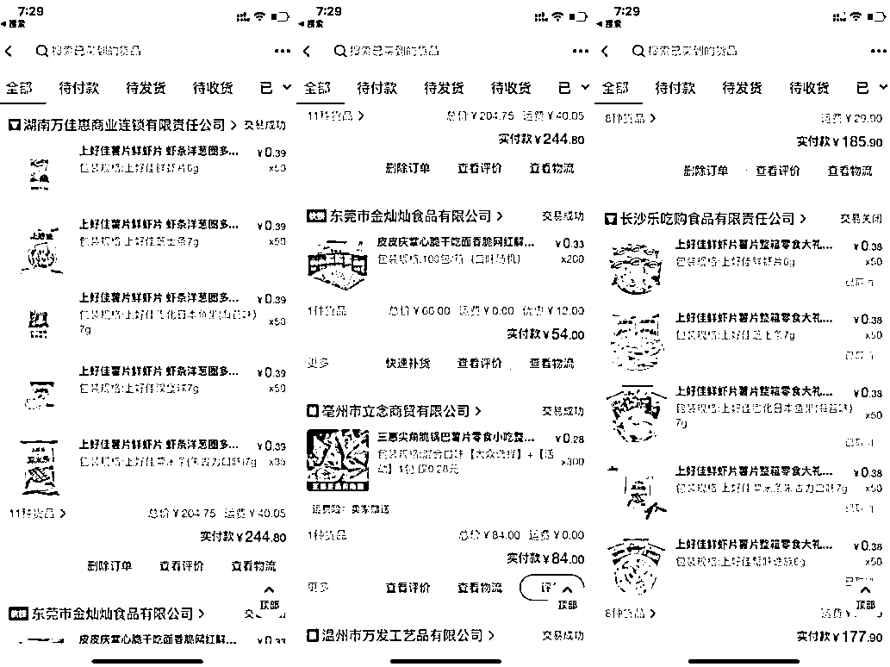
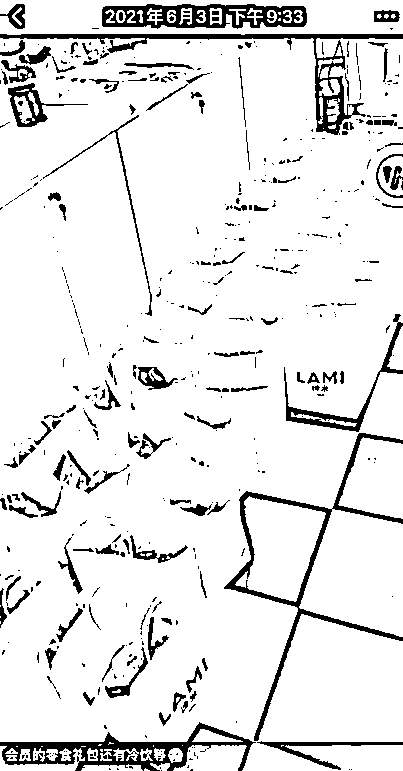
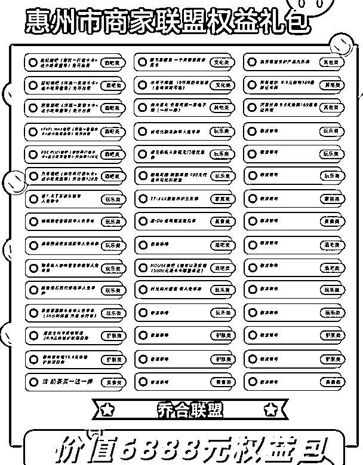

# 5.1.1 用海底捞式服务卖电子烟 @乔合

（电子烟生意至少有五成利润打底，所以下面这套打法，利润薄的行业玩不转。）

第一，门店周边四公里内免费跑腿。很多店会让顾客另外付配送费，我们直接免掉，跑腿成本约8元。

第二，只要下单，就送顾客一袋零食。这个操作是不是很眼熟？袋里装七八包薯片、一小瓶可乐，薯片每包约4毛，可乐1.5元，加上袋子总成本约6.5元。顾客拿到电子烟时，还会额外收到一大袋零食，形成超出预期的交付，制造惊喜。

第三，顾客下单时再送其他商户的联名优惠券（获取这些券的方法，后面会分享）。

换个角度想：你花78元买一盒烟弹，店家免费送到家门口，还搭一袋零食和这些优惠券，你会不会觉得划算？

第四，把私域运营中维护客户的那套方法照搬过来。只要在门店下过单，顾客资料和生日都会被登记，临近生日时还会提前通知：可领礼品、享折扣等。这招看着不复杂，却真管用，能让顾客长久记住你。

设想一下：你只在一家店花过几百元，可这家店每年都主动联系你，记得你的生日，还会送点礼物，你是什么感觉？礼物并不贵，一件T恤或其他小礼品也就十几块钱，但这份心意顾客能接收到。

内容来源：《00后实体店创业者：用互联网思维破局疫情影响》

