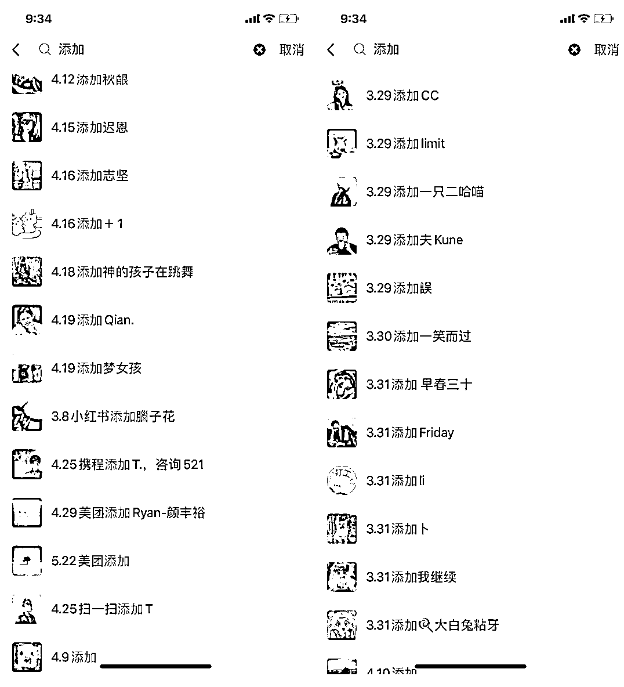
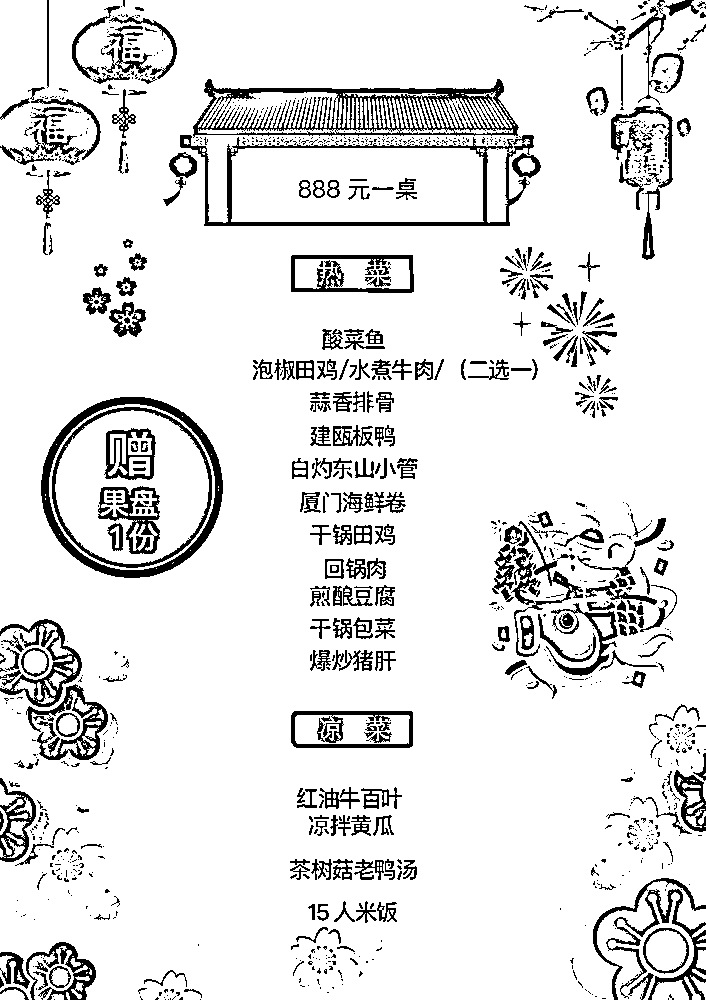

# 案例二 轰趴别墅：把细节做透，订单七成靠转介绍

轰趴别墅本身有大、中、小不等的体量，体量决定了目标客群，也决定流量入口。当前主要客群有四类：公司部门团建、家庭朋友聚会、学生部门聚会、节假日游客。不同客群要有各自的推广打法，尽量各方面都覆盖到。

公司团建的拍板人大多是HR或老板。我当时混入一批HR招聘群，以及场地周边写字楼的物业管理群，时不时发个红包热热群，再配合广告推送。

家庭朋友聚会这边，始终没找到特别理想的切入方式，现在主要靠团购点评平台和熟人转介绍。

游客流量通过入驻主流平台解决，同时多上架一些房源，把整体曝光量做起来。学生市场则是校内发展校园代理，和学生部门合作对接。

多渠道拉新只是基础，真正靠得住的还是靠细节留住老客户、提升复购率。目前大概三分之二的订单都来自微信转介绍。

说到底，轰趴做的是服务生意，利润来源也在服务上。除了常规的场地预订，还有订餐服务。像一份套餐的利润，大致有15%到20%。有时一场场地费也就两千多，但客人到店后让我代订餐食、酒水，这部分能带来一千多块的利润。

后续能增加多少服务，取决于你对客户的了解程度。比如了解今天是哪种类型的聚会，客人有没有自备食材和酒水；如果没有，就可以顺势推荐自家套餐和酒水。

同行之间也经常互相推荐，有时还会帮忙承接场地布置。比如我这里周六的场地已经布置到位，客户又急需订周六，我就会把客户推荐给同行，一般有10%到15%的返佣。

内容来源：《从亏损 8000 到盈收 3W+，轰趴别墅通过精细化运营实现转介绍率 70%》

