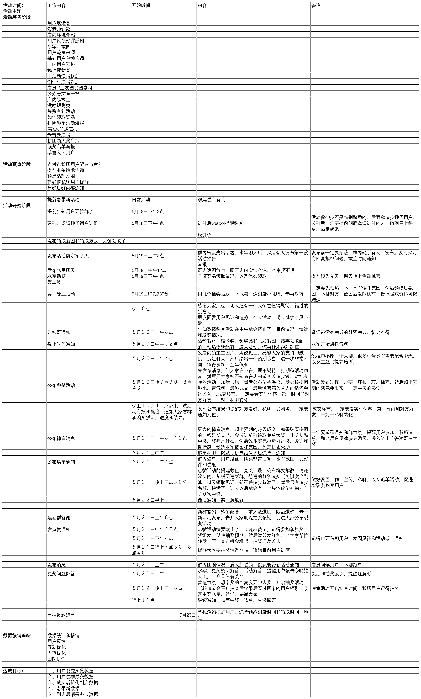
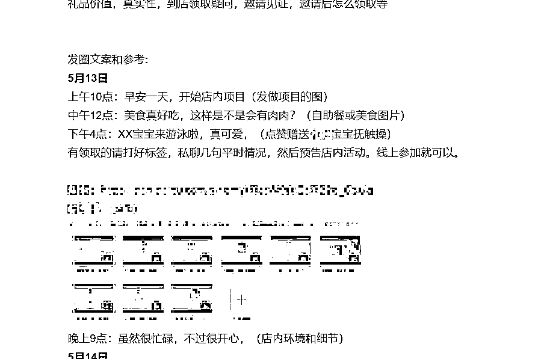

# 6.3 个护产康行业 @椰子青青

核心标签：高客单价、储值升单、销售激励与赋能、老客裂变。

先聊聊这类型门店的短期引流打法。由于客单价不低，门店对持续获取新客的需求通常很旺盛，借助社群邀请、任务宝、分享有礼等玩法来做集中引爆，往往立竿见影。正因如此，市面上也催生了不少专门替这类门店做获客落地的服务团队。

这类门店客单价高，意味着每个进店客户的价值天花板都很高，所以销售端必须立刻跟上节奏。这时候，店员和导购的战斗力直接决定业绩上限——及时激励、实时跟踪，再加上一套清晰的升单话术，后期产出的回报空间会非常可观。说真的，谁做谁知道。但有一点要注意：不少门店导购的教育背景有限，再漂亮的方案落地前，也必须先做拆解和培训，否则执行起来会走样。

做拓客，本质上是在拿捏人性。贪便宜、爱面子、乐意分享炫耀……这些微妙心理，恰恰是驱动老用户主动推荐、帮忙传播的燃料。所以在设计活动时，多问自己一句：如果我是目标客户，我对这个玩法有兴趣吗？我会不会主动参加？一旦这个心理关口被打通，方案基本就稳了。

另外，拓客方案的重中之重，是最大限度盘活门店现有的客户资产。如果手里没有存量，才需要考虑地推或线上投流来补流量，之后的核心动作，就是动员现有用户做二次转发，产生新的转介绍。社群里一轮接一轮的多层扩散，会带来类似涟漪的波纹效应，最终实现“1+1>2”的裂变结果。下面直接给一套实际跑过的门店拓客方案作参考——该方案最终交出社群转化率20%到店消费、总充值金额数十万元的成绩单。

从长期视角看，产康社群的底盘要靠IP人设来搭建。重点打磨服务细节和温度，让顾问有血有肉、有人情味，真正做到以“人”对接“人”。因此，做社群运营时，每一次与客户的互动触点都必须珍惜，同时老老实实把客户标签打细。在写整体方案框架时，这些细节一定不能略过——只有这样，交付的方案才是完整、可落地的。

内容来源：《不同行业私域如何搭建社群体系及运营团队》
