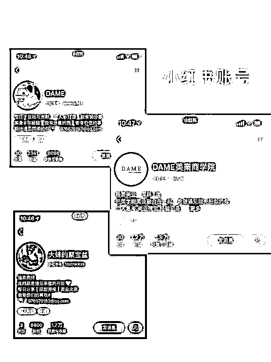
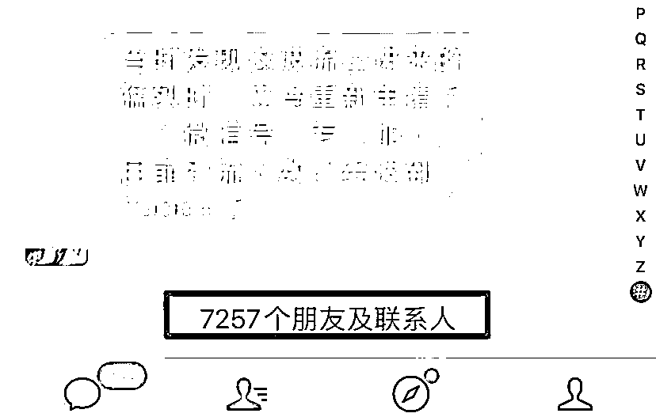

# 【案例五】美业店主 @陳大妹 May：📕获客，朋友圈成交

## 1. 用📕素材吸引美业店家，再把流量沉淀到🛰️

一开始，我只是在📕持续发布美业素材，希望做美业的店主能主动加🛰️。那时我会免费提供不带水印的美业海报。这个细分方向做的人还不多，每天来的流量很可观，于是我专门注册了一个新🛰️号负责承接和对接，如今好友已经超过 7000 人。

后来，📕上的“美业海报”开始形成搜索词条，进入这个领域的人也多了。我早就判断到这一点：市场足够大，不可能由我一个人全部拿下。面对竞争，我的准备不是硬扛——单靠个人精力有限，即使每天再多运营几个📕号，也没法和整个竞争圈对抗。

所以，我借助素材库，联合加入我们护肤品牌的团队成员以及品牌里表现突出的代理，提出一起做联名推广素材库：大家各自去📕引流。当时，素材库里已经攒下上千张精致海报；除我以外，不少成员也会把自己做的海报放进去。整个库的内容已经逐步完善。

筛选之后，我把素材库的销售资格开放给部分表现优秀的代理。与此同时，美业海报这个圈子里，出现了许多共同销售我们素材库的人。他们得到了销售分成，也积累了自己的流量；我们也借此把渠道延伸到了抖音。

## 2. 朋友圈是转化的关键

整套流程里，我最看重、也最终落脚的地方，就是朋友圈转化。朋友圈怎么布局，直接关系到转化率能不能提高。说到底就三点：

其一，版面要清爽耐看，别频繁刷屏。做到这一点，别人不但不会把你屏蔽，还可能愿意直接搬用你的文案和配图；其二，内容要充实、有表现力。要让人从朋友圈里看出你的本事和价值，进而对你产生兴趣；其三，别只停留在口头上。我不吹牛，说过要做的计划和目标都兑现了，所以别人能看到我是拿结果说话的人。

这三点做好，我觉得就够了。市面上关于朋友圈的复杂教学很多，但核心无非就是这些。

内容来源：《通过在📕输出美业素材精准引流，售卖素材库+加盟+建立会员机制实现变现》

