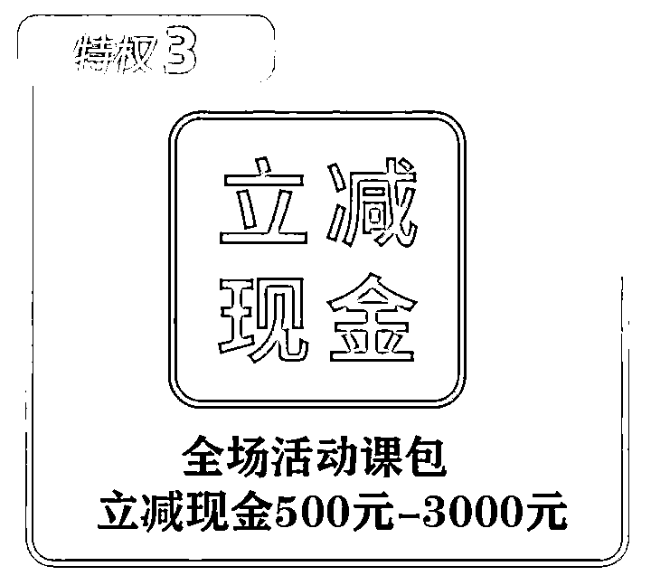
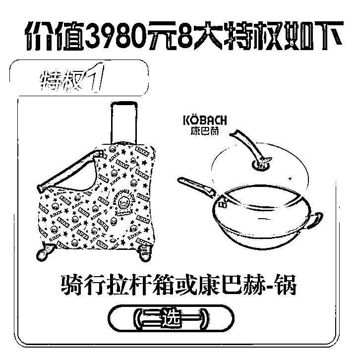
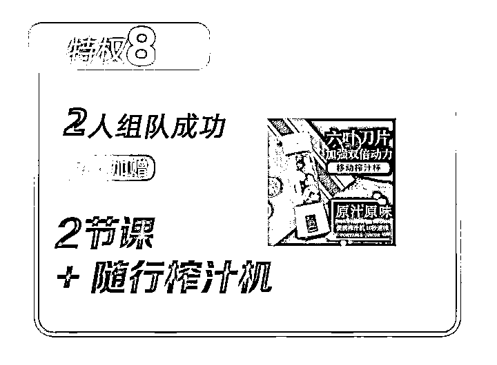

# 【案例七】少儿书画店同城获客拆解

这是一家做少儿书画培训的实体门店。对它来说，关键不是盲目铺流量，而是让自己的产品持续被本城精准人群看见。门店的流量重心，天然在同城。

同城流量有两个主阵地：微信和抖音。微信端，最快的触达方式是本地微信群；抖音端，则要抓住抖音同城。

## 1. 先拿下同城流量

本地微信群里，业主群、村居群、商家群、团购群的打开率通常更高，是城市私域的重要阵地。活动开始前，门店员工先在线下加本地微信群，累计约1000个同城群，然后做两件事：

动作1：把同城群里的宝妈沉淀到自己的群。宝妈进群可领一张小板凳，再邀请5人进群，加送一个保温包。这样裂变出约4000人的微信群，宝妈占比超过95%，相当于沉淀了近4000组家庭。领礼品时还要登记手机号和姓名，所以一份礼品同时完成了微信个人号沉淀和家长信息收集。

动作2：把这1000个同城群作为活动曝光渠道，持续推送活动入口。前期已经沉淀了一波宝妈流量，此时再反复触达，不必过度担心被移出群。

抖音方面，常态化输出和打造IP都没问题，但如果实体门店没有成熟的抖音账号，就很难借它引爆同城流量。这里可以把零散资源聚成势能：前面送出了小板凳和保温包，进群宝妈要到店领取，门店便可用抖音爆店码，让宝妈们参与抖音视频分发。1000个宝妈到店领礼品，就能分发1000多条视频。

这些宝妈账号的权重相对更好，观看者多为其社交圈熟人。1000多条普通用户视频发出去，门店所在区域就会被带动。若想再推一把，还可以找V3—V4博主加热，并挂上引流团购品、基础团购品进行投放，短时间内便能在本地形成一定流量基础。

## 2. 让私域流量自我裂变

外部公域完成第一波曝光后，还要用自有流量再推一轮。自有流量里，价值最大的仍是个人微信号。但私域每次推送都是一次消耗，持续消耗就是在耗尽用户资产。因此，推送产品时也要设计裂变，拼团是较好的方式之一。

这次设计了一个66元宠粉节定金卡作为裂变品：用户支付66元，可抢订价值3980元的优惠名额。课程福利方面，现场报名可立减500—3000元，为现场高价转化做铺垫；礼品方面，则准备了价值较高的康巴赫锅、骑行拉杆箱等。裂变规则设置为2人团：拉一个人支付66元，可得若干节课及礼品。让老用户先买66元定金卡，再带动他人购买，从而完成私域流量裂变。

前面已有4000多位宝妈进群、1000多名宝妈加微信，符合领礼品条件的还会到店领取。因此可以做三个动作：

1、在群内推66元定金卡，再让购买者去裂变；
2、对新添加微信的家长推66元定金卡，再让购买者去裂变；
3、对到店领小板凳的家长推66元定金卡，再让购买者去裂变。

## 3. 把到店流量转成成交

通过公域的同城群流量、抖音流量，以及自有私域流量和私域裂变，66元定金卡共卖出624张。接下来要做的，就是把这624张卡转化掉，把到店流量转化掉。

这时门店要造节促销：

·现场氛围上，要做出节日感；
·成单速度上，要设计紧迫的支付节奏，用老用户带动新用户，并设置群接龙——只要成单就接龙，让客户相互影响；
·方案上，要设计阶梯成交：价格有阶梯，礼品也有阶梯。越早下单的客户，越能优先挑选礼品，并享受更低价格。

最终，通过这三步走，20多天周期内转化了160万元。这套方案也适合瑜伽、水育、教培、医美等行业，复制这套逻辑，做出几十万元并不难。

案例整理自《20天帮助实体书画门店收款160万》

