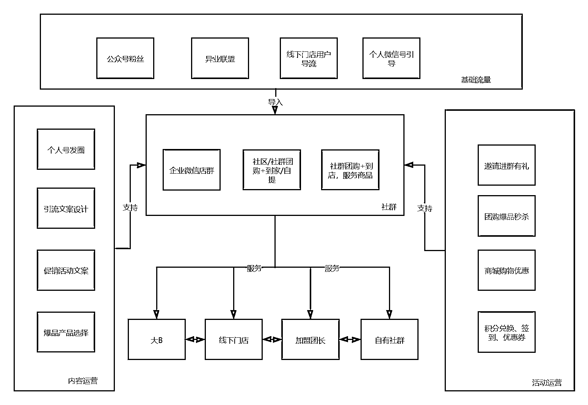
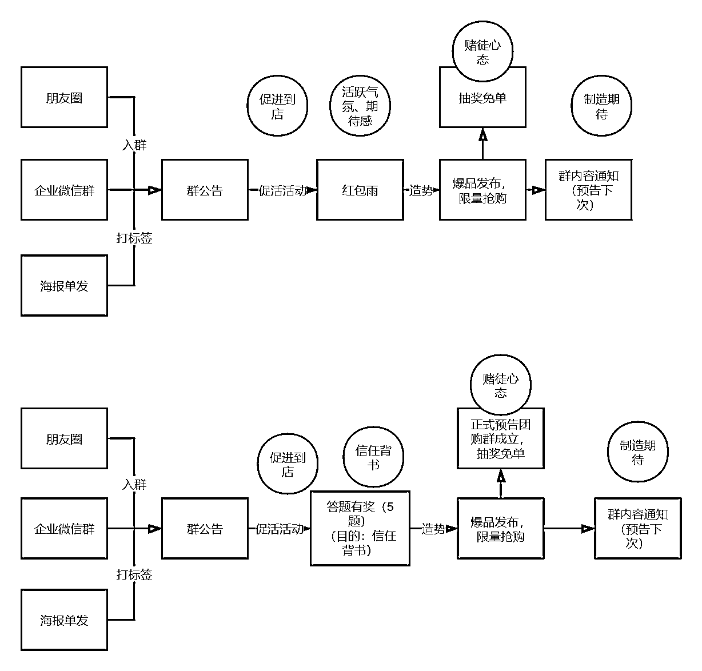
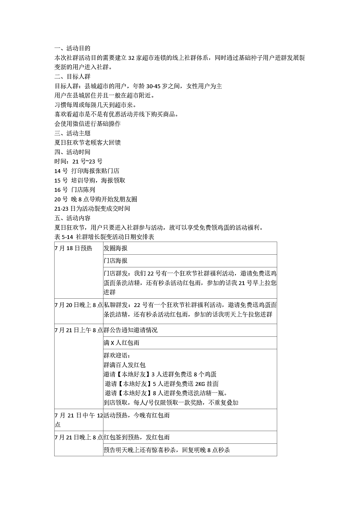
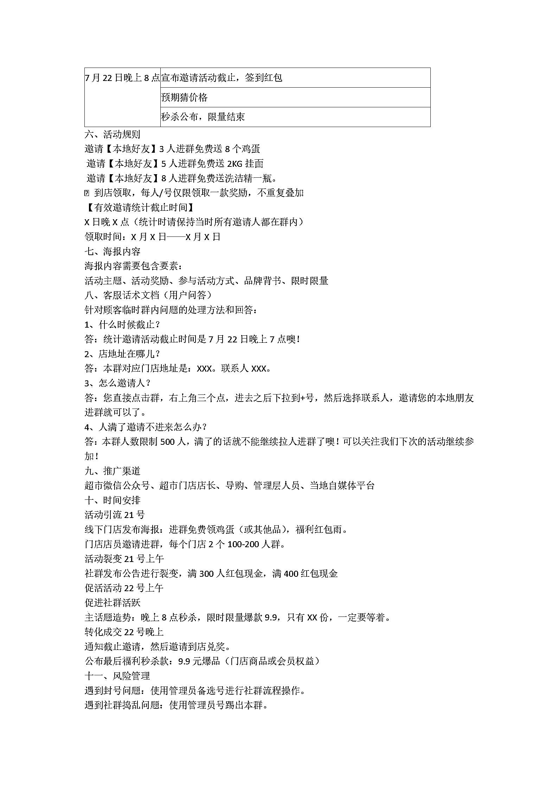

# 6.7 商超行业：低客单下的导购赋能打法

商超行业的关键词很明确：客单价偏低，门店导购要用起来，重点做好导购赋能与宣传效应。

搭建方案时，我会先画一张思路导图，把整体框架理清楚。具体来说，就是把基础流量、用户、活动以及平台支持串成一个闭环。框架搭好后，方案工作就变成对流程和内容的反复打磨。

框架理清后，下一步就是活动方案。活动方案可以这样铺开：

活动入口的拆解，可以沿用餐饮门店项目那套方法，围绕顾客接触点与行进路径，准备两个版本，供测试或讨论。基于这些设定，再形成下面的活动总案。

总案会落到细处，例如邀约话术、邀约时间、活动排期、培训安排、风险控制计划等。方案再经过一轮讨论确认后，就能排进执行甘特图。

内容来源：《不同行业私域如何搭建社群体系及运营团队》

