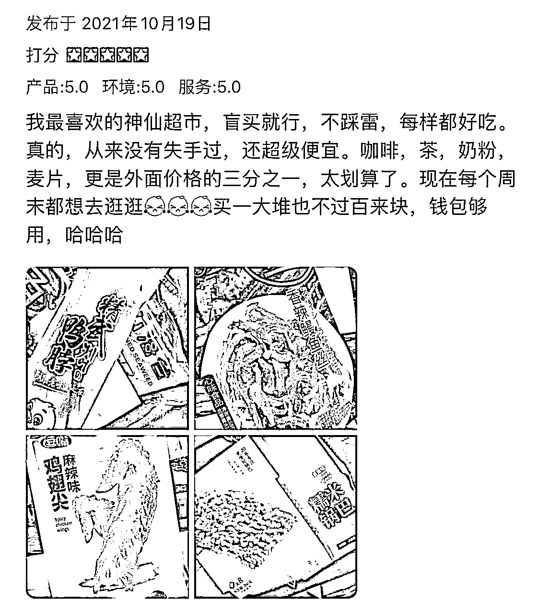
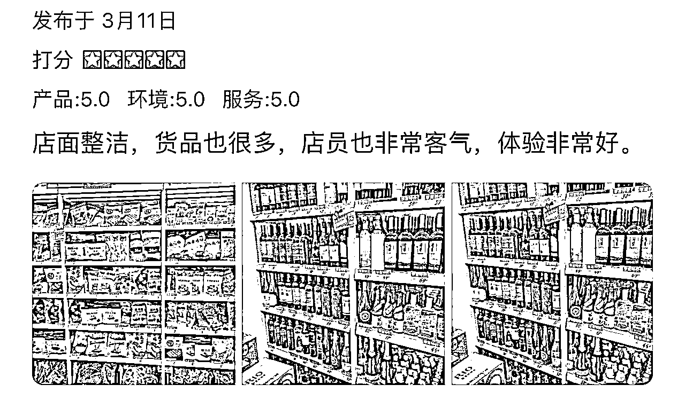
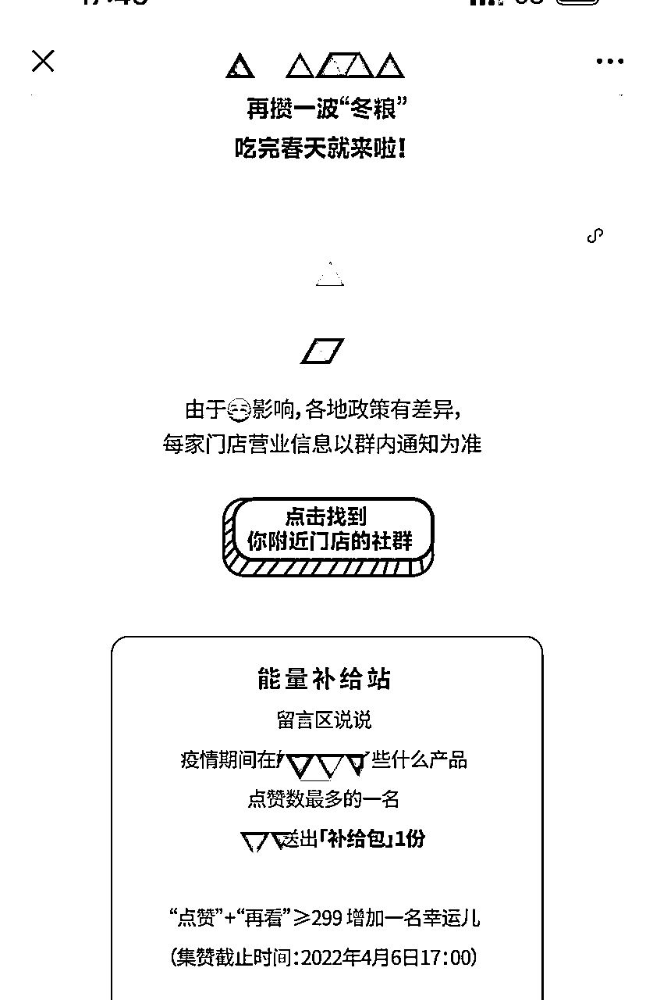

# 案例八：临期食品店这样引流 @Bester

临期食品门店想把生意做起来，不能只靠低价，还得把开业预热、日常到店、私域沉淀和会员复购串成一条线。

## 1. 开业阶段：装修期就提前预热

门店还在施工时，围挡就是现成的广告位。把预计开业日期、店名和 logo、门店类型写清楚，再挑几款周边居民熟悉的产品做价格对照，提前突出店铺特点、完成种草。若人手充足，可以同步把👸号搭好，将二维码印在围挡上，并设计转发有礼活动，让信息多扩散一层，帮助门店完成冷启动。

临近开业的三天到一周，在门店周边集中派发传单，把顾客往店里引；条件允许的话，用喇叭循环播报活动。例如：某店开业，全场三折，三十元能提走一大袋；某款大家都熟悉的产品，原价多少、现价多少，用超低价制造冲击。

## 2. 日常运营：围绕“到店”持续做动作

线下方面，把显示屏放在橱窗醒目位置，轮播特价商品；若允许外放，喇叭偶尔也能派上用场，听觉触达往往比纯视觉更直接。隔三差五在周边派发传单或小零食，也能唤醒附近顾客。

线上渠道要结合城市消费习惯来选，大众点评、抖音、📕，甚至🛰️朋友圈都可以尝试。用适度折扣或赠品做引子，鼓励顾客自发发布内容；👸号则可不定期做裂变活动，让线上热度和线下到店互相加持。

## 3. 门店引流私域：把顾客留在自己手里

把顾客沉淀到私域，至少有三方面价值：

- 便于产品推荐和内容传播；
- 活动信息能直接触达顾客；
- 短保商品可做预售，周转更快、库存压力更小。

## 4. 会员体系：用付费门槛增强黏性

会员可以设计成月卡、年卡或终身卡，但建议设置付费门槛。顾客付了钱，更愿意持续使用，因为人天生不愿让已花的钱浪费。

会员权益要足够有吸引力，比如终身 95 折、88 折，首次办卡送 50 元无门槛代金券，长期享受 xx 服务等，描述得越让人觉得值越好。平时也可以偶尔准备会员小惊喜。整体体系不必复杂，积分可按需决定，折扣和福利到位就够。

## 5. 节假日礼品：做增量营收

节庆礼品也能贡献不错的收入。选一些卖相体面、品质在线的产品，再搭配酒水、饮料、牛奶等常规礼品，用于节日促销和送礼；条件具备时，可申请烟草销售许可证，顺带销售。

## 6. 给 B 端客户供货：小批量也能长期合作

餐馆、酒店、小商店等 B 端客户同样值得做。这类店单次拿货量不算大，但周转较快，对保质期要求没那么苛刻；我们有货源优势，零售价有时甚至能低于他们的拿货价，因此不少小 B 客户愿意来进货，适合发展长期合作。

## 7. 异业合作：互相导流

找没有竞争关系的业态合作，在彼此门店摆放宣传物料，或一起策划联合活动，实现互相引流。

## 8. 其他注意事项：陈列、服务与收银转化

- 上货要及时，缺货就用其他商品补满陈列，货架空着会明显拉低顾客体验。
- 员工培训要重视服务，遇到分歧别和顾客争辩，有则改之、无则加勉。
- 若打算做私域和会员，收银员的培训与激励也要提前设计，保证每位结账顾客都能得到自然的推荐引导，进入私域、会员体系或会员群。

内容来源：《临期食品店玩法：多 SKU+高坪效》

