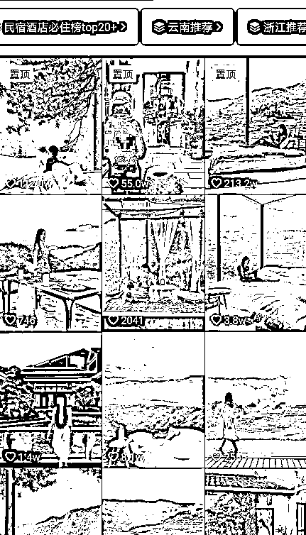
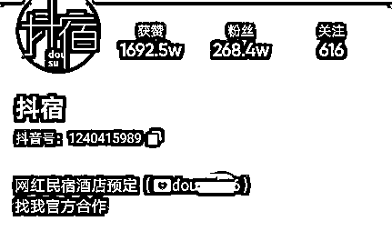
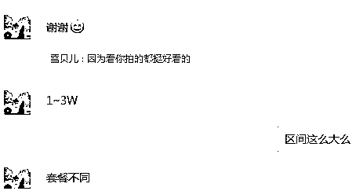
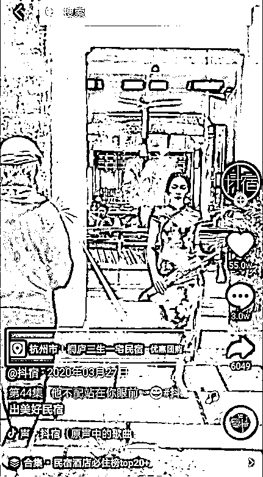
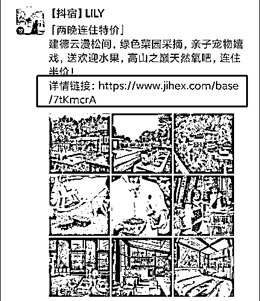

# 【案例九】抖宿@大江：民宿探店号拆解

民宿获客通常不会立竿见影，复购频率也偏低，因此不少从业者把探店作为主要打法。下面借一个民宿探店账号的实例，带你看懂民宿酒店与达人合作大致怎么运作。

需要提醒的是，投达人的流量成本并不低；如果民宿本身缺少特色和记忆点，达人又没能带来精准客群，合作往往很难见效。所以，一边帮民宿塑造差异化卖点，一边也要把私域和个人IP经营起来，形成自己能掌控的流量池。

1. 抖音内容拍什么

民宿酒店能打动人，多半靠区位、周边风光和住宿环境的独特性与美感。因此短视频要把这些稀缺、美好、让人心动的元素拍出来，画质要清晰，画面要唯美。城市人群看腻了水泥森林和高楼，对自然有强烈向往，希望亲眼看看、亲自体验亲近自然的感觉。

@抖宿的内容像自然的搬运工，把住宿空间与户外景色交织呈现；再叠加美女出镜，人物置身自然景色中，观者的向往感会被进一步放大。因为要突出自然风光，取景地多为旅游目的地，从账号合集里也能看出这一倾向。整体上，这些内容会从多个角度撩起观众“想去看看、想去住住、想体验自然”的冲动。民宿自营账号同样可以借鉴这类视频的选题和拍法。

2. 引流方式

把抖音主页简介当成入口，将感兴趣的用户引到微信。

3. 变现路径

这类账号走探店模式，民宿付费、达人来拍视频。合作前要问清覆盖哪些平台、各项费用怎么算，并把分佣价格确认好。

• 视频团购分佣：达人视频中嵌入团购小程序链接，订单成交即可分佣，卖得越多收益越高。

• 朋友圈成交分佣：在达人微信朋友圈投放民宿内容，附上团购链接；客户下单并完成订单后，按约定分佣。

内容来源：《民宿酒店探店号，怎么做？》

