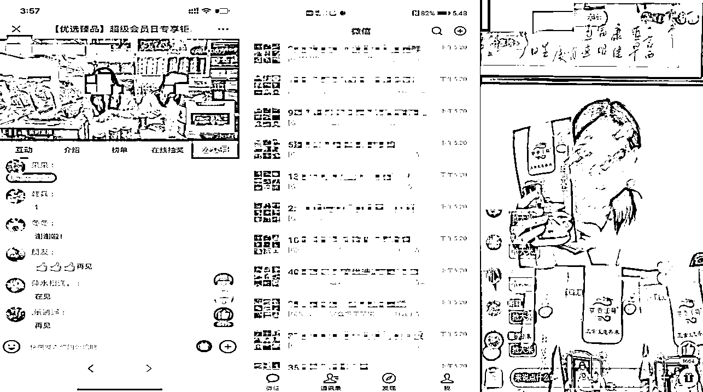

# 案例十：门店社群跑出400万销售额

这套打法的起点，不是先投广告，而是先把客户从销售个人手里收回公司。

## 1. 准备期：客户留在公司

李雪梅2020年4月入职后很快发现：公司并不缺客户，问题在于客户几乎都沉淀在销售个人手中。日常接触客户的是销售员，CRM系统却基本闲置，高层对客户情况了解甚少。一旦某家门店负责人离开，客户资源就可能被一并带走。

她随即组织全体销售各自建群，把手中客户导入群里。考虑到不少老年客户仍在使用功能机，她定下硬指标：入群人数不得低于个人客户数的80%；公司承担人力、资源和费用来维护社群，员工配合度因此很高。团队有60多名员工，新同事客户积累不足，就先继续沉淀，等手上超过30个客户再建群。最初拉了41个群，后来逐步增加到60多个。那场益生菌活动，正是从这41个群起盘的。

为了补上客户画像，她又发通知：每位员工每天至少往CRM录入5户资料，内容涵盖家庭成员、个人偏好、职业、消费习惯、性格脾气、方便接听电话的时间等，且必须填完整。

## 2. 启动期：先小范围试水

41个群累计约8000多人。进群客户都购买过高客单价产品，包括普通绿色有机食品和保健品。仅保健品消费最低就在6000元以上，加上零售，最低基本超过1万元，属于VIP客户。没有购买高端产品的客户，则另建群，每天更新不同内容进行植入，协助市场团队推进成交，之后再逐步升级为VIP。进群者对产品至少有基础认知。

通过CRM，她筛出了去年没有买过益生菌的客户，也筛出了多年购买、反馈良好的客户；其中愿意作为分享嘉宾的，被选为种子客户。当时五个地方设有分店，便按地区建了五个群。第一次操作不敢铺太大，先小试一波。地区负责人先把员工拉进群，员工再拉入种子客户，以及CRM中购买过高档产品但还没尝试益生菌的客户。五个群的准备工作就此完成。

## 3. 引流裂变：代金券带动到店

团队选用了“火把助手”做群管理，5元一天一个群，实际并不划算：功能不齐全，还经常闪退。但第一次尝试，只能硬着头皮克服困难用下去。于是有了第一条群规则：进群者每邀请一位本地客户入群，就能获得门店10元代金券一张，一次使用一张，邀请越多，获得的券越多。

群很快满员，成员基本是当地居民，方便后续邀请到线下做活动；加上有实体门店，代金券可直接到店消费，既提高可信度，也带动门店回暖。第一天晚上八点左右，群就满了。团队考虑是否继续开新群时及时叫停，因为首次操作要控制在可掌握范围内，五个群满员后便不再拓展。

这波代金券也促进了线下消费，门店像疫情前一样热闹起来，每天都有客户来领券并消费。对老客户是维护，对新客户则是接触和了解基本情况的机会。

## 4. 群运营：红包、笔记与报名

第二天，群里开始用红包造势。客户大多是40岁以上的老年人，空闲时间多，抢红包更多是为了消磨时间、图个热闹。团队先让各店负责人在群里发表提前准备好的感谢词，以及疫情期间如何保护自己的感言，随后再发红包。

红包也有节奏：每天早上9点、10点，下午2点、3点，晚上10点睡前各发一波；发完后禁止任何人在群里发消息。这样做是为了培养客户线上习惯和准时意识——只有准时，才能抢到大红包，不错过福利。

发红包第一天，也就是线上操作第二天，10个店的负责人都发表了感言，每个店负责人发10个红包，因此一个群当天有100个红包；加上小助手预热和关灯红包，一共106个。客户抢得开心，第三天还没到点就准时蹲守。第三天继续发红包和礼品，礼品需到线下门店领取；当天红包较大，发完后随机抽取幸运客户，送出门店特色食品，比如木耳、东北大米、粉丝、豆浆等销量好、反馈好的产品。抽奖助手设置成约一半人中奖，参与度很高，客户和员工都很兴奋。

下午五点，团队引出讲益生菌课程的老师，小助理随即宣讲接下来三天的听课规则和奖励：认真听讲、做好笔记，在群内晒笔记照片，经工作人员检查后可得豆浆一包；听课时间为每天上午9点到10点、下午2点到3点。因为要做笔记，每人每天在群里的时间大约三到四小时。

第四天课程开始，开课和结束都有红包开路。客户做笔记格外认真，写了满满几页；有人晒笔记领到豆浆后，原本不愿动笔的客户也被激励，甚至晚上十一二点还在补笔记。三天课程每天晒笔记所得礼品不同，客户热情很高，既能学知识又能领礼品，进群者基本都在认真听课。

课程第二天，也就是整个环节第五天，团队回到正题，开始植入讲解相关产品；课程第三天，也就是第六天，宣讲产品优势、国内专利以及哪些人在使用，并在群内发布购买政策：有意向报名者还可继续免费获得三天益生菌试饮装，并有机会享受买一赠一，现货不多，需要在群里打出“我报名”。结果一下爆了，基本都报名，少数没报名的人看到气氛火爆也开始报名。

## 5. 线下成交：分批到店，持续跟进

团队邀请客户第二天到店领取，但要等员工通知再来。原因是怕一次性来太多招待不了，影响体验，加之疫情之下更要注意，所以安排分批次到店了解，并兑换这几天听课的礼品。

第七天，下单客户约400家，整场业绩约240万元；后续几天还在持续出单，回款约一百多万元，整体销售额达到约400万元。对于没出单的客户，到店兑换礼品时，销售人员继续跟进、维持关系，即使最后没买益生菌，也可能慢慢建立信任，转而购买其他产品。

过程和售后维护同样关键，因此客户粘性很高：一上新品，客户就会购买，不少客户家里甚至摆满了一面墙的产品。回购率在80%以上，满意度在98%以上。

内容来源：一篇以大健康线下门店为例，讲述如何快速梳理客户、获得首批客户、完成裂变并促成成交，进而找到第二增长曲线的方法论文章。

