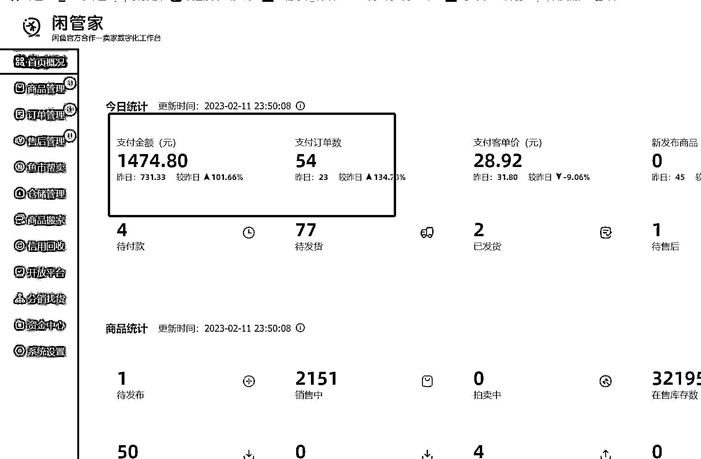

# 1.2 闲鱼二手书项目，为什么值得做？ @老瞿 Qu

很多人做副业想找低门槛的路子，闲鱼正好符合；另一边，二手书的需求也在肉眼可见地扩大。具体可以从四点来看：

第一，高校教材不再强制统一预订。目前超过八成的高校已经把教材选择权交给了学生，学校不干预，学生可以自己决定从哪买。这等于给二手书打开了一扇门。

第二，大学生的接受度越来越高。教材在课堂上其实用得不频繁，加上正版化让盗版空间变小，二手书又只有标价的1到4折，学生自然愿意选便宜的。

第三，消费降级带来了新机会。经济压力下，家长也开始省着花，闲鱼上的二手字典经常卖断货，成了一个小爆款。

第四，学校周边的旧书店撑不住了。这些店主年纪普遍偏大，又碰上三年疫情，绝大多数都倒了。他们做不了电商，没法线上突围；而学生早就习惯了通过网络买二手书，电商模式的优势也愈发明显。

在这些玩法里，我比较推荐闲鱼无货源二手书。闲鱼现在还处在红利期，相比之下，淘宝和拼多多上的二手书门槛更高，不建议轻易去碰。

如果是一个人单干，最好用家人的身份证再办一个出版物许可证，凑齐两个证、开6个账号。6个账号基本是一个人管理的上限。精细化运营下来，一年利润预计可达20万到50万。眼下正是开学季，单账号日销售额在1000到2000元之间，平时也有500元左右，利润率大约30%到50%。

闲鱼单个账号最多只能上架500本书，这个数量更适合拿来打爆款，所以做无货源更稳，不用压货。

官方偶尔会放出活动。例如之前有过这个规则：上架满500本书，同时开通7天无理由退货和“不符合描述退货”，就能申请把发布权限扩到3000本。留意官方动态，有机会及时放大操作。

闲鱼无货源二手书的优势，主要有五点：

1. 还处在红利期。普通用户只能发5本书；2020年9月前网上有个能突破发布数量的bug，但早已修复。2021年闲鱼官方邀请约200个商家内测，用出版物许可证认证就能发3000本；2022年申请通道曾关闭，到12月才重新开放。如今APP里已支持出版物许可证申请，说明这个方向确实能走。只不过开了鱼小铺后，单号最多只能发500本。

2. 不用反复选品。大学教材和小说是最好卖的，教材一般过3到5年才改版，小说的生命周期更长。商品上架后就能一直卖，省下天天挑品的时间。

3. 售后少。书的价格低、属性简单，售后率不到10%；我们在实际运营中的数据是低于5%。相比之下，卖投影仪这类电器，售后问题会多不少。

4. 成本低。它保留了无货源的优势，不需要垫资，没有资金压力，也不用担心库存积压。

5. 起号容易。现在做这个类目的人还不算多，起号相对轻松。执行力到位的话，第一个月做到5000元利润、第二个月过万，问题不大（带人实测结果）。

当然，也得说说它的不足：

1. 前期上架需要耐心。精细化运营讲究实拍图做主图，每个账号的文案要标准化，同时还要有差异。每天上架20到30本，不要用群控软件，效果反而差。一般累计上架300到500本后，账号才会稳定出单。

2. 不能躺赢。客单价大概20到30元，订单多了以后，买书、发货的杂事会占用不少时间。跟短视频带货比起来，显得琐碎。

3. 内容不能搬运。不要直接搬别人的账号内容，被举报后很可能封号。

4. 单账号的收入有天花板。目前跑得最好的账号，旺季月利润约1到2万，淡季平均5000元左右。这跟短视频爆一条视频赚几十万没法比，赚的是辛苦钱。

内容来源：《深耕行业 2 年后，分享咸鱼二手书无货源、绝版二手书等 5 种项目玩法》

