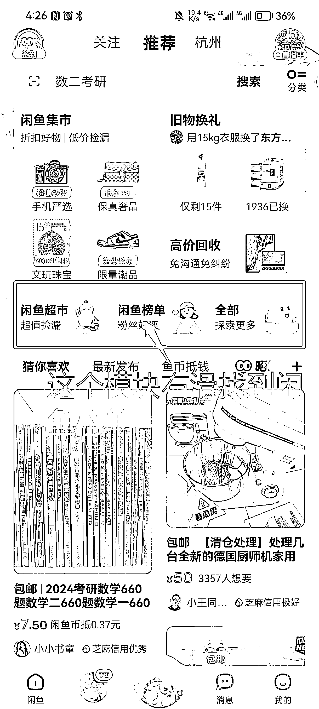
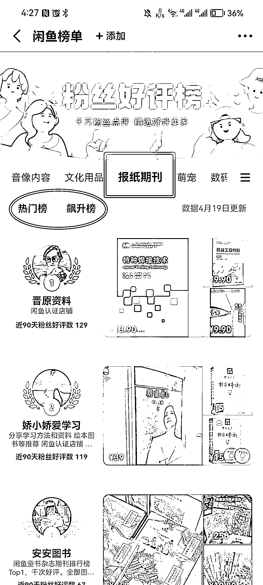

# 3.1.3 选品捷径：对标闲鱼热卖店铺 @一游 @老瞿 Qu

做闲鱼选品，未必要从零试错。更省力的做法，是先找到一个表现不错的同行，把它店铺里相关商品逐一拿来作为上架参照。这样做有两个直接好处：这些商品已经由同行替你先筛过一遍，同时也能降低触碰违规规则的概率。

具体操作可以按下面两步走：

1. 先找排行榜入口。打开闲鱼 APP，在首页的“二手车”板块继续向后滑动，就能看到「闲鱼榜单」。
2. 进入「闲鱼榜单」后，选择「报纸期刊」分类，再从排行榜中挑一个适合对标的店铺作为参考。

内容来源：《深耕行业 2 年后，分享咸鱼二手书无货源、绝版二手书等 5 种项目玩法》

