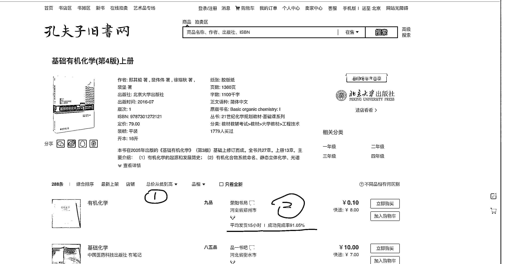
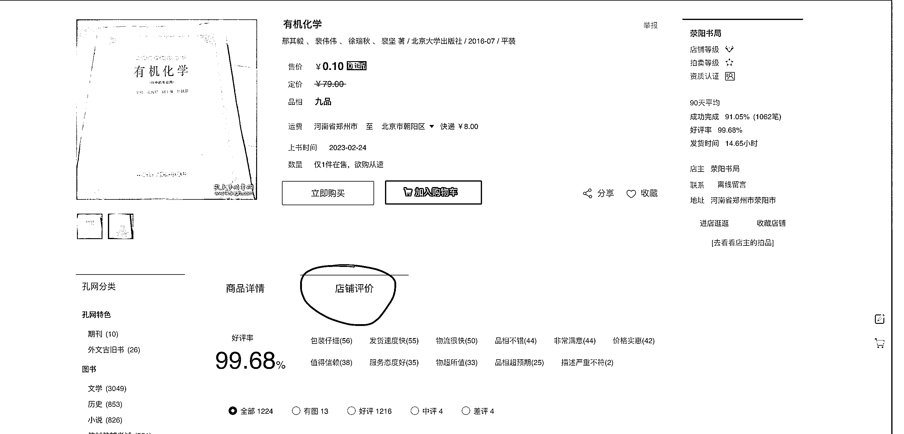
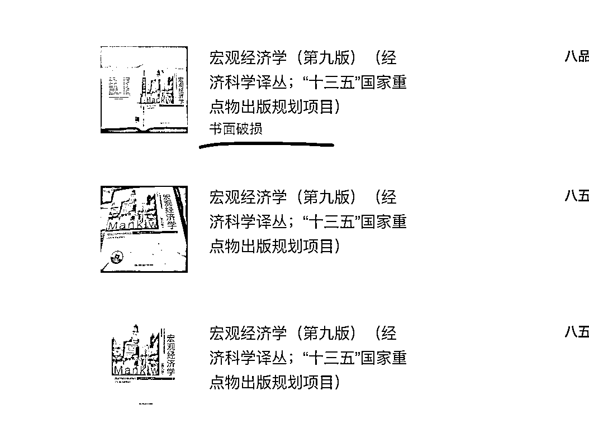

# 3.2 二手书货源怎么挑更稳？@老瞿 Qu

同一本二手书，摆在不同店铺里，品相常常差得不少。想把售后风险压下去，挑货源时就不能只盯着书价，还得会看店铺数据。下面拿孔夫子网做个示范，其他平台也能用类似指标来判断。

第一步，把搜索结果按售价从低到高排。接着重点看两件事：店家发货快不快、成功交易的比例高不高。发货用时越短越省心，成交完成率越高越可靠。

然后点开具体商品页，找到店内的评价板块。好评率自然是越高越放心，但别只看一个数字，最好再翻几条真实评价，帮助自己判断这家店靠不靠谱。

还要留个心眼：如果商家已经写明缺页之类的问题，那就等于承认商品有瑕疵，这种书不建议下单。

