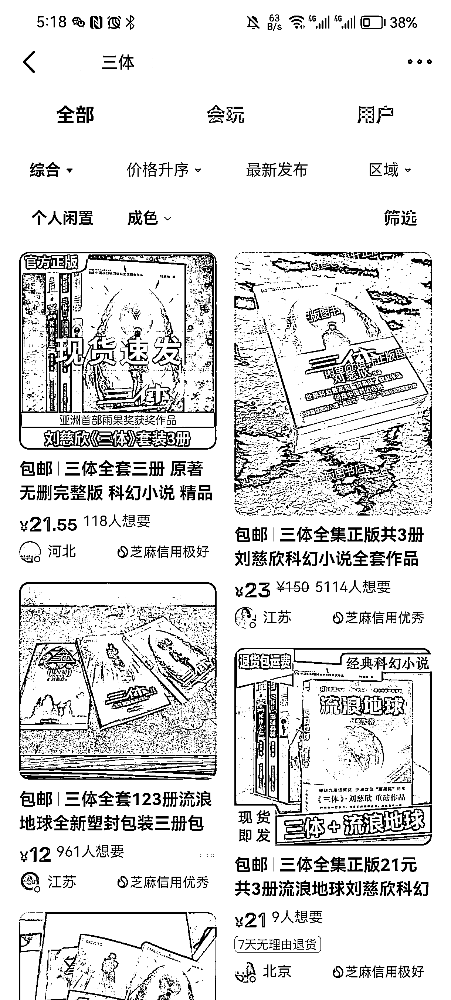

# 4.1.1 打造吸睛主图的秘诀

在闲鱼上，主图就是你的门面。一张优秀的主图，必须能在用户划过的瞬间就牢牢锁住他的视线。什么样的主图才算合格？画面要足够清爽，构图上不拖泥带水，最关键的是要让买家一眼就明白你在卖什么。

拿《三体》来说，那些收藏量和成交量都遥遥领先的链接，主图几乎都有一个共同特征：产品端端正正地放在画面中心，而且用的是实拍照片。

至于详情页里的其他配图，不用太过纠结，直接参考那些卖得好的同行，看看他们放了哪些图，照着类似的思路来就行。

另外，想要获取高质量的主图实拍图，去孔夫子网找现成的素材直接用也是很省事的办法。