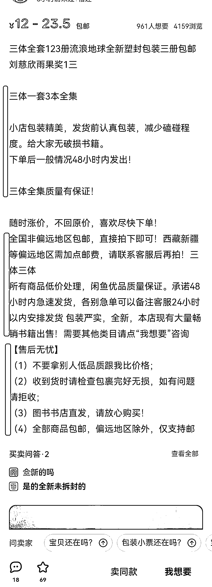
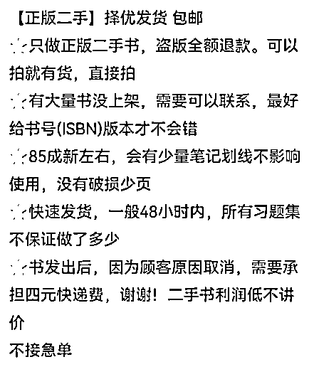

# 4.1.3 产品介绍怎么写？记住这个公式就行

图片部分，可以参考闲鱼市场动态里那些卖得好的同类商品图，这个不难。真正需要花心思的，是产品介绍的文字版本。

这里直接给出一套通用的产品介绍模板，照着写基本不会出错：

第一段，先说清楚你为什么出售这款产品，再把产品的主要特点带出来。  
第二段，把规格和售价写明白。  
第三段，交代发货时间、快递方式，以及售后怎么安排。

这样写下来，用户想知道的重点基本都覆盖了，自然就不用反复来问客服，我们的沟通成本也能省下不少。

另外，如果产品介绍能做到简洁明了，就像下面这张图一样，用户一眼就能找到自己关心的信息，做决定的效率也会更高，最终转化率自然就提上去了。

