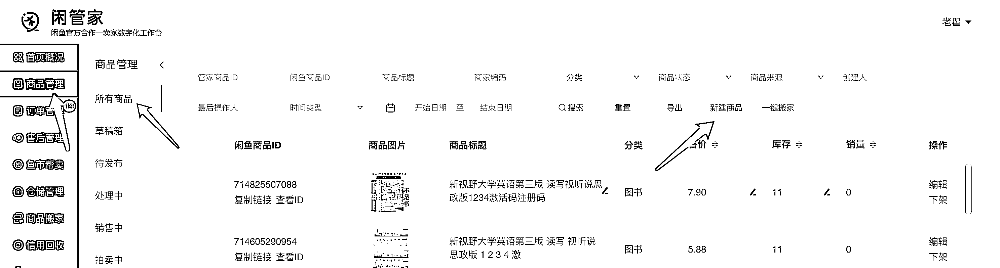
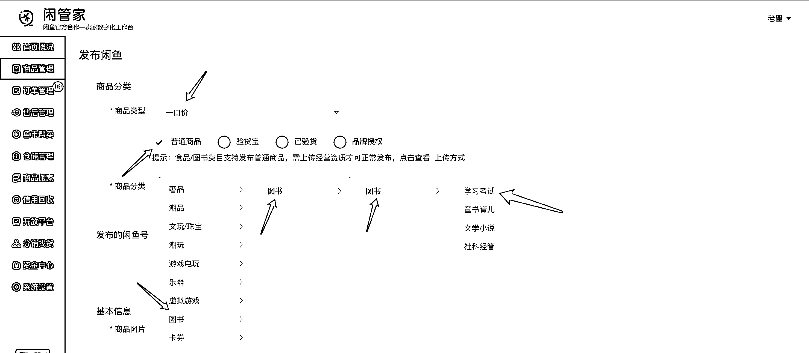
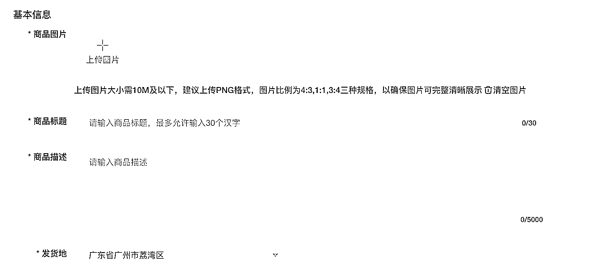
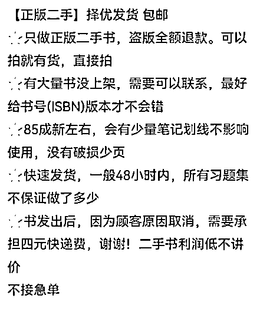
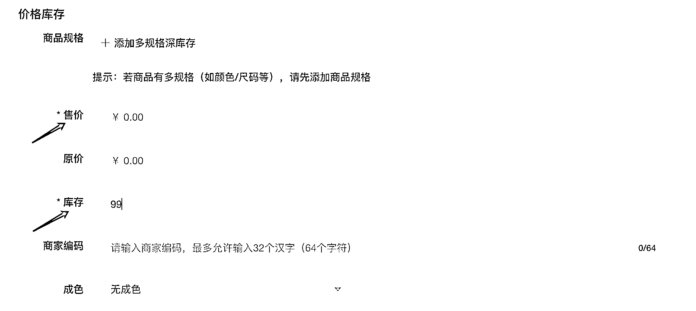
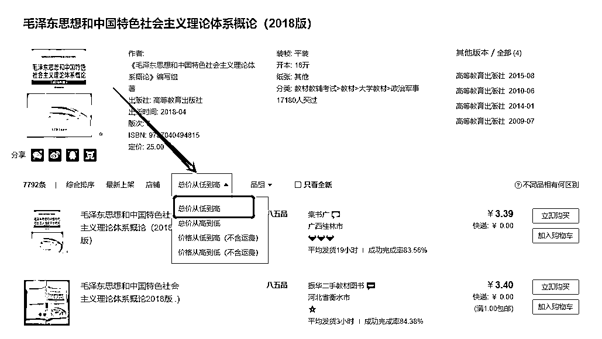
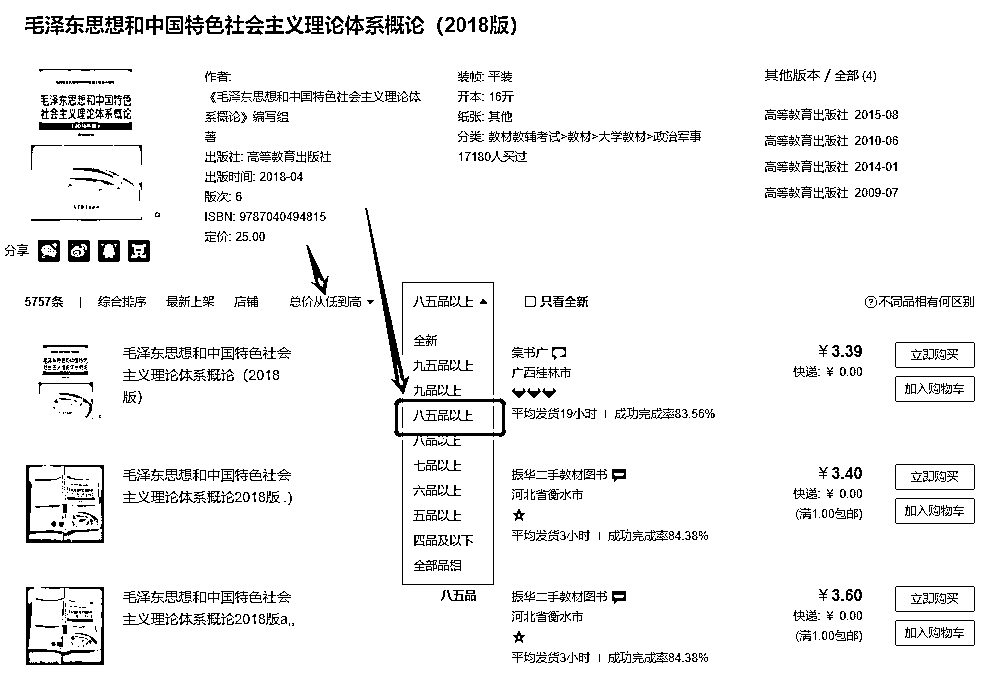
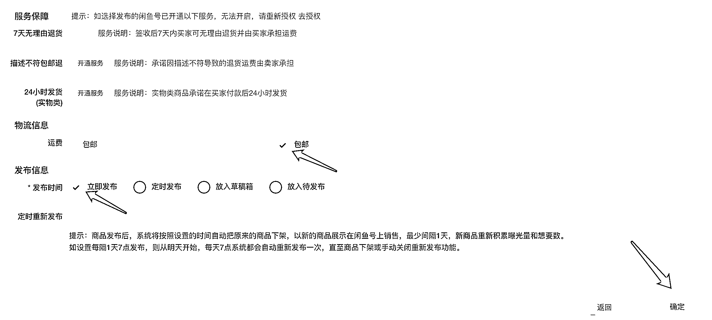

# 4.1.4 二手书挂闲鱼：电脑端上架实操 @老瞿 Qu

卖二手书时，建议把手机先放一边，优先开电脑。浏览器里打开官方商家后台“闲管家”，入口是：www.goofish.pro/product/all。移动端当然也能发，但每本书都得扫 ISBN，速度会慢不少。

定价要按阶段来：新店铺、新链接还没拿到曝光时，溢价先压在 10%—20%，用成交换数据；出单后再逐步上调。等自然流量稳住了，平时发布就参照孔网、淘宝同款价位，上浮 30%—50%。

开始操作：

① 登录后进入卖家后台，找到商品列表，创建一条新链接。

② 售卖方式选“一口价”；类目放在图书，如果卖教材，就归到学习考试。

③ 选定这次要用的发布账号。

④ 把商品基础资料补齐。

几个细节：
• 配图：孔网或淘宝上的无水印实拍图可以用。
• 标题：以“正版二手”或“二手正版”打头，再放作品名、写作者、出版机构，长度尽量填满。
• 描述：先看同行框架，一个账号固定一套模板，减少撞车感，再结合自己的货源改写。下图样式可参考，别原样照搬。

⑤ 在“价格库存”栏填售价、调数量。定价时，把孔网同行的书款加邮费作为基数，上浮四成，毛利通常能守住三成以上。

拿 2018 版《毛概》教材练手：在孔网把总价按升序排，品相不低于八五品，取同行标价后再加四成。

确认无误，按页面底部的发布按钮，再点确认，链接就挂出去了。

流程熟练后，六十分钟发二十条并不难。

资料出处：《深耕行业 2 年后，分享咸鱼二手书无货源、绝版二手书等 5 种项目玩法》