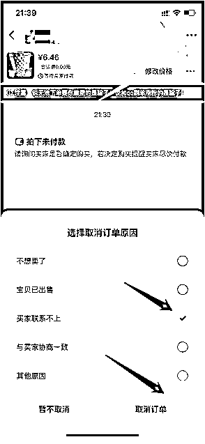

# 5.2.1.1 售前答疑这样回 @老瞿 Qu

欢迎语：亲，欢迎进店！本店主营各类正版图书，看中后直接拍下就行。

顾客：这书是全新的吗？是正版吗？
回复：书源来自学生回收，之后做过消毒和翻新处理，成色大约七至九成新。不会出现破损、显眼污渍，也不影响正常使用；个别书里会留有少量字迹，阅读不受影响。发货时我们会优先挑成色较好的寄出。

顾客：在吗？/你好/还有货吗？
回复：在的/您好/还有货。只要页面还能下单，就说明库存还在；拍下后最晚 x 小时内安排发出，喜欢的话直接拍即可。

顾客：多久能发？用什么快递？
回复：下午 x 点前下单，通常当天就能发出；承运方会根据仓库现有合作情况随机匹配，最晚也在 x 小时以内发出。

顾客：能拍张照片看看吗？
回复：抱歉，仓库距离较远，没办法每本都单独拍照；不过发货时会优先挑选品相较好的，请您放心购买。

顾客：有货吗？品相怎么样？
回复：只要还能拍下，就代表有货，成色为 7-9 成新。不会出现破损、显眼污渍或无法使用的问题，少量笔记不影响翻阅，发货会优先选成色好的。

另外，如果改价后客户一直迟迟不付款，可以点右上角“···”，选择“关闭订单”，再按页面下方提示完成关闭即可。

