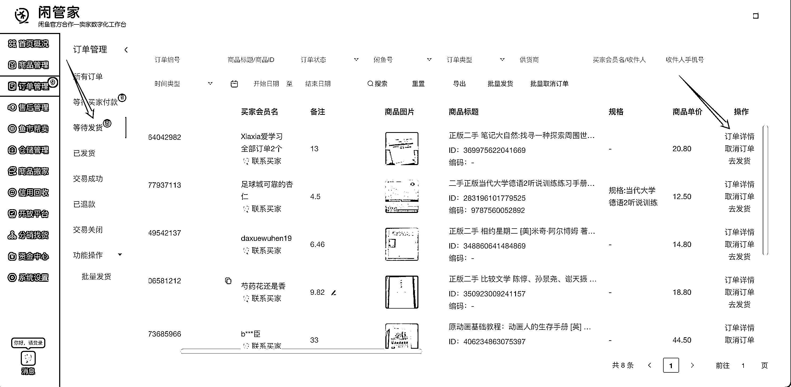
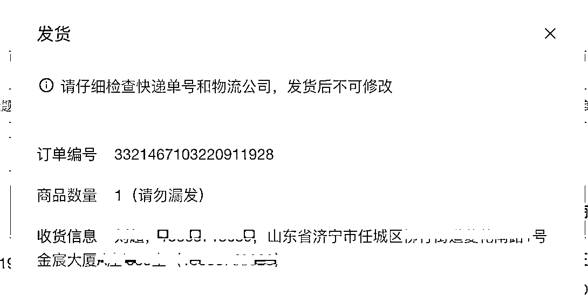

# 5.2.2 订单来了怎么发货？这套流程照做就行

闲鱼那边一旦有顾客拍下商品，接下来的动作就是去孔夫子或者淘宝找到对应的店家把货拍下来。等上家把包裹发出后，我们拿到快递单号，再回到闲鱼完成发货操作，整个闭环就完成了。

具体操作建议在电脑上打开网页版「闲管家」来处理。顾客下单之后，先进入“等待发货”列表，找到对应订单，点开订单详情查看收货信息。

把顾客的地址复制下来，接着去上家（也就是孔夫子网或淘宝上对应的店铺）拍单付款。上家发货之后，把快递单号复制过来，填回闲鱼发货即可。

内容来源：《深耕行业 2 年后，分享咸鱼二手书无货源、绝版二手书等 5 种项目玩法》、《加入生财有术一年，终于实现副业月入过万》

