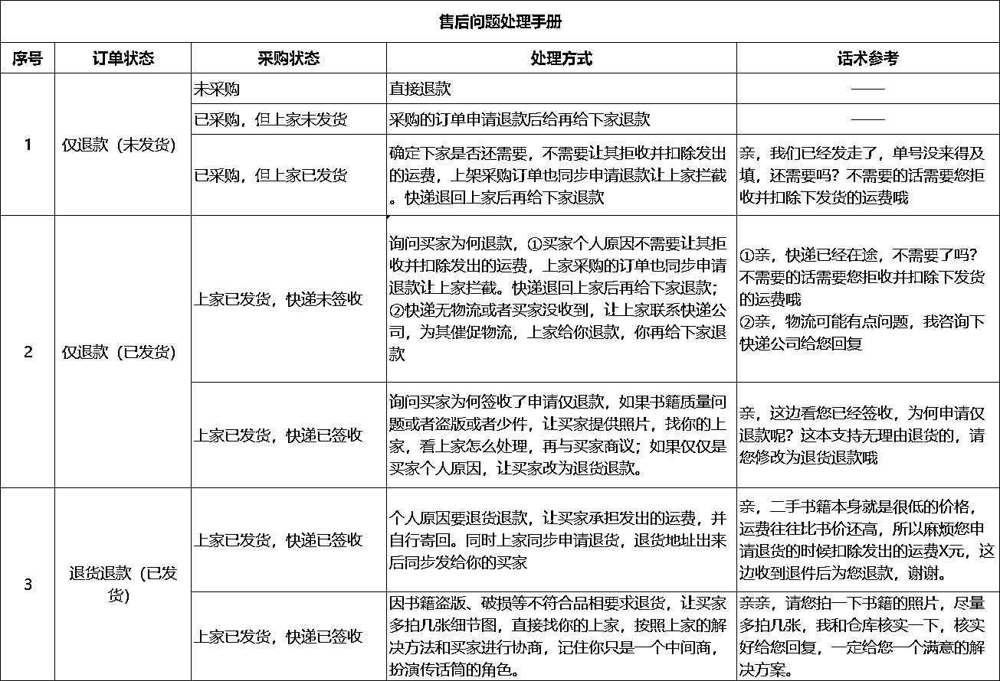

# 5.2.3 售后：守住中间人角色 @老瞿 Qu

处理售后时，先把身份想明白：我们扮演的是连接买家和商家的中间角色。遇到问题，不必在闲鱼上和买家来回拉扯。用户来反馈后，请他尽快拍一张照片，把快递盒上的面单和损坏产品放在同一画面里。这样既能确认这件货确实是我们卖出的，也能在后续找商家沟通时留下凭据。

拿到照片后，直接转给商家。商家给出处理方案，我们再同步给用户；用户有什么回复，继续转给商家。整个流程不复杂，按这个节奏走就行。

另外，在平台下单一般会附带运费险。闲鱼买家如果因为个人原因退货，产生的运费由买家自己承担；换个角度看，运费险最后反而成了我们的收益。若是质量问题，依旧按上面的办法把情况转给商家处理。

个人建议：能少折腾就少折腾。只要不超出利润空间，协商解决，甚至直接赔付，都可以考虑；把省下来的时间和精力投入到提高利润上更划算。

附：售后处理参考

