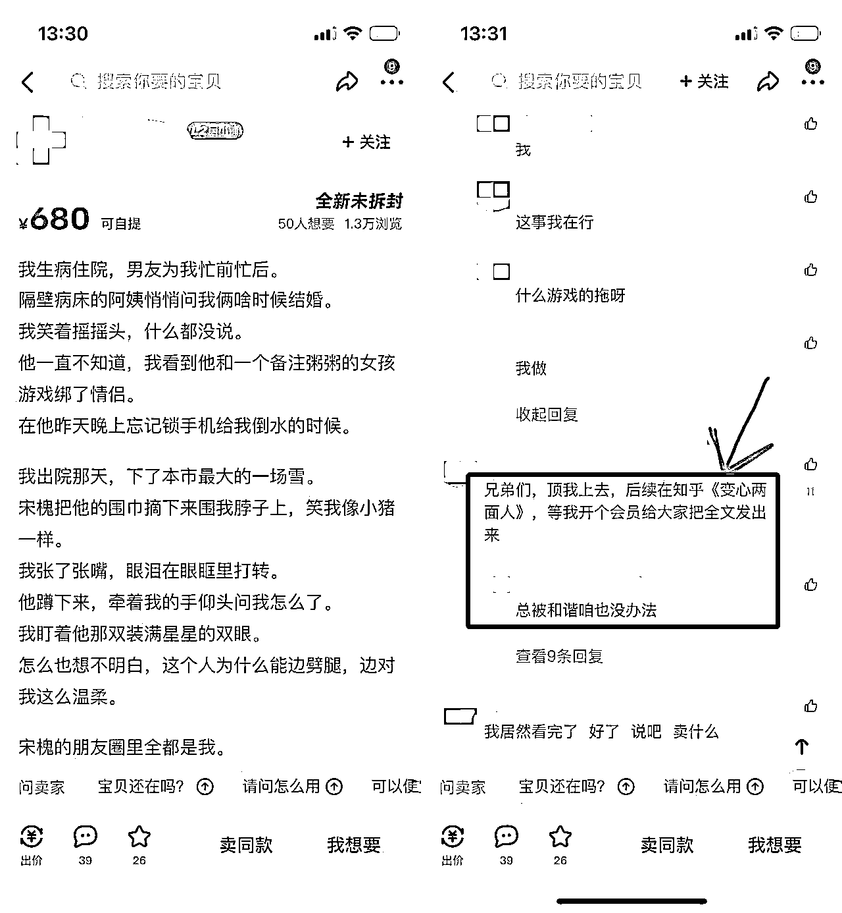

# 1.1 小说推文：低门槛的蓝海机会

刷短视频的时候，你是不是也刷到过这样的内容：画面是解压视频或者美食制作，看起来像普通营销号，但仔细一听，里面居然在讲故事？这就是当下很流行的一种玩法——小说推文视频。

所谓小说推文，简单来说，就是借助各类内容平台发布小说相关的视频，吸引用户去小说平台继续阅读。这个项目的最大特点就是门槛不高，对新人格外友好。

它不需要你掌握多复杂的技术，也不需要什么硬性技能。只要你能把视频发出去、把用户引导到阅读页面，就有机会获得收益。当然，想做好也需要耐心，持续优化视频内容，提升选文眼光，慢慢积累实战手感，最终都能看到效果。这是一个可以长期深耕的事情。

我们这次重点聊的是小红书和抖音两个平台。具体操作上，主要分视频推广和图文推广两条路，后面在「五、创作并发布图文」和「六、创作并发布视频」两章中会详细展开。

目前来看，小说推文在抖音已经步入相对稳定的阶段，而小红书才刚刚起步。小红书的月活跃用户已经超过两亿，其中七成左右是女性用户，这意味着一个尚未被充分开发的潜在市场。

与此同时，低门槛也意味着竞争者越来越多。再加上版权管控越来越严格，各平台最近掀起了大规模的封号潮——不只是推文账号，很多做「混剪」的内容号也受到波及。

封号确实是个麻烦，也是风险，但换个角度想，它也带来了新的机会。一批老号倒下，不少人因此选择放弃、转去做其他项目，可流量并没有消失，它依然在那里。所以最近一段时间，不少新号反而获得了比之前更好的流量表现。

这种情况下，我们更需要精细化运营，尽量做到人无我有、人有我优。

最后想说，别把自己困在固定套路里。小说推文这个项目非常灵活，还有很多蓝海流量等着被挖掘。理论上，只要能打字、能发布内容的地方，都可以尝试小说推文。

比如闲鱼上，有人挂出知乎文章的内容，然后在评论区引导关键词，也能实现转化。

部分内容来源：《知乎小说推文项目保姆级实战教程》《小说推文的玩法类型，以及我对三类玩家的建议》

