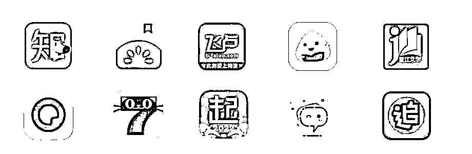

# 1.2 变现路径拆解 @seven

搞清楚小说推文到底怎么玩之后，下一个问题自然是：钱从哪儿来？

其实核心就两条路：一是让用户充值小说平台会员，二是让用户下载小说平台App。说白了，都是把公域流量导向小说平台，靠平台给的分佣赚钱。

1）路径一：给平台拉新

小说平台要成长，最缺的就是用户。这个环节一般按CPA结算，也就是按拉新人数给钱。拿番茄小说来说，用户只要下载App，不需要充一分钱，我们就能拿到返佣。

好在哪：门槛低，用户没心理负担，下载意愿强；
坑在哪：等平台用户量够了，任务可能会下架。不过这事儿目前不用担心，一个平台停了，总有新平台接着拉。

2）路径二：帮平台卖会员

这个走的是CPS路线，用户付费我们才有佣金。拿知乎举例，用户得下载App并充值会员，我们才能赚到推广分成。这样一来，选小说就得更有眼光，引导文案也得下功夫。

好在哪：模式持久，会员到期后用户回到流量池，依然是我们的潜在客户；
坑在哪：现阶段难度偏高，用户被各种平台教育过很多轮，且付费门槛确实存在。

说到底，两种模式没有绝对的好坏，适合自己的就是最好的。自媒体平台上对标账号一抓一大把，操作门槛真心不高。关键就一句话：认真做内容，敢下场试错，持续做优化。

具体的内容形态和操作细节，后面实操篇再展开聊。

内容来源：《起底小说推文整体逻辑，一个月实操分享》

