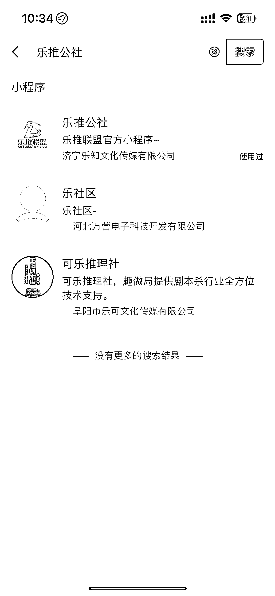
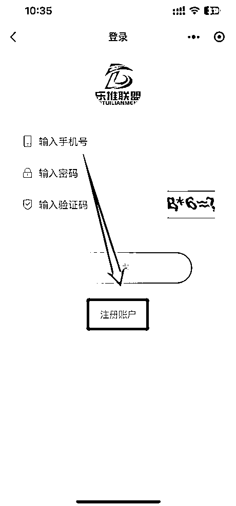
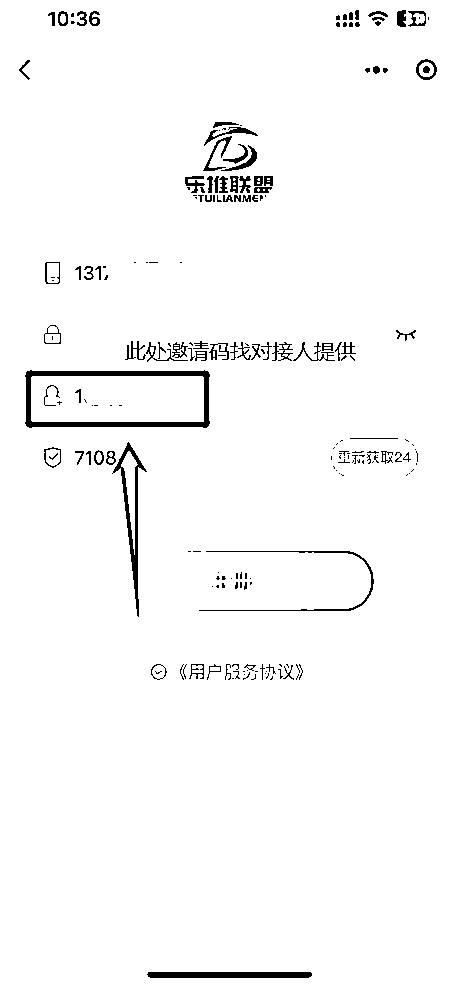
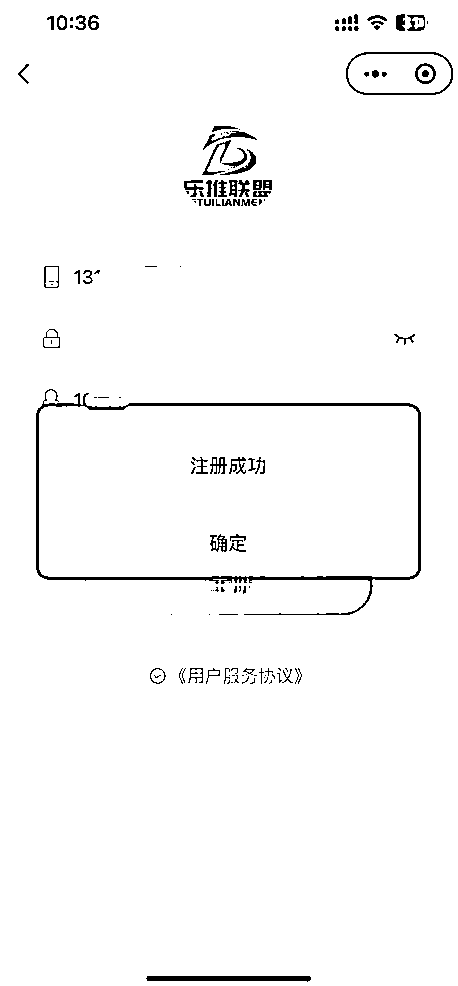

# 第一步：先注册账号

使用乐推公社之前，先要把账号开好。注册通道有两种：手机端在微信中查找名为「乐推公社」的小程序；电脑端则在浏览器里访问 `iletui.cn/system/user`。注册时使用的邀请码是：10090。

下面以手机端为例，完整走一遍流程：在微信里检索「乐推公社」，打开对应小程序，点底部的“注册账户”按钮，把对接人给你的邀请码填入，点注册就能完成开通。

这里要提醒一下：小程序承担的是注册和日常数据查看；关键词申请、作品回传这类事项，则需要转到后台处理。