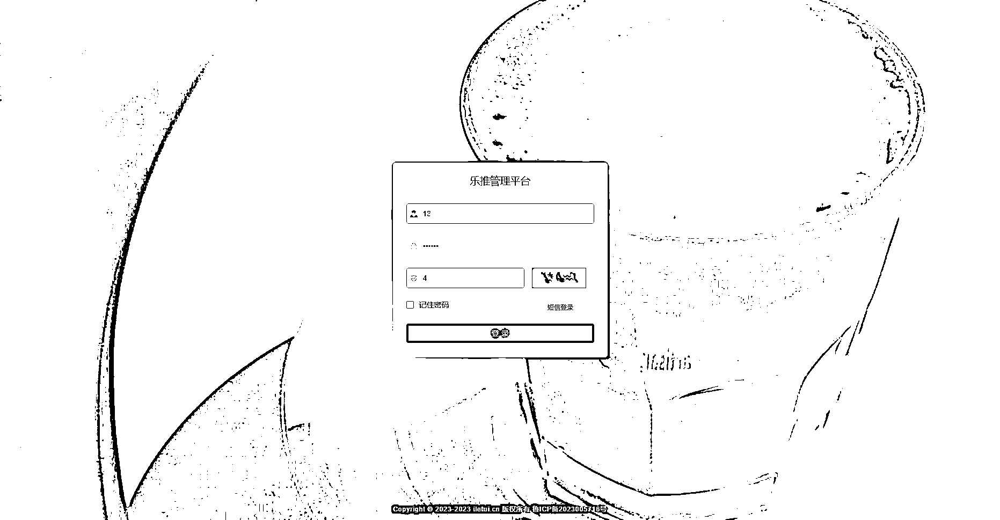
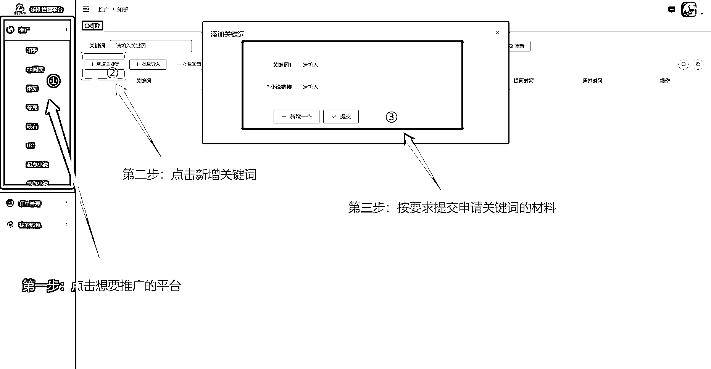
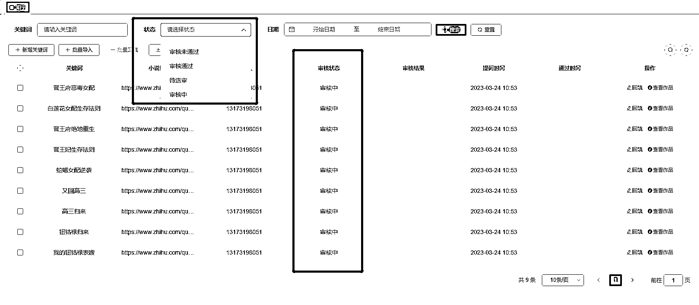
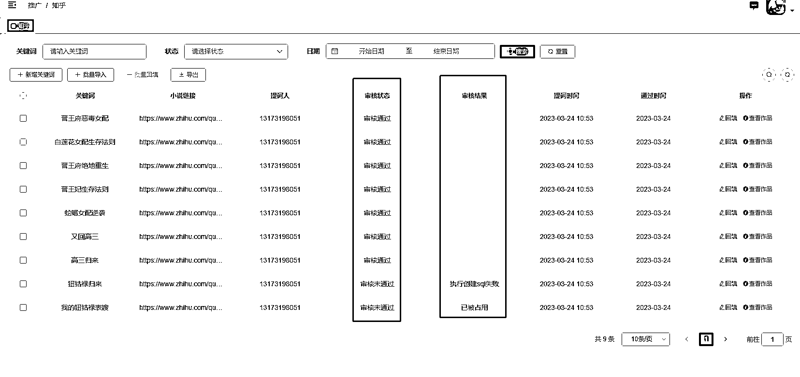
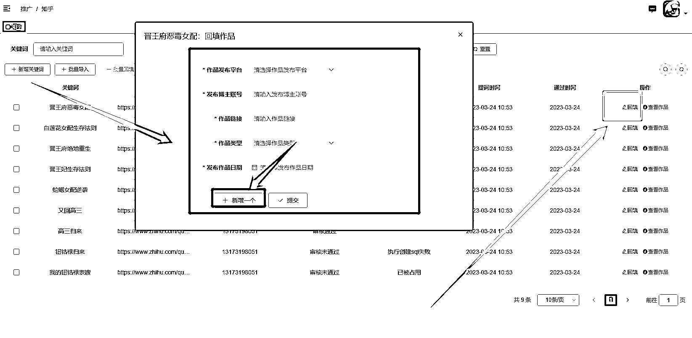
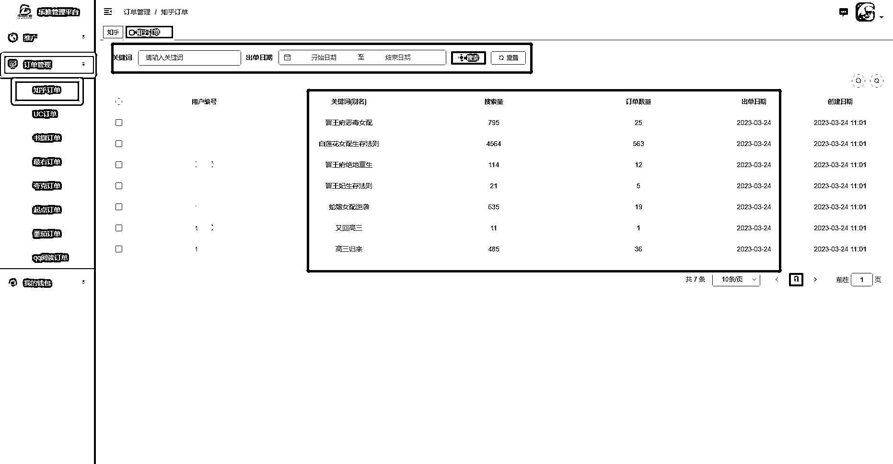
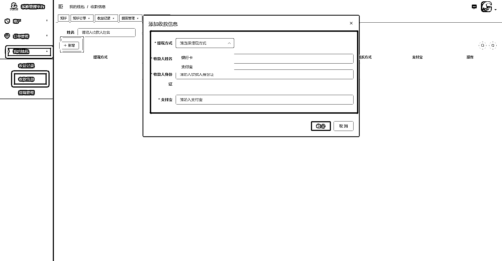
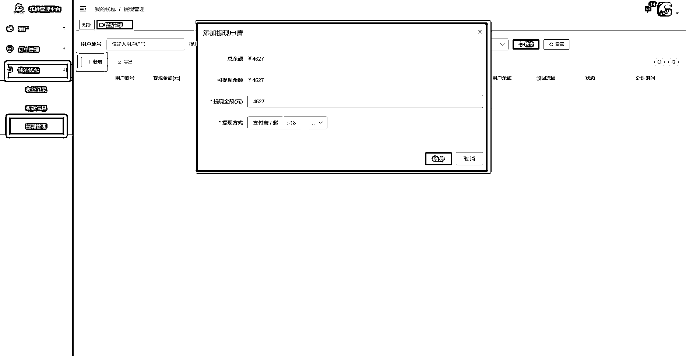

# 第二步：登录后台，四步上手

小程序注册完成后，接下来就进入后台实操。入口先收好：[`iletui.cn/system/user`](https://iletui.cn/system/user)，用刚注册的账号和密码登录即可。

## 1. 关键词申请：三步完成

关键词申请可以拆成三个动作，跟着页面提示走就行：

提交之后，页面会即时刷新关键词的处理状态，申请结果可对照下方截图：

## 2. 回传信息怎么填

在对应关键词后面找到“回填”按钮，按提示填写回传内容。如果同一个关键词对应多个作品，或同一条作品要分发到多个平台，点“新增一个”继续补充即可。

## 3. 订单记录怎么查

进入“订单管理”，再点“平台订单”，该小说平台的全部订单都能在这里看到。单量较多时，用页面上方的“关键词”或“出单日期”筛选，查找会更快。

## 4. 余额提现怎么操作

先把收款方式绑定好：进入“我的钱包”，找到“收款信息”，点“新增”，选择“提现方式”，按提示绑定支付宝或银行卡。

绑定完成后，回到“我的钱包”，进入“提现管理”，点“新增”，输入提现金额，选择提现方式，最后点确定。

这里提醒两点：余额提现不扣手续费，但需要签署“灵活就业协议”。这份协议是平台方乐推联盟与劳动者之间的合作协议，主要约定平台业务类型；劳动者可自主决定是否接受业务并向第三方提供服务，平台不承担社保责任。对个人基本没有影响，可以类比抖音带货赚佣金——佣金提现时同样要通过云账户签灵活就业协议。大家不用提前准备什么，提现过程中系统会自然引导操作。提交后一般 1—2 个工作日到账，节假日可能不定期顺延，届时以公告通知为准。