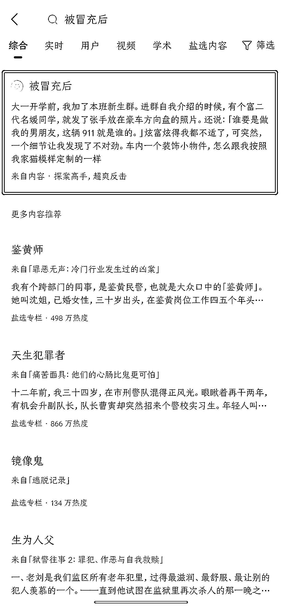
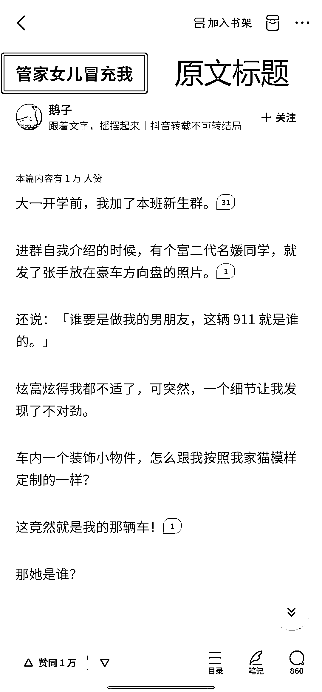

# 第二步：关键词提交后，别忘查审核

提交关键词时，请按「2.3 平台使用流程」操作：把相关信息填写完整并提交。提交之后，会有专人判断该关键词能否通过审核，审核结果可以在后台查看。

这里要特别提醒：申请完千万别忘了确认审核状态。要是没通过却没发现，前面的功夫很可能就白费了。

**关键词需满足这些条件：**

1. 长度为 4—10 个字；
2. 不能包含标点等特殊符号，也不能是纯数字；
3. 不可与原书名、章节名相同，也不能直接把原书名或章节名改一改就拿去用。

提交时，可以顺带申请意思相近的关键词，例如“无情公主”“无情的公主”。至于更详细的组词方法，后文会讲到，也可以参考「4.2 获取关键词」。

**关键词提审时间：**

周一至周日均可提交，时间点为 10:00、11:00、14:00、15:00、16:00，周末照常审核。

**关键词审核时长：**

每个提审时间点开始后，10 分钟内完成审核。

**关键词有效期：**

通过后可使用 180 天，一旦超过期限就不能再用。

**关键词查重：**

申请之前，先到知乎搜索一下，确认是否已经有人提交过同一个关键词。若能搜到相关结果，就应更换关键词，避免重复申请。如果该词已被申请，页面会直接跳出对应的小说页面，如下图所示：

