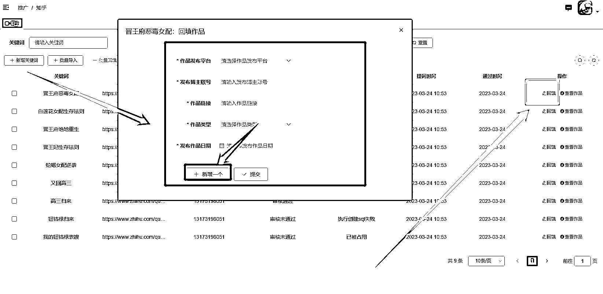

# 第四步：链接回传别漏

作品发布完，还有一步不能忘：把视频链接按对应关键词填好并回传。

• 回传操作：找到对应关键词，点后面的“回填”入口，把链接填进去提交。若同一关键词发了多条作品，或同一条作品发到了多个平台，可以点【新增一个】继续添加。

• 提交时限：第二天8:00前完成前一天的回传；只要发过作品，链接都要上传，平台不限。

作品发布后务必尽快回传。官方平台要靠这些链接把订单来源录入系统；不传链接，系统就追溯不到订单出处，哪怕有成交也没法结算。这也是平台防作弊的要求。

没回传链接，服务商同样没法给你结算，因为官方没把款结给服务商。

记住：同一个关键词下，无论发了多少条作品、覆盖多少个平台，每条作品的链接都得逐一回传。