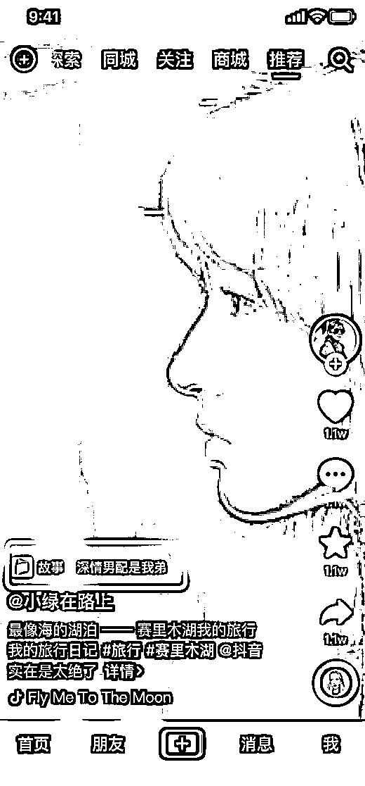
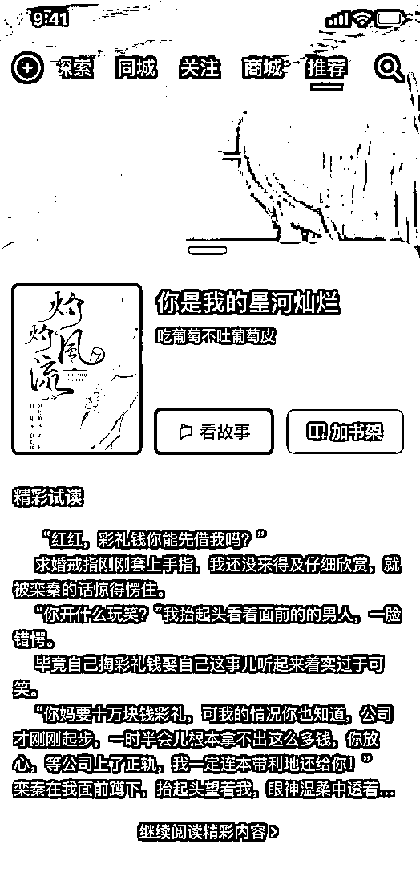
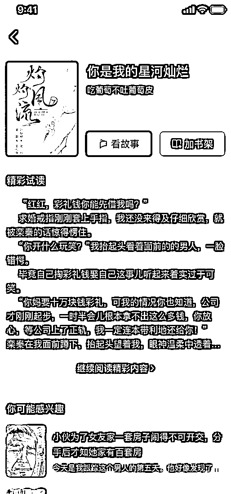
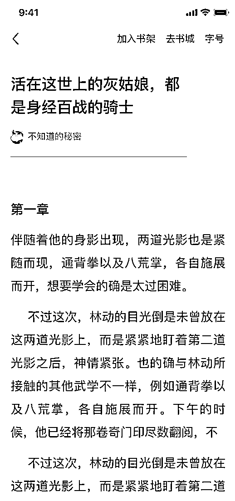
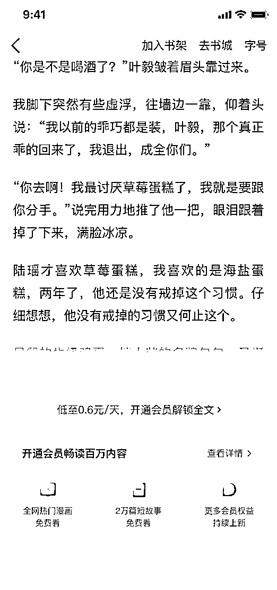

# 2.7.1 用户如何完成付费

先别急，我们直接用几张示意图来还原整个付费链路：

这组图其实很好懂，我帮你拆开来看：

第一张图，视频页面上会有一个“故事”入口，目的是吸引用户点一下；第二张图，点进去之后，用户就跳转到了小说阅读界面；第三张图，继续往下翻，会进入完整的小说详情页；第四张图，再点“阅读”，就能看到正文内容，正式开读；第五张图，读到关键处就“卡住”了，这时候系统会提示用户付费解锁。

这样理一遍就会发现，这条路子和前面几种推广玩法本质上没啥区别：都是先把人引到小说页面，再顺势引导开通会员，最终完成付费转化。

所以，我们真正要做的其实很简单——在视频里埋好锚点，让用户愿意点进来。具体操作往下看。