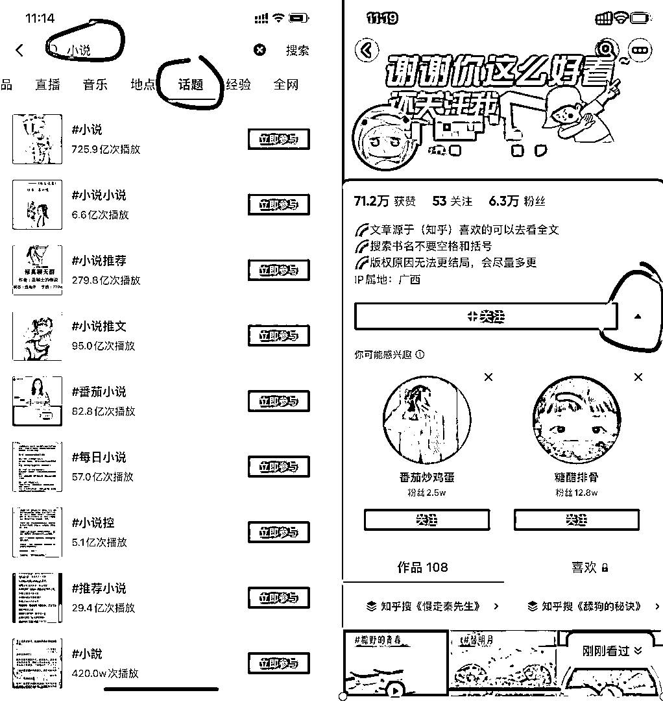
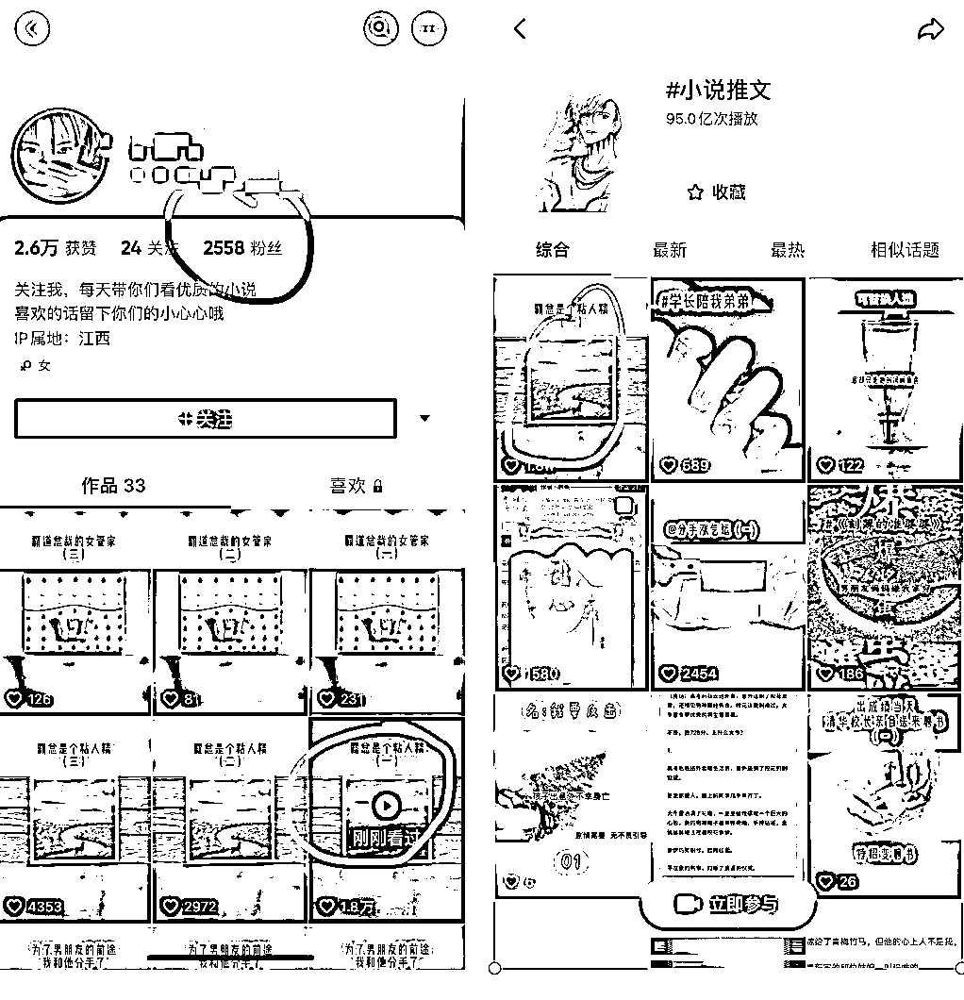

### 3.2.2.2 找对标签，小说推文账号越推越多

想快速锁定同类账号，直接在平台里搜“番茄小说”“女频”这类词就行。在相关话题下找到那些账号，点进主页顺手关注，然后点一下“▽”的推荐按钮，平台就会顺着这个账号的类别，给你推荐一堆同类型的新号，效率很高。

顺带科普一下，女频指的就是女生频道，内容大致分成古代言情（古言）和现代言情（现言）两大块，读者基本以女性用户为主。

另外，这个方法不只是用来找账号，最近那些数据不错的爆款视频，也能靠它挖出来。

内容出处：《起底小说推文整体逻辑，一个月实操分享》

