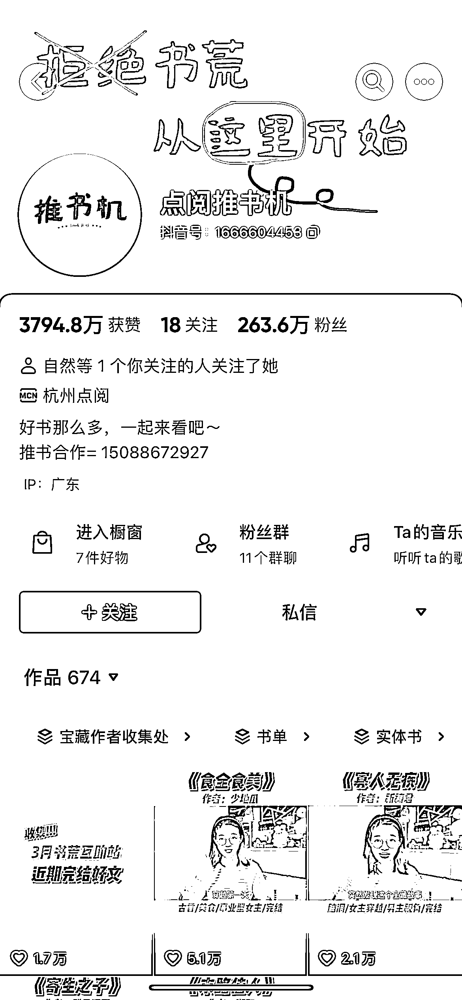
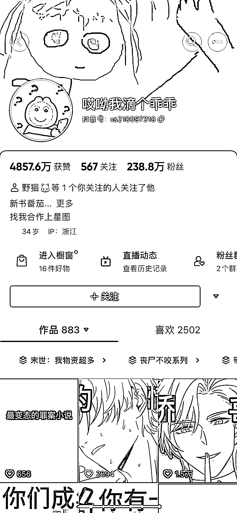
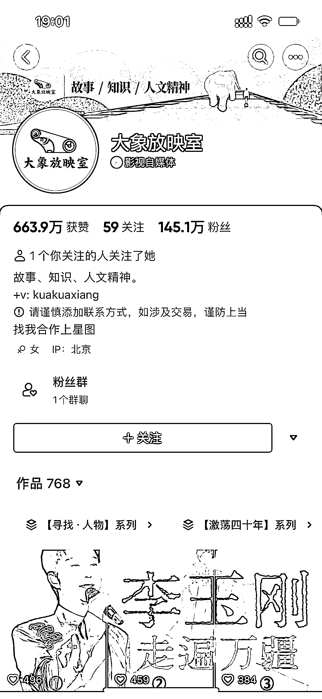

# 3.2.3.1 主页包装：让路人一眼记住你

账号包装，说白了就是把抖音个人主页做得更耐看、更统一。昵称、头像、简介、抖音号、主页头图，都是包装的一部分。把这些细节收拾好，路人点进主页的第一印象会更舒服，也更容易一眼明白你是做什么的，从而更愿意点下关注。

1）头像怎么选
真人照可以，虚拟形象也行。关键是它决定别人对你的第一观感，挑一张最能突出你个人特点的就好。

2）昵称怎么起
昵称要顺口，粉丝才容易记住。起名时抓住三点：独特好记、贴合账号定位、能体现你提供的价值。

3）简介怎么写
简介在主页占的地方不小，写好了收益很多。建议注意：用一句通俗完整的话说清定位；定位要有差异，别和别人撞；以后就算调整简介，那句核心定位也别轻易动。

例如：
• 天天分享好看的小说，搞笑段子也不断。
• 会画漫画、能写小说，剪起视频来也不含糊。
• 十年书龄，偏爱 BE 美学，也爱嗑糖。
• 十年老书虫，主要看推理悬疑（番茄），我先替大家探路，你们放心跟。

4）头图怎么放
头图就是主页最上方那张背景图。记得选清晰的高清大图，别发糊；画面要体现你的个人风格；还可以把昵称、口头禅或简介里的话放上去。

