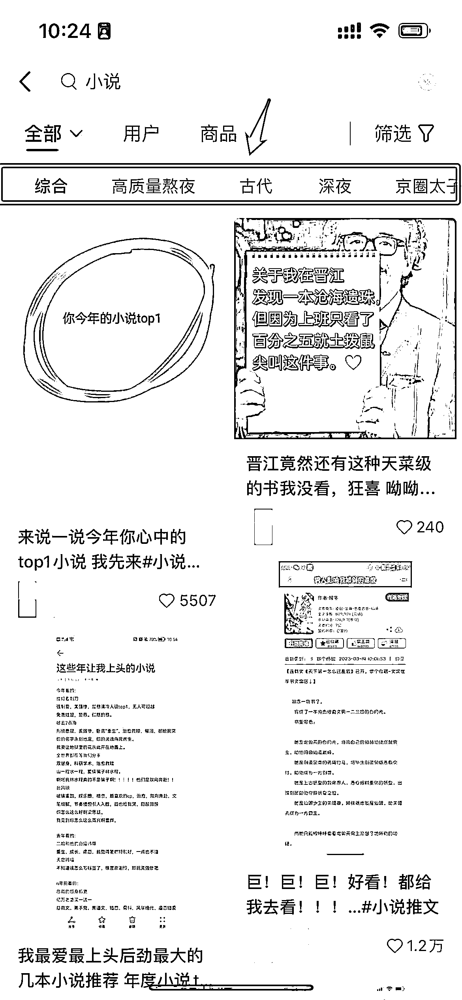
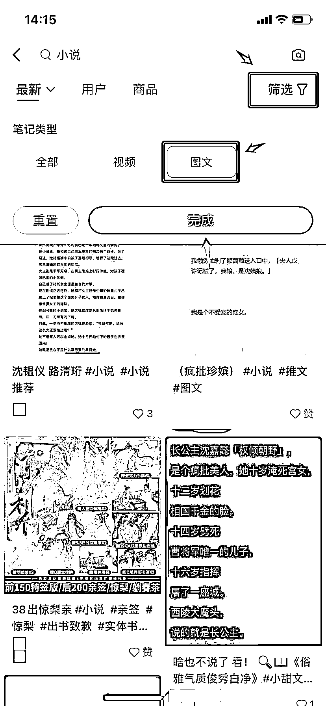
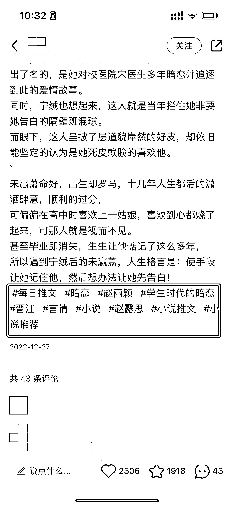
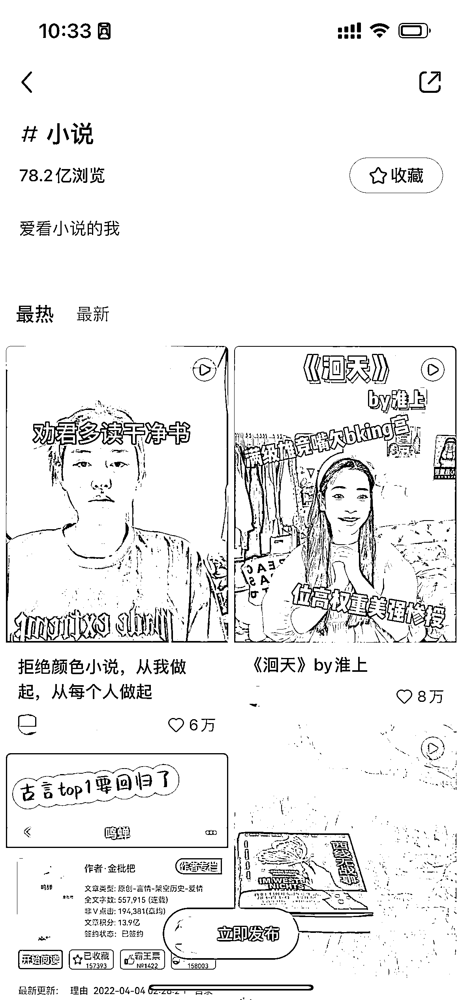

# 3.3.2 对标账号怎么找？@seven

📕和抖音找对标账号的思路其实一脉相承：从小说相关标签入手搜索。打开搜索框输入“小说”这类词，会跳出一批相关笔记；若想更细分，可以点顶部分类栏再做过滤。

在📕，图文内容的流量表现通常更占优势。所以挑对标账号时，把筛选条件切到“图文”，再按“最新”排序，通常就能刷到一批做推文账号。

接着，随便点进一篇笔记，找到笔记下方的标签并点开。每个标签背后都藏着不少同类图文；照这个动作反复操作，就能积累出大量对标账号：

