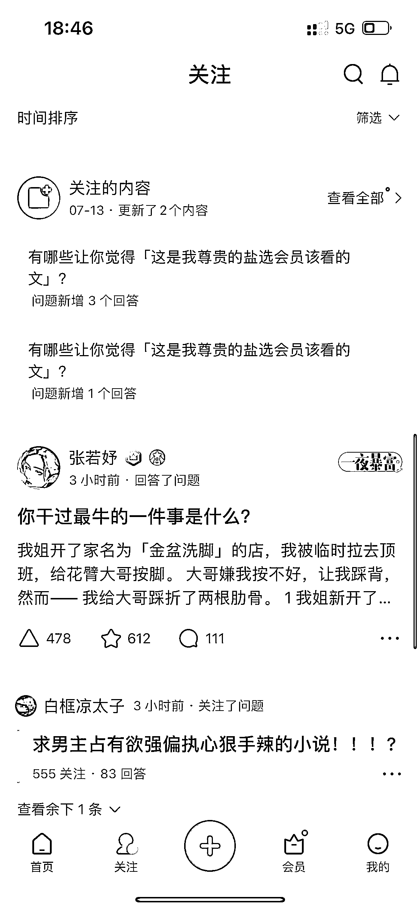
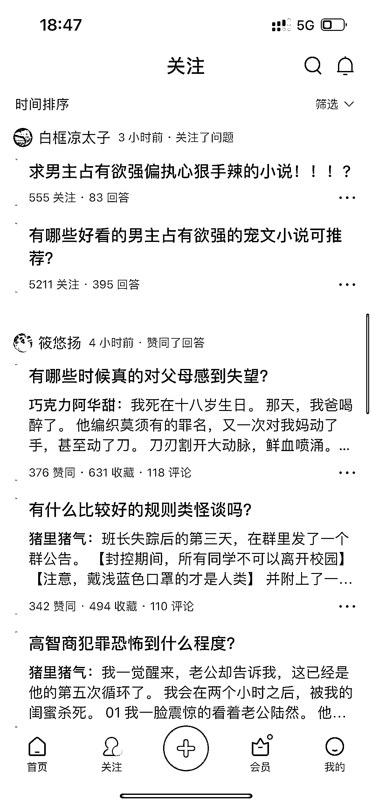
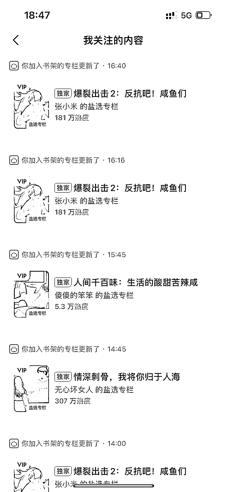

# 方法一：盯作者，挑好文

平台上的小说多到刷不完，靠工具批量抓取也未必能一网打尽；一个问题下面动不动上千条回答，更新很勤，质量却高低不一。但有个底层逻辑始终没变：每一篇内容背后，都站着写它的人。

所以，把作者锁定住，就等于握住了一条稳定稿源。与其一遍遍刷新问题等新回答，不如把注意力从“问题”转到“答题的人”身上——持续产出内容的那一端，终究是作者。

优质作者往往意味着更可靠的文章来源。以知乎为例，巧克力阿华甜、白框凉太子、张若妤等，都是粉丝几十万甚至上百万的专业创作者，对热点走向和创作套路的理解远胜普通用户。与其在海量回答里淘金，不如直接跟住这些人。

把8到10位与账号定位对得上的优质作者列入关注名单。在知乎“动态”里，可以看到他们每天点赞的文章、关注的问题、发布的回答，以及他们关注的作者；顺着这条线逐个摸下去，稿源基本不会断，接下来要做的只是筛选内容。

把优质作者和专栏关注到位后，每天固定几个时段去“收菜”即可：既能第一时间看到他们的新动态、争取文章首发，也能留意盐选专栏变化，提前卡住关键词，抢得先机。

还要留意：知乎小说通常以问答和专栏两种形态出现。不管页面是哪种形式，动手复制链接之前，都先确认它是不是会员文。点开正文滑到末尾，一旦出现付费提示，就说明这是会员文，可以拿来做推广。