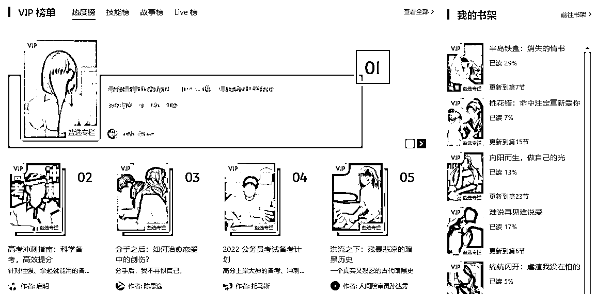

# 方法二：在专栏里挑出爆款

好内容的源头是作者，而盐选专栏则把高质量作品按主题或作者聚拢起来，相当于平台编辑先替我们做了一轮初筛。

每个专栏都有明确的定位。以《从校服到婚纱，少女暗恋成真》为例，光看名字就能判断，里面大多是青春校园故事，结局偏向 HE。想找 18—23 岁女性爱看的校园题材，这个专栏就很对路：[《从校服到婚纱，少女暗恋成真》](https://www.zhihu.com/xen/market/remix/paid_column/1487036003281625088)

再比如 10、11 月新号很值得用的《爽文女主她杀疯了》。其中部分作品上线当日就有机会成为热门爆款；哪怕隔一周左右再推，市场反馈依然不错：[《爽文女主她杀疯了》](https://www.zhihu.com/xen/market/remix/paid_column/1572960807180226560)

爽文满足的是读者平日里不敢开口、不敢尝试的那股劲，图的就是一个“爽”字。内容从校园打脸到“反杀”亲戚都有，覆盖面很宽。尤其先隐忍后爆发、扮猪吃虎的桥段，读者百看不腻，大家爱看的就是憋屈之后的痛快反击。

归结起来，按专栏选文对账号做“垂直”很有帮助。高产作者往往不会把自己困在单一题材里，账号也不可能只依赖一位作者；但完全可以盯住一个合适的专栏持续深挖。

因此，专栏选文能补上作者选文的缺口：先发现某位作者的一篇好作品，再找到它所在的盐选专栏，接着从专栏中挑选题材相近的高质量内容。