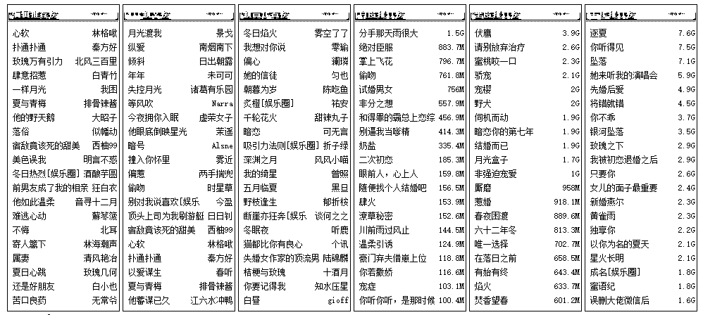
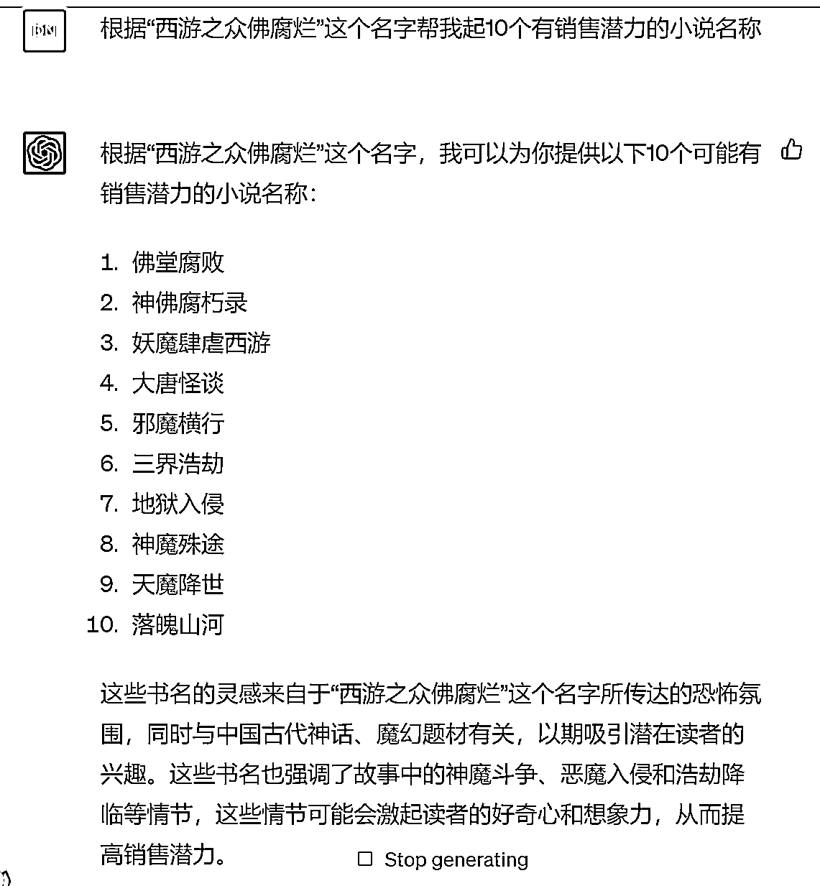
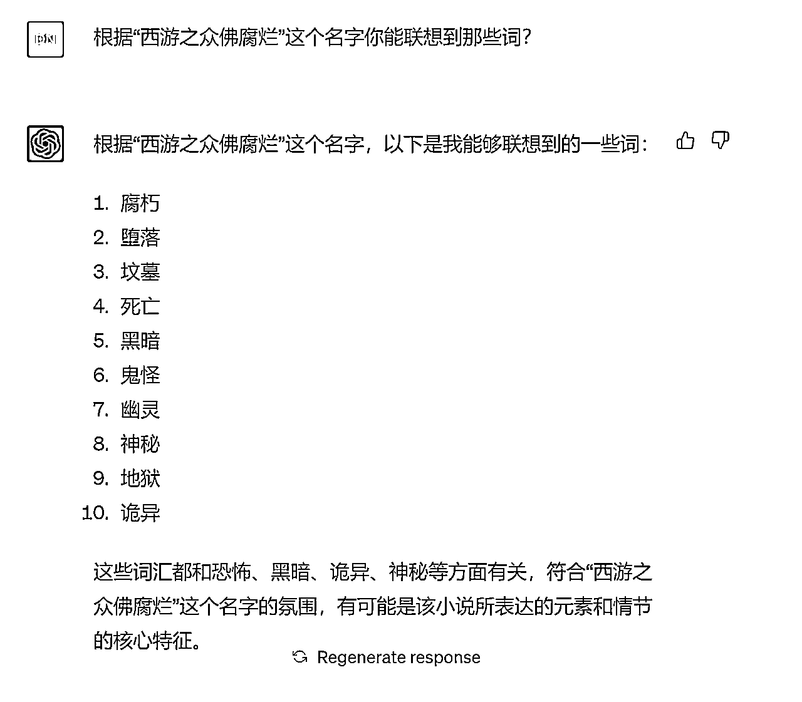
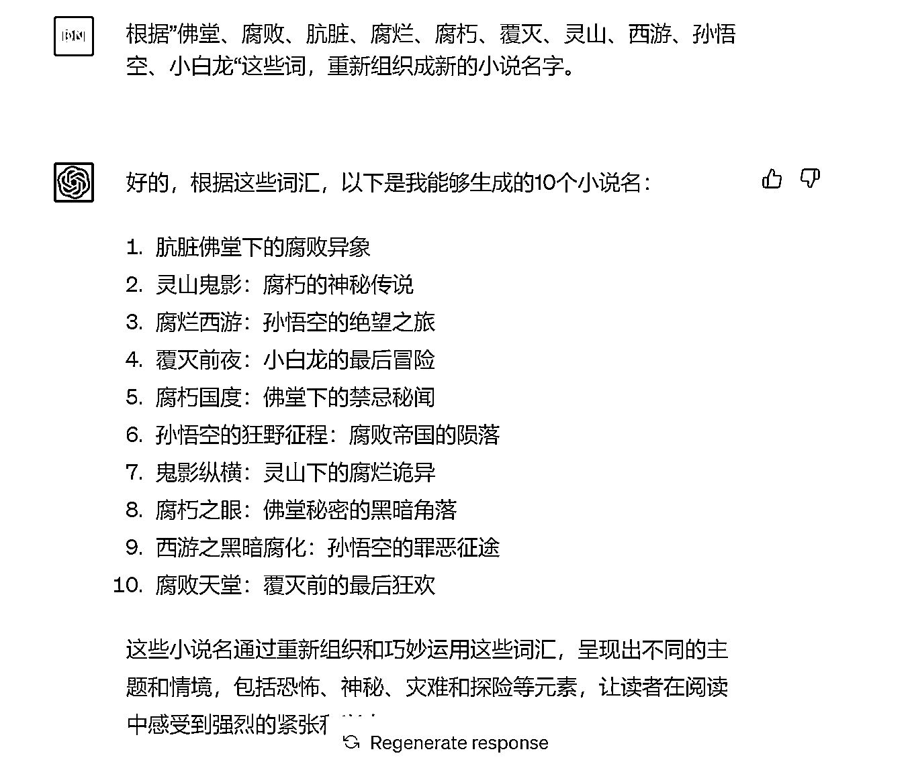

# 4.2 名字要顺口，搜书不费劲 @鲸鱼 @某人周 @王大诗

对配音类账号而言，检索词就是内容的“第一眼名片”。它一般摆在画面上沿或下沿的显眼处，也可以在发布时做成封面大字，让用户进入主页后立刻抓住重点。

1）用词浅白，别让用户多敲键盘

命名时避开绕口拼音、难认字，也别选那种要反复切换输入法才能打出的字。大家填检索词是为了找到小说，从短视频平台切去别的应用已经多了一步，词越省事越友好。

像“宸宸星愁”“氤氲难眠”“流萤渐沉”这一类，文艺感很强，却更适合作者给作品取名。真要拿来做搜索入口，用户得先记住再去别处敲出来，所以越短、越常见、越容易一眼记牢越合适。

如果卡住了，不妨逛一圈晋江文学城，观察专业作者如何命名；也可以从现成书名里捡几个好记的词进行拼接，挑顺手的用即可。

2）让词和剧情发生关系

理想的检索词能点出或暗示故事主线，例如“分手”“千金”；也可以把关键物件放进去，比如“信封”“房本”“首饰”。

以高考后常见的“重回高中”爽文为例：
主角再活一次考出好成绩，可从“高分”“状元”“榜首”这些方向造词；若重点在反击轻视自己的人，“打脸”“反杀”“翻盘”就很贴切；若感情线更重，则可用“旧情”“前任”“复合”来组合。

再往深处走，还能拿三个字提炼穿越剧情：
穿回去与渣男断交，可用“要分开”“别和好”“断缘分”；靠生意和股票翻身，可用“当富商”“不缺钱”“做股神”；想摆脱原生家庭泥潭，可用“不返家”“早抽身”“不认账”。

汉语的组合空间极大，同一个故事能变出许多叫法。平时多拆词、多观察同行的命名，灵感会慢慢积累。也可以先锁定一个前接词（如“高中”“重生”“眼泪”）或尾接词，再围绕它找搭配，既省思考时间，也能让一批标题看齐。

3）绕开人名、地名、职务等红线词

有些称谓、符号和暗指不能写进标题，这是底线。公众人物姓名、明星名、具体地区、公职人员岗位等，都属于需要躲开的范围。

4）借 ChatGPT 帮你出检索词

阶段一：把选中的小说完整读一遍

这里拿知乎故事《西游之众佛腐烂》做示范，点蓝字可进入原文。

阶段二：让 ChatGPT 产出候选词

1. 直接从原名派生

把生成结果拿去提交检索词申请即可。

可这样说：围绕「小说原名」这个书名，帮我拟「数量 X」个带「形容词」的名称。

这里的「形容词」通常对应作品类型词，例如穿越、系统、种田、爽文、克苏鲁。

2. 由原名做发散联想

将联想到的词语替换进原名，再提交审核。

可这样说：看到「小说原名」这个书名，你会想到哪些词？

比如以“西游之众佛”为底，加上「替换词」，能组合出西游之众佛腐朽、西游之众佛堕落等书名。

3. 先提炼词，再重新拼装

前几步会攒下不少候选词。结合你对剧情的理解，把自带“开局即爆点”效果的词重新组装。

可这样说：请用「n 个关键词」这些词，重新组织成新的小说名字。

这样拼下来，可得到类似《孙悟空的绝望之旅》的新书名。

4. 顺着灵感继续造新词

如果你常看这类作品，走完上面的流程后，多半会冒出更贴合的点子。

比如把“养殖场”放进西游设定，或写成“西游之人肉电池”；也有把“众佛团灭”和“养殖场”糅在一起的名字。其中，养殖场相关叫法由情节联想而来；“人肉电池”借了克苏鲁风格的氛围；“众佛团灭”则取自网络热词的语感。

小经验

• 送审：不必先到知乎确认词有没有被占用，直接针对一本书把标题一次列全。该平台合集通常 50-90 集，一个故事大约一分钟能起五个名字。
• 标题：多去不同平台搜罗命名套路，比如“从 XX 开始变强”“我穿成了 XX”“开局激活 XX”，看得多就有手感。
• 操作：在电脑端把相关页面全部展开，复制类工具提前装好；没有插件时，用微信、QQ 自带的截图识字功能也能达到相近效果。

内容来源：《知乎小说推文项目保姆级实战教程》《小说推文进阶玩法，精细化运营所带来的稳定出单》ChatGpt 辅助小说关键词申请

