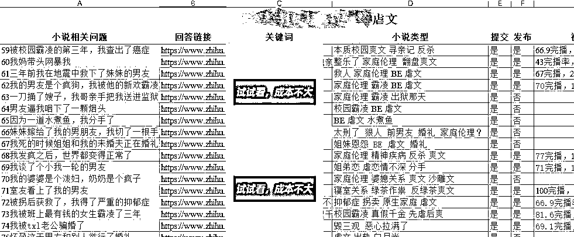
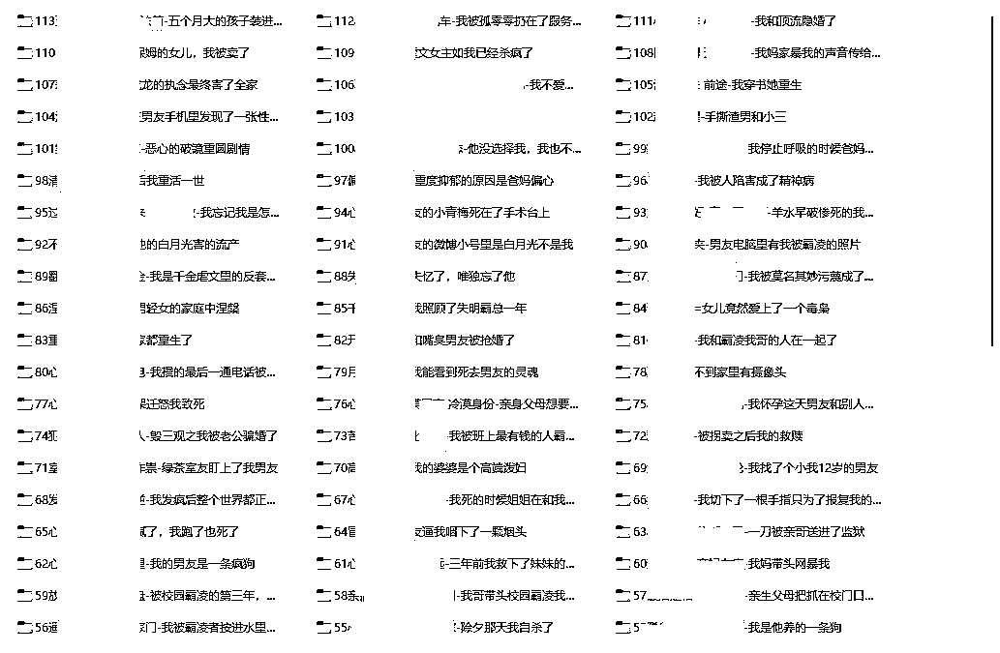

# 4.4 建一张选文台账

挑完素材后，顺手为账号搭一份选文台账，之后做复盘与数据追踪会更省力。

下面以虐文类账号为例，表格栏目依次为：故事梗概、专栏地址、检索词、作品类型、是否送审、上线状态。

每篇入围内容单独建一个目录，目录名用“编号+核心词+短句概括”来组装。这样做的好处主要有两点：一是备选库清晰直观，日后检索方便；二是能加深对每次选稿和改稿的理解，记得更牢。

备注：本篇经验源自多份实战整理。

