# 5.1 选对图文类型，起号更稳

动手做图文前，先想清楚账号要往哪个方向走。每个赛道都有人做出好成绩；刚入门的话，优先挑自己真正感兴趣的内容。实在没有偏好，可以试试黑底白字型或事件改编型：这两类上手不难，出爆款的概率相对更高，对新手也比较友好。若考虑批量生产，图文同样很适合团队协作。下面说的图文类型，主体是图文内容，其中有些成品会由多张图片组合成视频，这类流程需转到“六、创作并发布视频”学习。

1）图片轮播

做法：从小说简介页、书中内容页和评论区分别截取一张图，总量最多两张。

特点：操作门槛低，个人就能干，单日可运营几十个账号，番茄小说推广里很常见。

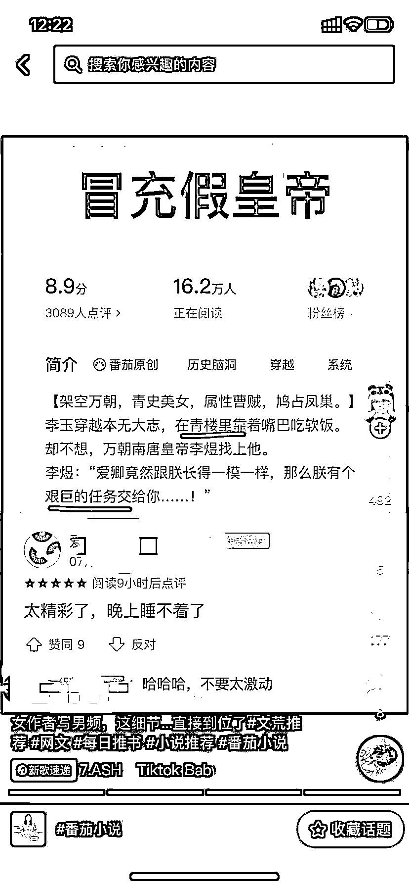

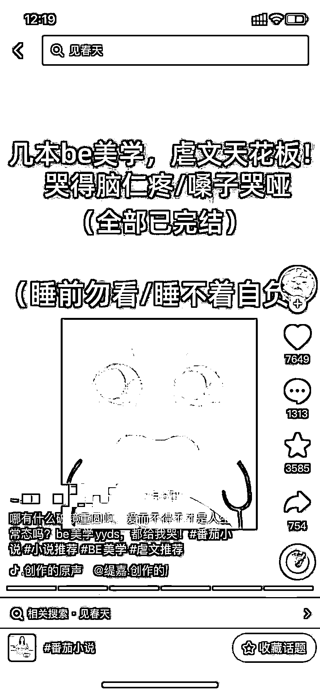

2）事件改编类

做法：这是图片轮播的升级玩法。在书籍简介之外，再加入视觉冲击更强的图片，文案围绕真实案件改编，用悬念把人吸引进来。配图要避开案件现场图和真人照片，优先选相关剧照；同时别用明星、名人照片，以免引起争议或踩到侵权红线。

特点：制作难度不高，但视觉与话题冲击更强，跑出爆款的机会更大，当下多用于推理小说推广。

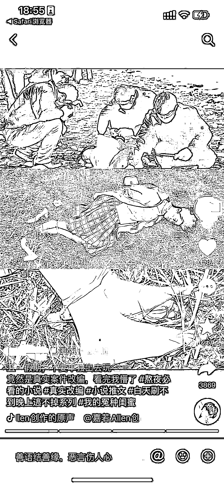

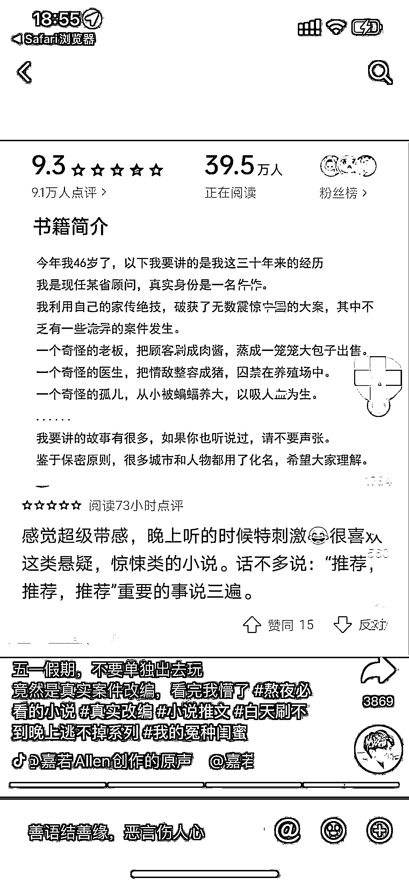

3）长截图

做法：把多张截图拼成长图，再用关键帧让它滚动播放，形成录屏观感。具体制作步骤要参考“六、创作并发布视频”。

特点：目标读者与图片轮播相近，知乎小说推广中较常见。

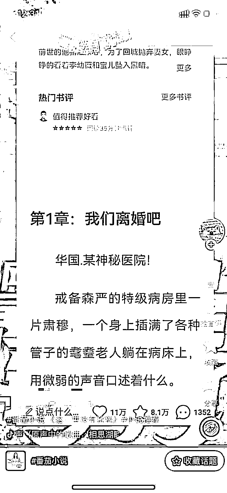

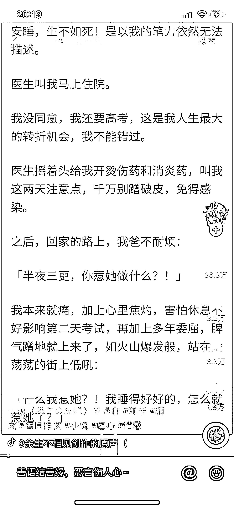

4）风景文案

做法：把小说里的精彩片段摘出来放进描述，配上氛围相近的风景图；描述写得长一些，也有助于提升完播率。

特点：较容易出爆款，但前提是能吃透小说内容，并且有原创文案功底，晋江、起点小说推广中较常见。

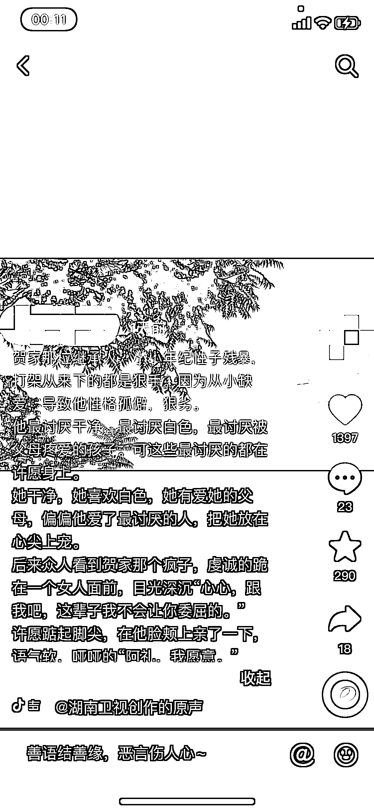

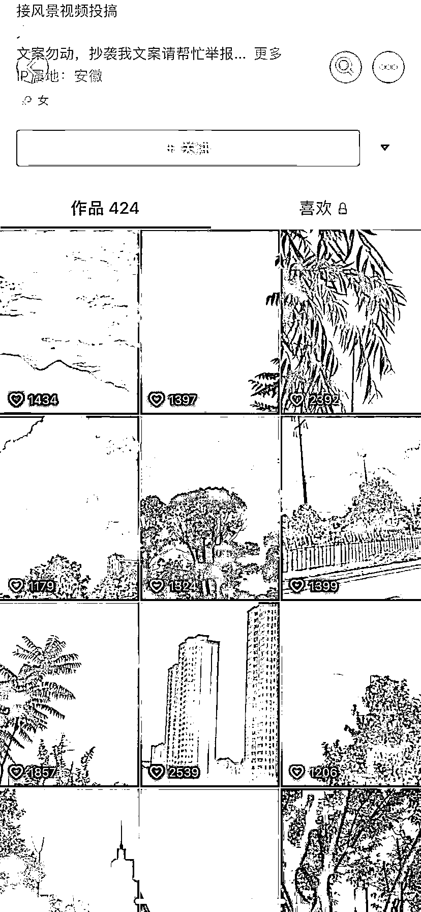

5）聊天记录类

做法：用聊天对话来呈现小说的精彩桥段。抖音上多为滚屏呈现，小红书上则大多直接发截图。

特点：原创度相对更高，以第一人称讲故事，读者更容易产生代入感。

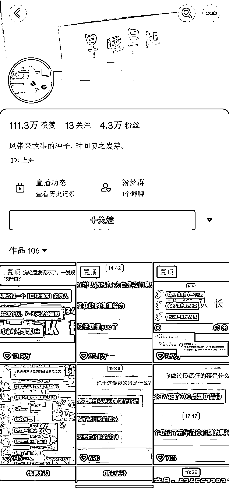

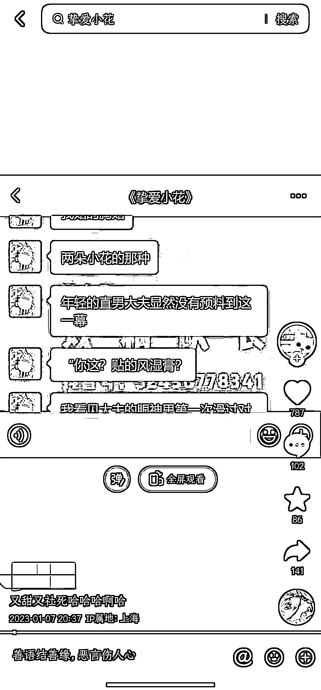

6）黑底白字类型

做法：摘取小说精彩段落，用黑底白字排版呈现，通常需要10张以上。

特点：制作不费劲，在一堆推文笔记里比较抓眼，受众与图片轮播类接近。

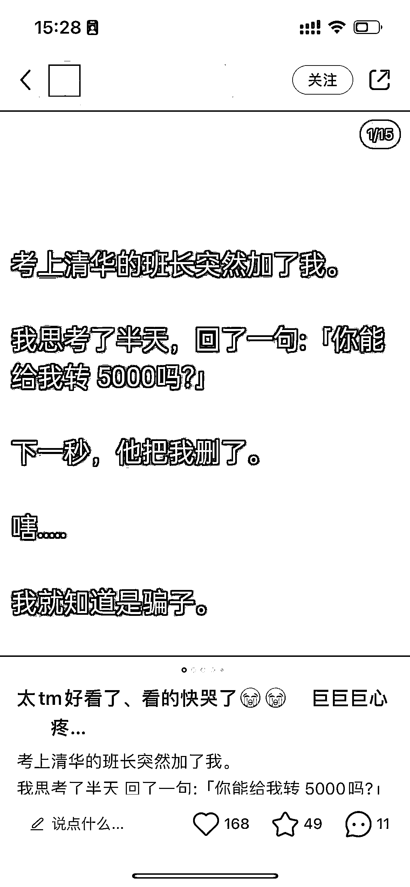

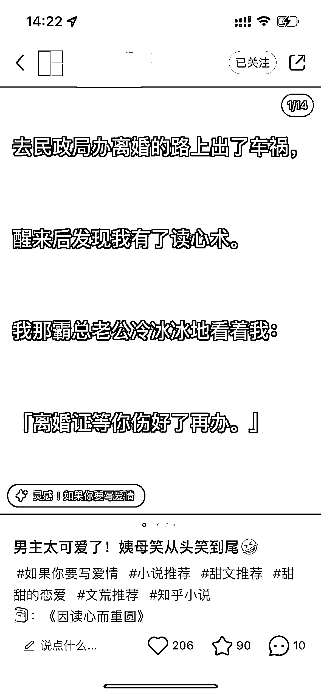