# 5.2.1 拼图轮播法

动手做图文前，先看一个很典型的例子。

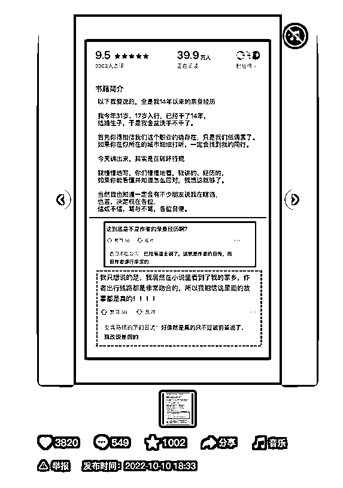

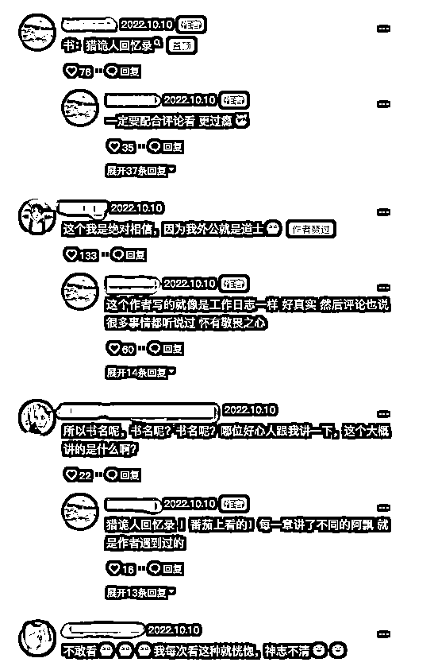

这张图谈不上精致，瑕疵也不少，但评论区没人纠结画面，反而都在聊小说情节。这里靠的就是评论区运营，具体方法放到「7.1 评论区维护」再展开；本节只讲这类图文怎么做。

先准备素材。把示例拆开看，整张图就是三块内容拼起来的：评分、书籍简介和评论。下面分别说素材怎么找。

1）评分截图

先选定小说，进入它的评分页面。

拿示例来说，原书名是《十四年猎诡人（全五册）》，在番茄小说能搜到，如下图：

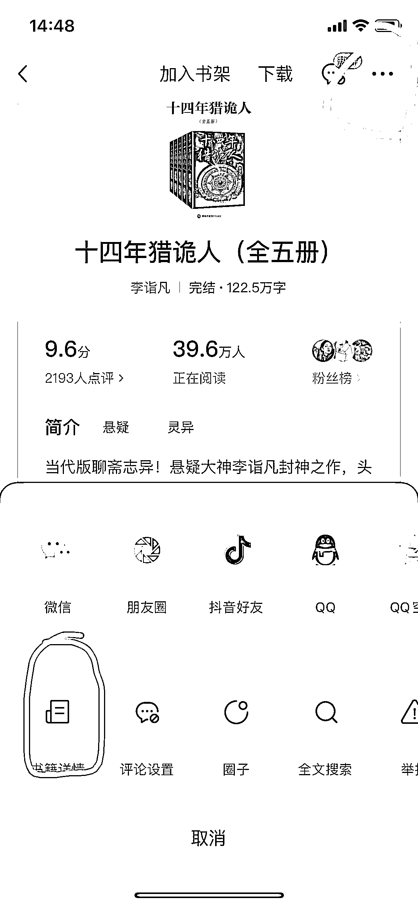

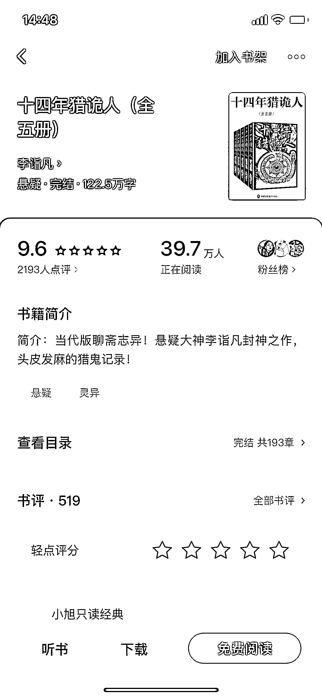

点右上角的三点菜单，打开【书籍详情】，就能拿到和示例第一块一致的书籍评分。

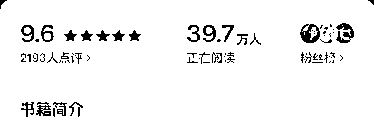

2）书籍简介截图

示例的第二块是书籍简介。这里别直接照搬简介，而要挑小说里出彩的段落；示例选的是第一章内容。至于怎么找精彩片段，可以看「4.3 套路化改文」。

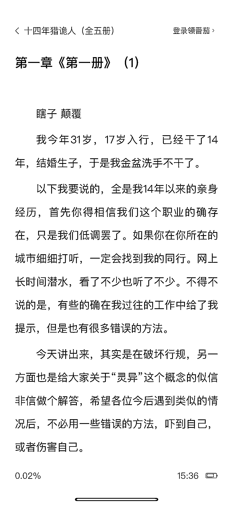

复制好之后，先粘到手机备忘录里，再截图保存：

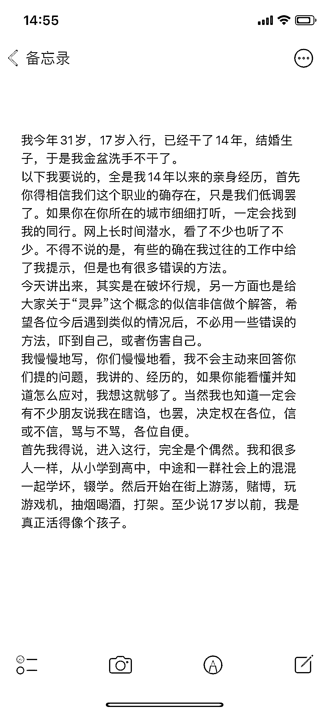

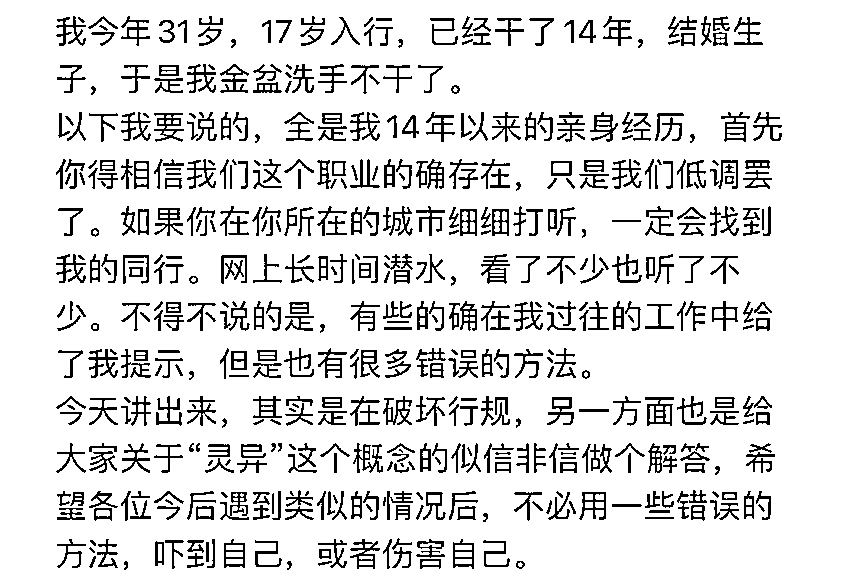

3）评论截图

第三块是评论。既可以从小说评论区截，也可以去小红书、抖音上随便找小说推文作品下的评论区截图，内容合适就行。比如下面两张：

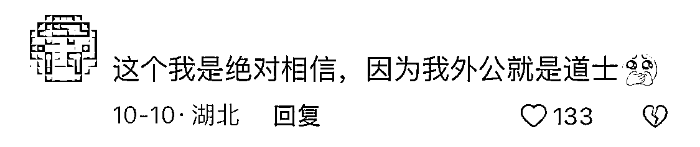

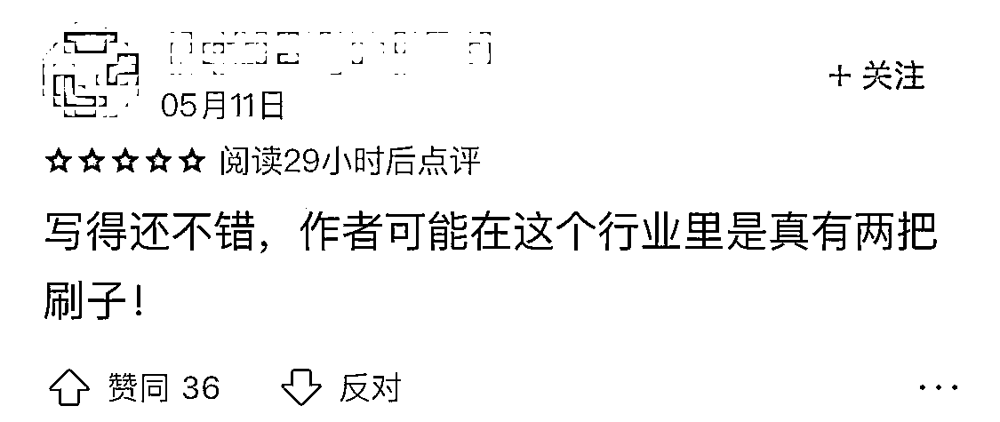

素材备齐后，进入拼接环节。

三类素材都准备好，就可以开始拼图。用什么拼图工具都行，这里以美图秀秀为例：在电脑上打开美图秀秀，把素材拖进去，调整组合即可。

具体操作可看这个视频：

[2022-10-15 18-34-25.mkv](https://search01.shengcaiyoushu.com/upload/doc/IASDdPTG3oPX6ixNb32cM39LnFg/OQSibaw8qoYP4ixqTpScfW2VnYd)

拼完的效果如下：

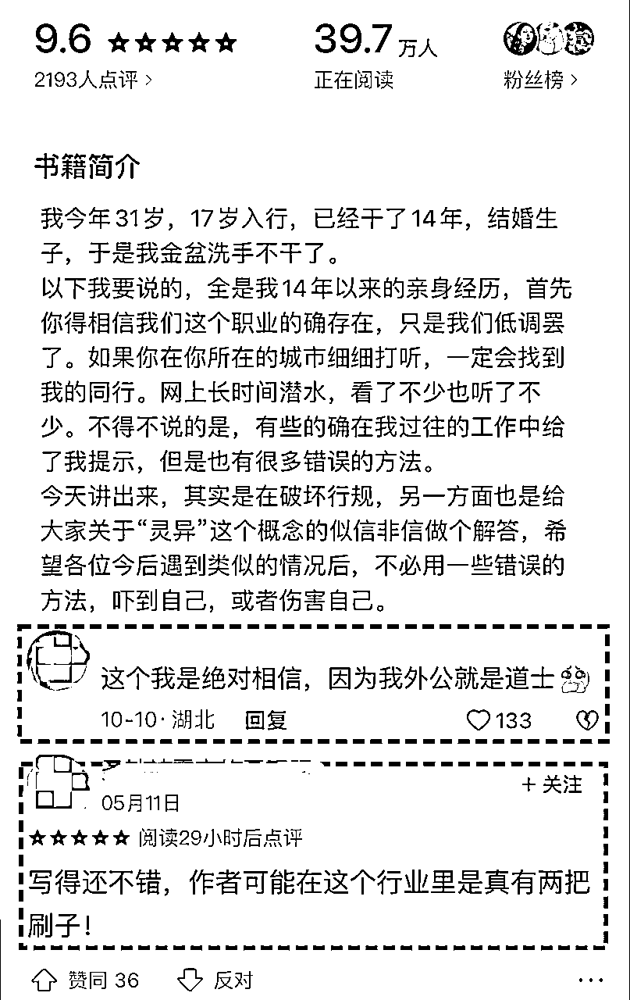