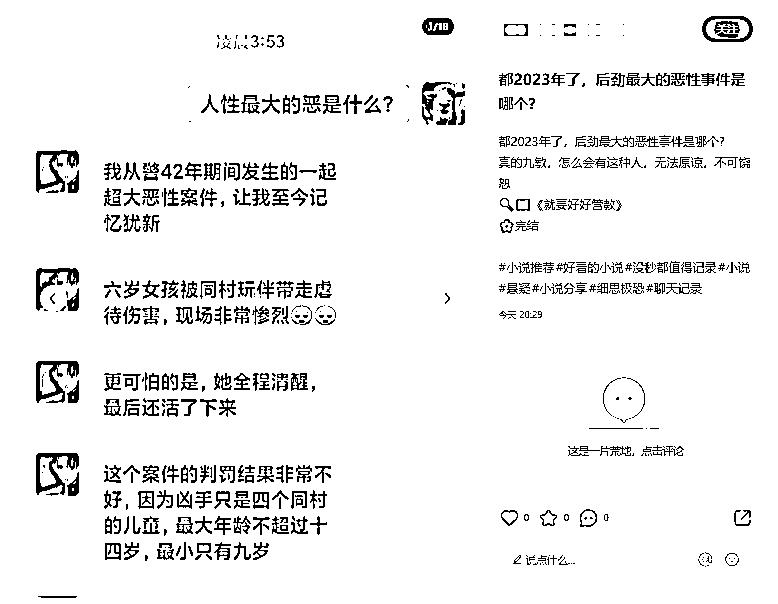

# 5.2.2 聊天记录型：把小说“演”成一场🛰️对话

这种形式的图文，是把小说里的桥段搬进🛰️对话框。作者用两个账号互发信息，把故事情节模拟成“我”的亲身经历，或“朋友”的真实见闻，让读者像是围观一段真实聊天。

具体做法是：准备两个互相关注的🛰️号，一个负责带出话题，例如先问一句“人到底能坏到什么程度？”另一个则用讲述者的身份逐条回复。消息一定要短，尽量口语化，像日常对话一样自然。

发笔记时，按剧情顺序依次上传聊天截图，不要拼成一张超长图，字会太小看不清楚。最后，在笔记简介里带上小说关键词，并说明这是一篇推文笔记，方便感兴趣的人查找。